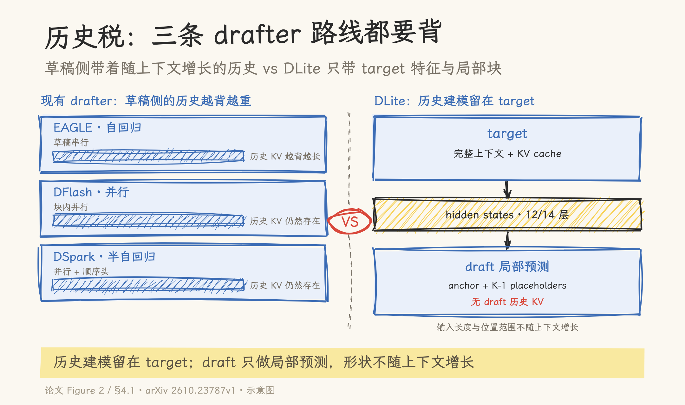
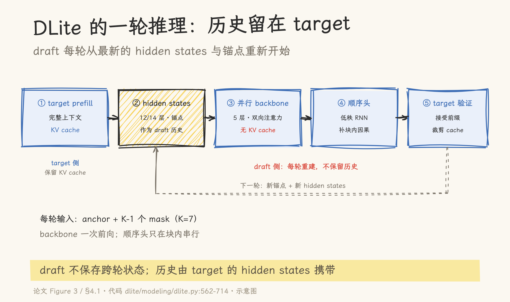

# draft 不再重建历史：DLite 的 history-free 投机解码

> 论文：DLite: History-free Speculative Decoding for Agentic AI（arXiv 2610.23787v1，2026-10-16，14 页）｜官方实现：SJTU-DAI-Sys/DLite（HEAD 07aece6，MIT，`dlite-inference` v0.1.0）｜核对日期：2026-10-19。性能数字来自论文与官方仓库，未独立复现；代码行号指仓库当前 HEAD。

一个 agent 在仓库里修一个 parser bug。它读 issue、列目录、读源码、跑测试、改代码；每一轮工具结果都追加进上下文。任务开始时输入只有几千 token，结束时可能超过五万。

这正是投机解码最想加速的负载，也是它最容易失效的负载。论文给出的观察是：现有 draft 模型在 agentic 任务上的接受长度下降约 80%，部分任务只剩 1–2 个 token。论文还测量了系统侧的开销：draft 侧维护历史 KV cache 的更新与裁剪，可以占到端到端推理延迟的 10–20%。

两个问题指向同一件事：target 已经把上下文处理过一遍，draft 却要自己再建一份历史。DLite 的出发点就是把这件重复工作停掉。先看投机解码的收益公式，再看三条 drafter 路线为什么都绕不开历史，最后拆 DLite 的架构、训练与边界。

## 一、背景：收益公式在 Agent 负载下失衡

### 1.1 投机解码的账

投机解码的基本流程是 draft 草拟、target 验证：draft 先猜出 K 个候选 token，target 用一次前向并行验证整块，接受其中最长的匹配前缀，再补一个 token。一次验证平均接受的 token 数记为 τ，块长记为 K。

论文给出的近似收益式是：

```text
Speedup ≈ (T_target(1) × τ) / (T_target(K) + T_draft(K))
```

分子是一次 target 前向的时间乘以接受长度；分母是 target 验证 K 个 token 的时间，加上 draft 草拟 K 个 token 的时间。这个式子说明，投机解码的收益由两个量决定：τ 越大，摊到每个被接受 token 上的 target 时间越少；draft 越慢，分母越大，收益越薄。

在论文的通用任务里，τ 通常能到 4–6，draft 又足够轻；按上面的式子，只要 draft 不拖后腿，加速比就能接近 τ。Agent 负载把这个平衡打破了：τ 掉到 1–2，draft 却还要为不断增长的历史付出额外开销。

### 1.2 Agent 负载的四个特征

论文把 agentic workload 的特征概括为长输入、短输出、多轮交互、上下文持续增长。落到一次真实任务里，就是这样的循环：

1. 读任务说明、工具 schema、仓库文件，输入迅速变长；
2. 模型决定调用一个工具，输出往往只有几十个 token；
3. 工具结果追加到上下文，下一轮输入比上一轮更长；
4. 如此往复，直到任务结束。

聊天场景的上下文也会增长，但通常一轮对话只有几千 token；agent 任务动辄几万到十几万。更麻烦的是，历史还会一轮一轮变长，每一轮都要重新带上。draft 模型如果要在每一轮都匹配 target 的分布，就必须把这份状态也维护起来。

### 1.3 两个观察

论文在 motivation 部分给了两组测量。

第一组是接受长度。DFlash、DSpark 这类方法在 GSM8K、MBPP 等通用任务上能拿到 4–6 的接受长度；换到 SWE-Bench、AgentLongBench 这类 agentic 任务，接受长度会掉到 1–2。EAGLE 的绝对值更低，Table 1 里大约在 2.1–3.1 之间，但在 agentic 任务上同样会退化。摘要的措辞是「最高约 80% 的下降」，引言写的是「超过 80%」，部分任务的降幅更大。这里不必纠结两个数字的差异，方向是明确的：上下文越长、越动态，轻量 draft 越难独立复现 target 的预测。

第二组是系统开销。论文用 SGLang 评测 DeepSeek-V4 的 multi-token prediction 模块，观察到 draft KV cache 的更新与维护可以占端到端推理延迟的 10–20%。这是一个具体配置下的测量，不是所有系统的通用比例；但它说明，历史不只是在算法上拖累接受长度，在系统上也要付账单。

### 1.4 同源问题

两个观察看起来一个在算法层、一个在系统层，根因是同一个：draft 被要求独立编码并维护一份不断增长的历史。

从模型侧看，draft 的容量只有 target 的一小部分，却要去拟合 target 在长上下文上的分布；历史越长，这件事越难。从系统侧看，draft 要连续更新自己的 KV cache，跨 agent 轮次还要保留 prefix 状态；轮次越多，维护成本越高。

target 已经处理过同一段上下文，也保留了完整的 KV cache。让 draft 再建一份，等于把最贵的上下文建模做了两遍。DLite 的选择是：draft 不再重建历史，直接复用 target 已经算好的表示，只做当前位置附近的局部预测。

## 二、问题：三条 drafter 路线，都绕不开历史

### 2.1 自回归：因果完整，草稿串行

EAGLE 是自回归 drafter 的代表。它逐 token 草拟，块内因果完整，预测质量通常不错；代价是草稿阶段本身要串行执行 K 次小前向。K 越大，草稿越慢，投机解码的收益被自己的草稿成本吃掉。

### 2.2 并行：草稿快，块内因果缺失

DFlash 走的是并行路线。它用块扩散的思路，把块内位置用 mask 占位，一次前向预测整块。草稿延迟大幅下降，但并行计算抹掉了块内 token 之间的因果依赖：第 3 个位置在预测时，并不知道第 1、2 个位置最终会生成什么。

### 2.3 半自回归：折中方案

DSpark、Domino 这类半自回归 drafter 想把两边的好处合起来：并行 backbone 一次给出块内所有位置的表示，再用一个轻量的顺序模块补回块内因果。这样草稿不必完全串行，质量又比纯并行稳一些。

DLite 也属于半自回归这一族，但它和 DSpark 最重要的差别在历史：DSpark 仍然依赖历史上下文，DLite 把历史建模整个留给了 target。

### 2.4 共同假设：draft 自己重建历史

论文的 Figure 2 把三条路线画在一起：自回归、并行、半自回归，草稿侧都带着一份「Full Historical KV」；只有 DLite 的输入变成了 target features 加局部上下文。

换句话说，三条路线在「草稿怎么并行」上各有取舍，但都默认了一件事：draft 必须自己携带历史。历史越长，draft 的输入越长、位置范围越大、KV cache 越重。草稿速度的优化，最终会被历史的增长追上来。

### 2.5 历史税的三笔成本

可以把这份共同负担叫作「历史税」。它至少有三笔：

- 容量税：draft 的参数只有 target 的零头，却要匹配 target 在长上下文上的分布；上下文越长，容量越不够用。
- 系统税：draft 要维护自己的 KV cache，跨轮次还要保留 prefix；论文测到的 10–20% 延迟开销就属于这一笔。
- 位置税：draft 面对的上下文和位置范围随解码增长，预测问题的复杂度也跟着涨；并行 drafter 能压缩草稿延迟，却压不掉这笔税。

DLite 换了一个征税对象：历史建模归 target，draft 只负责局部预测。



## 三、方案：把历史建模留在 target

### 3.1 一轮推理的数据流

DLite 的一轮推理可以拆成六步：

1. target 先做 prefill，处理完整输入，保留自己的 KV cache；
2. 从 target 的指定层取出锚点位置的 hidden states，作为 draft 的历史上下文；
3. 把当前锚点 token 和 K−1 个 mask placeholder 拼成 draft 查询；K 在论文配置里是 7；
4. draft 的并行 backbone 一次前向，给出块内所有位置的 hidden 表示；
5. 低秩顺序头按从左到右的顺序采样出 draft token，补回块内因果；
6. target 一次前向验证整块，接受最长匹配前缀，裁剪 target cache 到接受长度，进入下一轮。



要点在第二步和第六步之间：draft 不保留任何历史 KV cache。每一轮都从最新的 target hidden states 和当前锚点重新开始，输入长度和位置范围不随上下文增长。代码里这一点写得很直白：`initialize_inference_condition` 返回一个长度为 0 的张量，`update_inference_condition` 原样返回这个空缓冲区（`dlite/modeling/dlite.py:407-425`）。draft 侧没有「上一轮的状态」可以继承。

### 3.2 历史注入：target hidden states

draft 不再读历史 token，但它仍然需要知道历史。DLite 的做法是把 target 的 hidden states 当作压缩后的上下文特征。

论文的配置是：Qwen3-4B 取 12 层，Qwen3-8B 取 14 层；第一层和最后一层必选，中间层均匀采样。多个层的 hidden states 按序列维拼接，每一层作为一个独立的输入元素，再加上可学习的深度嵌入，标识它来自哪一层（`dlite/utils/hidden_states.py:8-60`，`dlite/modeling/dlite.py:275-288`）。

这里有两个设计选择需要说明。

第一，为什么不是只用最后一层？多层拼接让 draft 自己选择用哪一层的信息。一个直观的解释是，浅层更偏局部词法，深层更偏语义和任务状态；论文没有逐层拆开验证这一点。消融实验显示，7 层增加到 14 层，平均接受长度从 3.14 升到 3.30；继续加到 20 层或 36 层，收益基本消失（论文 Table 5）。

第二，为什么是 sequence-wise 而不是 feature-wise？Feature-wise 把不同层的向量沿 hidden 维拼起来，通道混在一起，层身份就丢了；sequence-wise 把每层当作一个独立 token，配合深度嵌入，注意力可以按层选择。论文的消融里，sequence-wise 是 3.30，feature-wise 是 3.04。

### 3.3 并行 backbone：局部预测

draft 的 backbone 是一个 5 层 Transformer（论文 Appendix A.1 的配置；代码里层数由 checkpoint config 的 `num_hidden_layers` 决定，不是硬编码）。hidden size 为 2560/4096，对应 Qwen3-4B/8B。

它的注意力和常规 decoder 不一样。每一层里，target hidden states 和当前 draft hidden 分别做 K/V 投影，拼在一起；draft hidden 自己做 Q 投影；注意力在「target 特征 + 块内 draft token」这个局部集合上计算（`dlite/modeling/qwen3.py:94-99`）。没有 past KV cache，也没有跨轮次的状态。`is_causal` 被设成 False（`qwen3.py:51`），块内位置由局部 position id 给出（`dlite/modeling/dlite.py:207-250`）。

这样做的结果，是 draft 的计算图在每一轮都保持同样的形状：输入是固定数量的 target 特征、一个锚点、K−1 个占位符；位置范围是块内的局部编号。上下文再长，draft 的输入长度和位置范围都不变。

### 3.4 顺序头：补回块内因果

并行 backbone 一次给出块内所有位置的表示，但它不知道块内前面的 token 最终会生成什么。target 的自回归分布却是按块内前缀条件化的：第 T 个位置的概率依赖前面 T−1 个已生成 token。

论文把缺失的信息拆得很清楚：完整历史 `x<t` 已经由 target 处理过，并通过 hidden states 传给了 draft；draft 缺的只是块内前缀 `x_{t:t+T-1}`。所以顺序头不需要重建完整历史，只需要编码当前块内已经生成的 token。

DLite 的顺序头是一个低秩 RNN 式模块。它把已生成 token 压进一个 recurrent state，再和并行 backbone 的 hidden 表示融合，得到当前位置的预测；词表投影在顺序细化之后才做，避免对每个 speculative 表示先做一次 D×V 投影（`dlite/modeling/sequential_head.py:27-87`、`:288-291`）。rank 为 320/512，对应 4B/8B。

这就是「半自回归」的含义：并行 backbone 负责速度和全局表示，低秩顺序头只负责块内那一小段因果，成本被限制在很窄的范围内。

### 3.5 两阶段训练：为什么要 teacher

DLite 的 draft 和 target 在完全不同的条件下预测。target 是自回归的，能看到完整历史；draft 是并行的，只看压缩后的 hidden states 和局部块。直接把 target 的分布拿来做 KL 蒸馏，效果并不好：论文 Figure 4(b) 显示，直接 KL 的接受率曲线明显低于 CE。

原因是结构不匹配。target 的预测条件里有完整历史，draft 的条件里只有 target 的压缩表示；强行让两个分布对齐，等于让一个只看摘要的学生去模仿一个读完全文的老师，中间缺了一个可学的台阶。

DLite 的解法是先造一个结构匹配的中间老师：

- Warm-up 阶段：训练一个同构的 history-aware teacher。它和 DLite 有相同的 backbone 和预测结构，但保留历史 KV cache。先用 token-level CE 训练 8 个 epoch；再用 forward KL 把 teacher 的分布蒸馏给 DLite，训练 2 个 epoch。位置权重是 `exp(-(i-1)/4)`，越靠前的位置权重越高。
- Stable 阶段：丢掉 teacher，让 DLite 直接对齐 target。损失是 `0.1 × CE + 1.0 × TV`，训练 6 个 epoch。CE 管 token 级正确性，TV 管分布重叠。

teacher 的作用是提供一座结构匹配的桥：它和 DLite 的输入输出接口一致，只是多了历史信息。DLite 先学会模仿「有历史的自己」，再把这个能力迁移到「没有历史、只有 target 特征」的版本。论文的消融显示，两阶段训练在稳定阶段的接受长度始终高于单阶段。

### 3.6 代码走读：空历史缓冲区

把论文的机制落到代码，最核心的一段在 `spec_generate`（`dlite/modeling/dlite.py:562-714`）。

prefill 时，target 前向打开 `output_hidden_states=True`，保留 KV cache，并从指定层取出锚点位置的 hidden states（`:573-585`）。解码循环里，每一轮构造 draft 输入、跑 backbone、采样、让 target 验证、按接受长度裁剪 target cache（`:596-714`）。验证后，用新的接受位置重新取 hidden states，作为下一轮的上下文。

draft 侧的状态管理只有两个函数：`initialize_inference_condition` 返回空张量，`update_inference_condition` 保持空张量（`:407-425`）。这是有意为之：draft 不需要跨轮次保存任何东西。

target 侧的 cache 默认是 `DynamicCache`（`:29-33`、`:562-564`）；benchmark 里可以用 `--preallocate-kv-cache` 换成预分配的 `PreallocatedLayer`（`dlite/modeling/kv_cache.py:10-57`，`dlite/benchmark.py:64-67`）。两种路径都只维护 target 的 cache，draft 侧没有对应的结构。

## 四、证据：数字说明什么，不说明什么

### 4.1 实验设置与口径

论文在 NVIDIA H800 上评测 Qwen3-4B 和 Qwen3-8B，块长 K=7。训练数据约 190 万条（130 万 Open-PerfectBlend + 60 万 Nemotron Post-Training Dataset V2），最大序列长度 4096，用 32 张 H800 训练（Appendix A.1）。对比基线包括 EAGLE-3、DFlash、DFlash2、DSpark、DFlow；DFlash2 和 DFlow 的部分结果来自外部来源（§5.1）。

所有加速比都是相对 vanilla 自回归解码的端到端口径，指的是解码阶段，不含 prefill；数字由论文和官方仓库报告，我没有独立复现。读这些数字时，先记住这一点。

### 4.2 通用任务：去掉 KV cache 不掉点

Table 1 报告的是通用任务上的接受长度。DLite 在多数任务上接近或略高于 DSpark：

| 任务 | DLite 4B | DSpark 4B | DLite 8B | DSpark 8B |
| --- | ---: | ---: | ---: | ---: |
| GSM8K | 6.38 | 6.27 | 6.48 | 6.36 |
| HumanEval | 5.68 | 5.62 | 5.96 | 5.86 |
| MT-Bench | 3.94 | 3.81 | 3.96 | 3.88 |

完整的 7 个通用任务见论文 Table 1。整体范围是 3.64–6.48 tokens。这里最重要的结论是：去掉 draft 侧历史 KV cache 之后，通用任务没有掉点。这说明 target hidden states 确实携带了足够的上下文信息，draft 不必自己再读一遍。

Table 1 里还有一个单独的数据点：Qwen3-4B 的 MT-Bench 上，DFlash2 是 4.14，DLite 是 3.94；Table 1 的 8B 部分没有 DFlash2 的结果。按表内数据，DLite 在多数任务上匹配或略高，个别格子低于对比方法。

### 4.3 长上下文：上下文越长，差距越大

LongBench v2 上的加速比更能说明问题：

| 类别 | DLite 4B | DSpark 4B | DLite 8B | DSpark 8B |
| --- | ---: | ---: | ---: | ---: |
| Multi-Doc QA | 2.18× | 1.81× | 2.32× | 1.98× |
| Long In-context Learning | 2.58× | 2.01× | 2.74× | 2.28× |
| Code Repo Understanding | 2.66× | 2.02× | 2.53× | 2.02× |
| Long-dialogue History | 3.88× | 3.16× | 3.96× | 3.02× |

四类任务的加速比范围是 2.18–3.96×。Long-dialogue 的收益最高。一个解释是它的历史最长，draft 在 DSpark 那边背的历史最重；DLite 把这块负担移走之后，相对优势最大。这个趋势和论文的设计动机一致：上下文越长，draft 侧的历史建模越不值钱，复用 target 表示的收益越高。

### 4.4 Agentic：最大的相对收益

Agentic 任务是 DLite 相对优势最大的地方：

| 任务 | DLite 4B | DSpark 4B | DLite 8B | DSpark 8B |
| --- | ---: | ---: | ---: | ---: |
| AgentMemBench | 2.39× | 1.72× | 2.20× | 1.83× |
| AgentLongBench | 2.07× | 1.45× | 2.31× | 1.68× |
| BFCL-v3 | 2.37× | 2.11× | 2.30× | 1.82× |
| SWE-bench | 2.68× | 1.64× | 2.74× | 1.60× |

整体范围是 2.07–2.74×。SWE-bench 上 Qwen3-8B 的 2.74× 对 DSpark 的 1.60×，约高 71%，这也是论文摘要中重点报告的数字。

但接受长度本身仍然只有 2.5–3.2，低于通用任务的 3.6–6.5。DLite 把 agentic 任务从「1–2 个 token」拉回到「2.5–3.2 个 token」，并没有把 agentic 任务变成通用任务。这个区别很重要：它修复的是 draft 的历史建模方式，不是 agent 任务本身的难度。

### 4.5 吞吐：不只靠接受长度

Table 4 测的是并发 1–64 的吞吐。以 Qwen3-8B 的 LCB 为例：

| 并发 | DLite | DSpark |
| ---: | ---: | ---: |
| 1 | 561 TPS / 3.95× | 511 TPS / 3.60× |
| 64 | 5758 TPS / 2.13× | 5621 TPS / 2.08× |

平均接受长度是 6.04 对 5.47。吞吐差距不只来自接受长度：即使两边的 τ 接近，DLite 的顺序头避开了中间的全词表投影，也没有 draft KV cache，草稿阶段的开销更低，吞吐仍然占优。

Table 4 中有一个例外：Qwen3-4B MT-Bench 在并发 16 时，DSpark 是 8177 TPS，DLite 是 8162 TPS，相差 15 TPS（约 0.18%）；其余并发度与任务上 DLite 更高。整体趋势仍是 DLite 占优，个别格子相反。

### 4.6 消融：14 层、sequence-wise、rank 512

论文的消融回答了三个设计问题。

先看 target hidden states 的层数。7 层到 14 层，平均接受长度从 3.14 升到 3.30；20 层是 3.29，36 层是 3.27。14 层是甜点，继续加层只增加计算，不再提升质量。

再看多层怎么组合。Sequence-wise 是 3.30，feature-wise 是 3.04。把不同层当成独立序列元素，配合深度嵌入，比把它们沿 hidden 维混在一起更有效。

最后看顺序头的 rank。256 是 3.16，512 是 3.30，1024/2048 是 3.32，4096 是 3.33；从 256 升到 512 只增加 0.3% 的端到端延迟，再往上收益很小。512 是成本和质量的平衡点。

另外两组消融也说明问题。两阶段训练在稳定阶段的接受长度始终高于单阶段；128/512 token 的 sliding-window draft KV cache 在充分训练后，与完全无 KV cache 的 DLite 接受长度相当。后者说明历史 KV 在训练早期可能有用，但一旦 draft 学会利用 target hidden states，这份 cache 的边际价值就消失了。

## 五、权衡：history-free 省掉了什么

### 5.1 省掉的是 draft 侧的历史

DLite 的「history-free」有明确边界：draft 侧不保留历史 KV cache，也不重新处理累积序列；target 仍然处理完整上下文，保留自己的 KV cache，并执行验证前向。

所以它省掉的是两件事：draft 的历史重建，以及 draft KV cache 的更新与维护。它没有省掉 target 的 prefill，也没有省掉 target 的验证。长输入场景里，prefill 仍是固定成本；DLite 加速的是 decode 阶段的草稿与验证循环。

这一点决定了它的收益形状：上下文越长、轮次越多，draft 侧历史越重，DLite 的相对优势越大；短上下文、单轮任务里，draft 本来就不需要维护多少历史，收益自然有限。

### 5.2 新接口的成本

DLite 把历史建模从 draft 移到 target，代价是 target 必须把 hidden states 暴露出来。

在官方实现里，prefill 和验证前向要打开 `output_hidden_states=True`，再从 12/14 个指定层取出锚点位置的特征（`dlite/modeling/dlite.py:573-585`、`:643`）。这带来三项工程成本：

- 目标模型要支持按层返回 hidden states，serving 引擎要能接住这个接口；
- 每轮要多存取 12/14 层、hidden size 2560/4096 的特征，内存带宽和显存占用都要算账；
- 这不是一个「换个 draft 权重」就能接入的方案，engine 侧要配合改验证与缓存路径。

官方仓库目前是一个独立的 inference release，提供 Python API、CLI 和 JSONL benchmark；SGLang 与 vLLM 的集成还在 roadmap 里，尚未勾选（`README.md:79-83`）。这意味着它离「在生产 serving 栈里开一个开关」还有距离。

### 5.3 适用边界

论文的实验边界很清楚：

- 只评估 Qwen3-4B 和 Qwen3-8B；仓库虽然提供了 Qwen3-14B 与 Qwen3.5-4B 的 checkpoint，但论文没有给出这两档的结果；
- 块长固定 K=7，论文没有给出块长消融；顺序头仍然是 O(K) 的串行循环，K 继续加大时成本会上升；
- agentic benchmark 的 prompt 规模有限：SWE-Bench 50 条、AgentLongBench 50 条、AgentMemBench 180 条、BFCL 41 个 session；BFCL 不计工具执行时间；
- 加速比、接受长度均由作者报告，检索范围内没有看到独立复现；DFlash2/DFlow 的部分对比数据来自外部来源。

这些边界不影响论文的核心论点，但决定了它不能直接被当成「所有 agent 负载的通用加速器」。

### 5.4 什么时候适合用

把上面的条件合起来，DLite 更适合这样的场景：

- 上下文长、轮次多，draft KV cache 的维护成本已经能测出来；
- 团队有能力改 serving 栈，或者愿意先用官方 standalone 实现做验证；
- 目标模型在官方 checkpoint 覆盖范围内（Qwen3/Qwen3.5），且能接受为每个 target 单独训练/加载 draft；
- 更看重 decode 阶段的吞吐，而不是一次请求的 prefill 延迟。

反过来，短上下文、单轮问答、或者必须使用引擎原生投机解码且不想改接口的场景，DLite 的收益有限，接入成本却不低。

### 5.5 与 DFlash、DSpark、MTP 的关系

DLite 不是 DFlash 或 DSpark 的替代品，它改的是 draft 的输入接口：从「历史 token + 历史 KV」换成「target hidden states + 局部块」。

和 DSpark 相比，两者都用了并行 backbone + 顺序头的半自回归结构；差别在于 DSpark 仍然维护历史上下文，DLite 把历史留在 target。和 DFlash 相比，DFlash 的重点是把草稿并行化，DLite 的重点是把历史建模移走；两者的着力点不同。和 MTP 相比，MTP 把预测头训进 target 模型，DLite 仍然是一个独立的 draft，只是这个 draft 不再背历史。

选型时先看瓶颈：如果草稿串行是瓶颈，DFlash 这类并行 drafter 更直接；如果 draft 的历史维护是瓶颈，DLite 的思路更对症；如果不想维护独立 draft，MTP 是另一条路。三者可以组合的空间存在，但论文没有给出组合实验，这里不做过度推断。

## 六、结语

DLite 改的是 draft 的输入：从「历史 token」换成「target 的 hidden states」。历史建模留在 target，draft 只做局部预测；代价是 serving 栈必须暴露 hidden states，收益在长上下文和多轮 agent 负载上最明显。

论文给出的最佳 agentic 结果是 SWE-bench + Qwen3-8B 的 2.74×，仓库 roadmap 里的 SGLang/vLLM 集成仍未勾选，checkpoint 已经覆盖 Qwen3-4B/8B/14B 与 Qwen3.5-4B。这三件事放在一起，大致就是 DLite 当前的位置：方法已经跑通，工程接入还在路上，独立复现还没有出现。

## 源文件索引

| 来源 | 主要内容 | 引用点 |
| --- | --- | --- |
| 论文 §3.1 | 80% 接受长度衰减、1–2 token、10–20% KV cache 延迟 | §3.1、Figure 1(b) |
| 论文 §4.1 | history-free 架构、target hidden states、局部预测 | §4.1.1、Eq. 2 |
| 论文 §4.1.2 | 低秩顺序头、hidden space、避免 D×V 投影 | §4.1.2、Eq. 3–5 |
| 论文 §4.2 | 两阶段训练、teacher bridge、CE/KL/TV | §4.2、Eq. 6–7 |
| 论文 §5.1–5.2 | 实验设置、Table 1–4 | §5.1–5.2 |
| 论文 §5.3 | 消融、设计空间 | Figure 5、Table 5 |
| 论文 Appendix A.1 | 训练配置、层数、rank、epochs | A.1 |
| 论文 Appendix A.2 | 设计空间探索、agentic benchmark 设置 | A.2、Table 5 |
| `dlite/modeling/dlite.py` | 局部位置、空历史缓冲区、`spec_generate` 循环 | `:207-250`、`:407-425`、`:562-714` |
| `dlite/utils/hidden_states.py` | target 层选择与特征收集 | `:8-60` |
| `dlite/modeling/sequential_head.py` | 低秩 RNN 顺序头、先低秩后词表投影 | `:27-87`、`:288-291` |
| `dlite/modeling/qwen3.py` | target hidden 与 draft hidden 的 K/V 拼接 | `:94-99` |
| `dlite/modeling/kv_cache.py` | 预分配 target cache | `:10-57` |
| `dlite/benchmark.py` | `--preallocate-kv-cache` 路径 | `:64-67`、`:302-305` |
| `README.md` | checkpoint 列表、SGLang/vLLM roadmap | `:69-83` |
| `pyproject.toml` | 包名、版本、MIT 许可 | `:6-11` |

## 参考资料

- 论文：[arXiv 2610.23787v1](https://arxiv.org/abs/2610.23787v1)｜[HTML 全文](https://arxiv.org/html/2610.23787v1)
- 官方实现：[SJTU-DAI-Sys/DLite](https://github.com/SJTU-DAI-Sys/DLite)
- 模型集合：[Hugging Face DLite collection](https://huggingface.co/collections/SJTU-DAI-Sys/dlite)
- 训练/评测框架：[SJTU-DAI-Sys/LiteSpec](https://github.com/SJTU-DAI-Sys/LiteSpec)
- 相关方法：DFlash（[arXiv 2602.06036](https://arxiv.org/abs/2602.06036)）、DSpark（[arXiv 2607.05147](https://arxiv.org/abs/2607.05147)）、DFlow（[arXiv 2609.06498](https://arxiv.org/abs/2609.06498)）、EAGLE-3（[NeurIPS 2025](https://arxiv.org/abs/2503.01840)）
