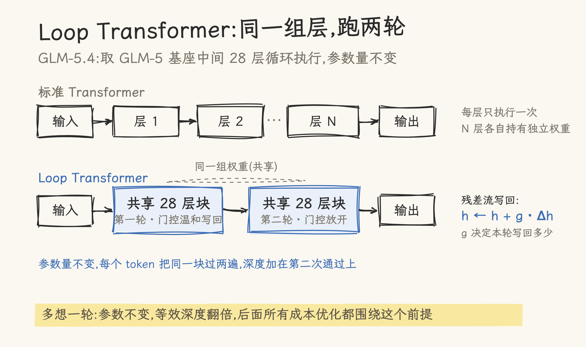
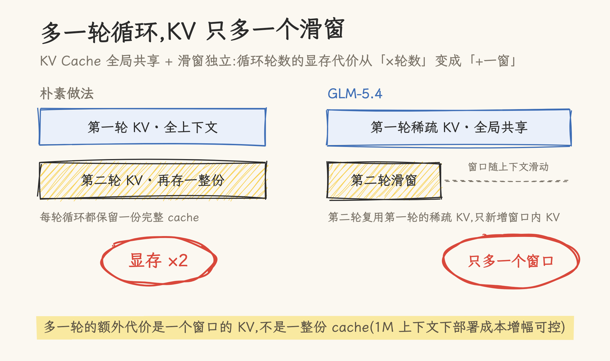
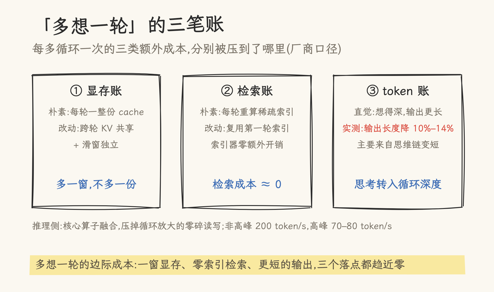
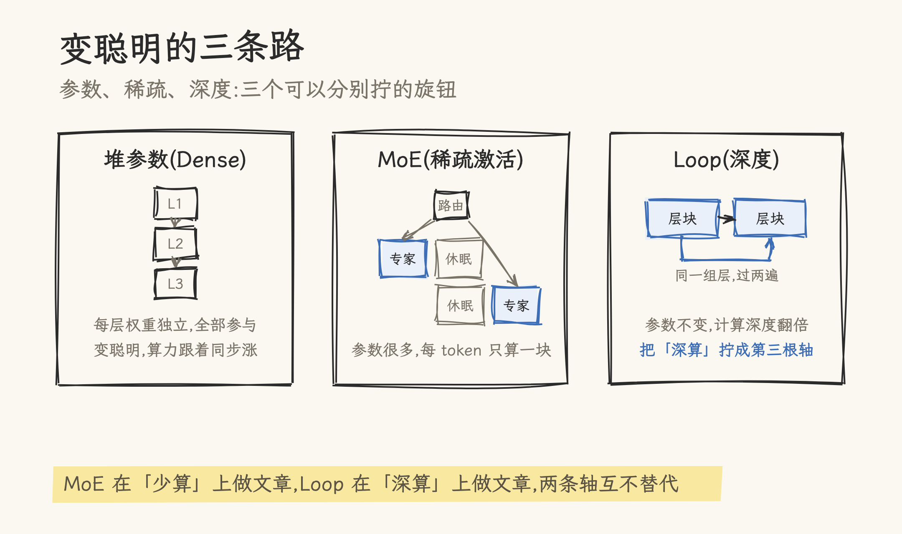

# Loop Transformer：当「多想一轮」的边际成本趋近零——智谱 GLM-5.4 机制与成本拆解

> 基于 2026-11-23 智谱公众号发布文、z.ai 官方英文博客与开源 GLM-5 config.json 核对写成。发布时点 5.4 技术报告与开源权重均未放出，文中全部性能数字为厂商口径，标注定稿见第七章折扣清单。核对日期：2026-11-23。

2026 年 11 月 23 日，智谱发布 GLM-5.4。发布文里有一个此前旗舰发布从未出现过的表述：参数量 750B（厂商口径；第三方多方源一致报道 GLM-5 总参数量 744B）的模型，「智能水平达到 2-3T 级模型」。

参数量与智能等级之间的换算，过去是行业默认的等价关系：想要 2T 级的智能，先堆出 2T 级的参数。GLM-5.4 给出的答案是让 GLM-5 基座中间的 28 层跑两圈：同一组权重，第一轮建立全局上下文，第二轮在其基础上精炼。参数一个不加，模型等效地「深」了一倍。

「循环」这个想法并不新。2018 年的 Universal Transformer 就提出了权重共享的深度结构，此后七年停留在研究层面，从未撑起过旗舰模型。GLM-5.4 的新意在工程侧：它把「多想一轮」的三笔额外成本（显存、检索、输出长度）分别用三项改动压到了接近零。标题里「边际成本趋近零」说的就是这三笔账；一种架构能不能落地，首先看它的推理成本结构。

## 一、为什么是 Loop：两个前提

### 1.1 推理型任务吃有效计算，不吃参数

GLM-5.4 博客开篇引用了一个判断，官方称其在 GLM-5.3 技术博客中讨论过：

> 记忆型任务受益于更多参数，推理型任务受益于更多有效计算。

这句话的出处需要注意：官方两次发布文都将其归于「GLM-5.3 技术博客」，但本文核对到的 5.3 发布文（z.ai 英文博客版）全文中并无此句，未能核实其确切出处，本文按官方转述引用。判断本身不难验证：知识记忆型任务（回忆一个事实）依赖参数容量存储知识；而大型软件工程、网络安全、3D 建模与物理控制，按官方的说法，「本质上都是极长链路的推理任务，模型必须沿多步因果链持续推演，并保持全局逻辑自洽」。后一类能力，堆参数和死记硬背给不了，需要的是模型在单次推理内可支配的计算量。

MoE 与 Loop 对「有效计算」的取法不同：MoE 把计算变「宽」，参数总量巨大，每个 token 只激活一部分专家；Loop 把计算变「深」，参数不变，让一部分层重复执行。两者的差异放到第六章对照。

### 1.2 权重共享的七年包袱

循环执行共享权重层，想法不新。2018 年 Google 的 Universal Transformer（Dehghani 等，arXiv:1807.03819）就把标准 Transformer 的固定深度换成了共享权重的循环结构，并配了自适应计算时间机制。这个工作被引用近两千次，但始终没有成为任何生产模型的基础：按官方博客的说法，「权重共享虽然提高了参数效率，但在同等预训练计算量下，效果仍不如不共享权重的模型」。

学术圈的后续进展分两条线，都与 GLM-5.4 的做法有关：

- **从头预训练路线**。Geiping 等 2025 年的 recurrent depth 工作（arXiv:2502.05171，NeurIPS 2025）用 3.5B 参数从头预训练了一个循环深度模型，验证了小规模下潜空间推理的收益。这是官方说的「近年关于循环深度、循环语言模型的研究也在小规模上验证了收益」的主要出处。但它同样受制于那条天花板：同等预训练算力下，从头训的循环模型不如不共享的稠密模型。
- **转换存量模型路线**。Google DeepMind 2024 年 10 月的 Relaxed Recursive Transformers（Bae 等，arXiv:2410.20672）给出另一种可能：不动从头预训练，把已经预训练好的稠密模型**转换**成递归结构，配逐层 LoRA 补回性能，只需极少量的继续训练。这条路把「权重共享」从预训练阶段的约束，变成了训练后阶段的改造。

GLM-5.4 选的是第二条路线的思路：没有从头预训练，而是「将一个已完成预训练的基座模型通过进一步训练改造为 Loop Transformer，以较小的算力开销换取智能上限的提升」。

两条路线的目标相反。Recursive Transformer 一系追求**把大模型变小**：转换是为了压缩参数，省显存、省存储，面向端侧部署。GLM-5.4 追求**把中等模型变大**：改造是为了涨智能上限，愿意多付每 token 计算量，面向旗舰服务。同一个机制（层循环 + 权重共享），在两个方向上被用于相反的目的。这也解释了为什么 GLM 版本的循环要配门控和 KV 共享这些「为效果服务」的改动，而 Recursive 系的改动（LoRA 松弛）是为「保住压缩后的性能」服务的。

## 二、GLM-5.4 的选择：改造存量基座

### 2.1 机制本体

标准 Transformer 的每一层在一次前向计算中只执行一次。GLM-5.4 取 GLM-5 基座（官方称 750B 规模）中间的 28 层，让这组共享权重的层循环执行两轮：第一轮的隐状态作为第二轮的输入，第二轮在第一轮结果的基础上继续推演、细化。参数量不变，每 token 经过的层数翻倍。基座的结构可以从已开源的 GLM-5 config.json 直接确认：`num_hidden_layers` 为 78，前 3 层 dense、其余接 MoE（`first_k_dense_replace: 3`），256 个路由专家每 token 激活 8 个、另有 1 个共享专家；总参数量约 744B、激活约 40B 是第三方按此结构推算的一致口径。循环的 28 层从这 78 层中选取，官方未公布具体层位。

写回方式是理解这套机制的关键。第二轮不是把第一轮的隐状态整个覆盖掉，而是在残差流上按比例追加：每个位置的新表示，等于旧表示加上一个门控系数 g 调节的增量 Δh。g 大，这一轮的改动就充分生效；g 小，这一轮就只是轻微修正。门控的取值规则放到第三章展开，这里只需要记住：循环的每一步都是「温和追加」，循环才有机会稳定训练。

### 2.2 为什么改造比重训划算

官方给的理由是算力账。权重共享的循环模型从头预训练，在同等算力下效果不如稠密模型，这条结论学术界和官方口径一致；而改造路线的预训练成本已经在 GLM-5 上付过了，继续训练只需要支付「把 28 层改造成两轮循环」的增量。官方没有公布这个增量的具体算力数字，只说「较小的算力开销」。可核对的一个间接参照是 30B 对照实验：参数量完全相同的 Loop 版本与基线，整体训练计算量只差约 10%（见第四章），这大致给出了「改造成本」的量级感受，但注意 30B 实验含 SFT 阶段，不等于 750B 基座的改造成本。

## 三、750B 规模的三项工程改动

把已有模型的中间层改成多轮循环，朴素实现会在三个地方出问题：激活范数膨胀、KV Cache 显存翻倍、稀疏索引重复计算。GLM-5.4 针对这三处各做了一项改动。官方的说法是「一系列试验后」确定的三项，未公布被放弃的备选方案。

### 3.1 门控渐进更新：防止激活范数膨胀

第一个坑：直接覆盖。把中间层改成多轮循环，如果每轮输出直接覆盖隐状态，「激活范数会随循环轮数过度膨胀，后续层接收到的表示也会偏离原模型熟悉的尺度与分布」。原因不难理解：基座的下游层是在「过一遍中间层」的分布上训练出来的，改成「过两遍」后，表示的尺度被叠加放大，下游层拿到的是分布外的输入。

GLM-5.4 的处理是给每一轮配独立的逐 token 门控，按比例把该轮的候选变化写回残差流（即 2.1 节的 h ← h + g·Δh）。训练结束后，两轮门控呈现出官方所称的「清晰的分工」：

- 第一轮侧重建立全局上下文状态，对多数位置只用较小的门值温和写回，稳住尺度；
- 第二轮复用第一轮的状态完成精炼，放开门控、充分写回。

另有一个按难度调节的细节：门控会根据 token 的预测难度动态调节步长，更难预测的位置，首轮写入会适度加大，「使复杂预测更充分地受益于多轮迭代」。这条描述是训练后对门控值的行为观察（厂商口径），官方未公布门控的具体结构（每轮几个参数、作用于哪些维度）。

### 3.2 KV Cache 全局共享 + 滑窗独立：显存只多一个窗口

第二个坑：显存。朴素做法为每一轮循环保留一整份 KV cache，「显存随循环轮数成倍增长」。750B 规模跑 1M 上下文，KV 本身已是部署开销的大头，再乘以 2，长上下文场景的成本直接翻倍。（一个背景数字：GLM-5 基座 config 的 `max_position_embeddings` 为 202752，即基座原生上下文约 202K；1M 是 5.4 的扩展口径，官方未说明扩展方式。）

GLM-5.4 的做法是「跨轮共享 KV + 滑窗补充」：第二轮复用第一轮选出的稀疏 KV，同时保留滑动窗口内由第二轮新生成的 KV。两路 KV 可以覆盖同一位置，模型既能读到第一轮的上下文表示，也能用上第二轮更新后的局部表示。效果用官方的表述：「多一轮循环的额外代价只是一个窗口的 KV，而不是一整份全上下文cache」。

这项设计对推理系统的影响是实打实的。多轮循环模型能不能上生产，卡点就在 KV 的增长曲线上：线性增长（每轮一份）意味着长上下文场景直接出局，常数增长（只多一窗）意味着它可以被当作「略贵一点的稠密模型」来部署。按官方口径，1M 长上下文下 GLM-5.4 相对 GLM-5.3 的部署成本增幅「保持可控」，未给出具体百分比。

### 3.3 复用稀疏注意力索引：检索零开销

第三个坑：检索。GLM-5.4 的基座采用稀疏注意力。已开源的 GLM-5 config 里，模型类型标注为 `glm_moe_dsa`，并有一组独立的 `index_*` 参数：索引器 32 头、`index_topk: 2048`，即每个 token 先由索引器从上下文中选出最多 2048 个要读取的位置。GLM-5.2 技术栈中的 IndexShare 是这一设计的前作。循环两轮，朴素做法是每轮重算一次索引。

GLM-5.4 直接复用第一轮索引器生成的索引，第二轮不再计算。「不增加任何索引器开销」，且官方实验称「它与每轮重新计算索引的效果几乎相当」（厂商实验口径，未公布对比数据）。这个复用能成立，隐含的判断是：第一轮精炼后的表示，没有大到需要重新选点的程度；上下文里的「哪些位置重要」，一轮就定下来了。

## 四、验证阶梯与两个发现

官方给这次架构改动冠了一个词：Scaling Correctness（缩放正确性），「任何的架构创新，必须在规模放大后依然成立」。Loop 的验证阶梯是 1B、4B、30B、750B 四级，逐级验证通过后才押注旗舰。

其中 30B 这一级做了受控实验：模型与 750B 基座「架构完全相同」，Loop 版本与基线参数量完全相同，整体训练计算量仅增加约 10%，Loop 版本「相对基线有明显提升」。评测条件：经 200K 长文本 SFT 后，开启 thinking 评测。具体的逐基准数值发布文只给了图，未给数据表，这是第七章折扣清单的一条。

实验中官方点名了两个发现：

**推理链越长，Loop 的帮助越大。** 提升最大的是数学推理、长上下文和代码，恰好是泛 Coding 最依赖的能力。直觉上这与门控的难度自适应行为一致：任务需要的推演步数越多，第二轮精炼提供的额外深度越有用。

**Loop 用更少的 token 思考。** 在 GPQA-Diamond、MMLU-Pro 等基准上，平均输出长度下降 10%–14%，缩减主要来自思维链。官方对成因的解释是本文标题的最好注脚：「一部分推理从token流转移到了循环带来的额外深度中」。

推理模型的标准做法是把推理放在显式思维链里：token 流越长，推理越充分，代价是输出 token 数增长，延迟和费用跟着涨。Loop 把一部分推理搬进了隐式深度：同样的推演步骤，一部分由循环内的额外计算承担，不再以 token 形式输出。输出短了，答案的推理含量没有掉。对按输出计费的 API 用户，这是直接的账面变化；对推理系统，这意味着思维链长度的分布发生了结构性变化，调度和配额的假设需要跟着调。

## 五、三笔边际成本账

把前面的改动按成本视角重新排一遍，就是「边际成本趋近零」的完整含义：「多想一轮」在三个成本维度上的额外付出，各有一个对应的压缩手段。

### 5.1 显存账

朴素做法：每轮一整份 KV cache，成本随轮数线性增长。GLM-5.4 的改动：跨轮 KV 共享 + 滑窗独立，多一轮的成本从「一整份 cache」降到「一个窗口的 KV」。这是三项改动中分量最重的一项：没有它，750B 规模的 1M 上下文部署直接不成立。

### 5.2 检索账

朴素做法：每轮重算稀疏索引。GLM-5.4 的改动：复用第一轮索引，第二轮零索引器开销。这项改动的规模效应在 1M 上下文下最大，索引器本身就是长上下文场景的主要开销之一。

### 5.3 token 账

直觉：想得深，输出应该更长。实测：输出长度降 10%–14%，主要来自思维链变短。这项「节省」不是刻意设计的，而是隐式深度承接显式推理后的自然结果，也是三项中对使用者体感最直接的一项。

### 5.4 推理侧：算子融合与吞吐

三项改动之外，推理 Infra 侧还有一层配合。官方对可用性的描述：非高峰时段最高 200 token/s，高峰时段 70–80 token/s（厂商口径，未说明硬件配置、并发规模与测量方法）。对多轮循环架构，这个数字的意义在于循环的额外计算没有把吞吐打到不可用。

手段官方列了三样：按距离拆分的 KV cache（配合 3.2 的滑窗设计）、稀疏注意力索引复用（配合 3.3）、核心算子充分融合，「减少中间结果在显存里的来回读写，把循环放大的零碎开销在内核层面省了下来」。第三条对推理系统的含义：循环架构把同一算子的执行次数放大了，原本一次调用顶一次的 kernel launch 与中间读写开销，在循环里被同步放大。算子融合从「优化手段」变成了「循环架构的可用性前提」。

## 六、与 MoE 对照：变聪明的两条轴

把 GLM-5.4 放回「怎么让模型变聪明」的坐标系里，位置会更清楚。这个坐标系有三个旋钮：参数量（模型多大）、激活宽度（每 token 算多少）、深度（每 token 过多少层）。

- **堆参数（Dense）**：三个旋钮一起拧，参数涨、每 token 计算同步涨。智能上限最高，成本也最高，这是 GPT-3 时代以来的默认路径。
- **MoE（稀疏）**：拧「激活宽度」。参数总量做大，每个 token 只激活一小部分专家，「少算」。当前旗舰的主流选择，GLM-5 基座本身也是 MoE（config.json 确认 256 路由专家激活 8 个，另有 1 个共享专家）。
- **Loop（深度）**：拧「深度」。参数不变，同一组层多过几遍，「深算」。GLM-5.4 首次在旗舰规模验证这条轴。

两条轴可以叠加，官方的表述是：「我们不是在扩展深度与扩展模型大小之间二选一，而是两者并进。GLM-5.4 验证了计算深度这条路，我们的下一个模型规模显著更大，将承载这里学到的一切。」另有一个边界：GLM-5.4 的 Loop 层只在中间 28 层循环，基座其余层仍是每层一次，「深度」目前是局部旋钮，不是全局结构。

## 七、总评：折扣清单与开放问题

### 7.1 这件事的分量

把判断集中说：计算深度这条轴，七年里第一次被公开推进到旗舰规模，并且是带着完整的工程成本结构推进的。三项改动分别对应显存、检索、输出三个成本维度，让「循环」从论文里的结构实验变成了可部署的架构。其中 KV 全局共享 + 滑窗独立是关键一项：它决定了循环模型的成本曲线形状。

### 7.2 折扣清单

以下折扣请在引用本文任何结论前过一遍：

1. **全部数字为厂商口径**。发布时无技术报告、无第三方复现。30B 对照实验只有图，无逐基准数据表，「明显提升」的幅度无法量化。
2. **「智能水平达到 2-3T 级」无测量口径**。未说明依据哪些基准、与哪些模型对比、评分如何折算成「T 级」。这个表述目前只能当作宣传口径。
3. **API 与开源权重均未落地**。「API 将在完成安全评估后开放」「模型权重计划以负责任的方式开源」均为将来时。权重放出前，门控行为、KV 双路结构、索引复用等机制描述都无法从模型侧验证。
4. **「索引复用效果几乎相当」「部署成本增幅可控」均为定性结论**，未公布对比数据或百分比。
5. **200/70–80 token/s 无测量条件**（硬件、并发、上下文长度均未说明），且官方同时承认模型容易进入马拉松式思考（公众号称「雷霆大思考」，英文博客为 marathon thinking，两个词均为官方措辞），单请求的实际等待时间会被长思考拉长，吞吐数字不等于体感速度。
6. **「记忆吃参数、推理吃计算」的出处存疑**：官方归于 GLM-5.3 技术博客，但 5.3 发布文中无此句，本文按官方转述引用。
7. **「750B」为厂商四舍五入口径**：已开源的 GLM-5 config.json 一手确认 78 层、256 选 8 MoE（+1 共享专家）、前 3 层 dense 等结构字段；总参数量 744B、激活约 40B 为第三方按结构推算的一致口径；官方 5.4 两份发布材料均写 750B，本文正文沿用官方口径并在此注明。

### 7.3 官方自列的开放问题

两项：一是自适应计算，「让不同难度的token获得不同的计算量」，目前的两轮循环对所有 token 一视同仁（门控只是调写回幅度，不调轮数）；二是「随着循环轮数和模型规模继续增加，Loop 的收益会如何变化」，两轮是个保守起点，收益曲线的形状还是未知数。

### 7.4 接下来盯什么

三件事，按可验证性排序：一是权重开源后的模型侧验证，30B 对照实验的逐基准数字、门控的实际行为、KV 双路的显存账，届时都可以实测；二是官方预告的「下一个规模显著更大的模型」，它是否继续沿用 Loop，是这条路线成色的直接信号；三是推理引擎侧的跟进，循环层、双路 KV、索引复用这些结构，当前 vLLM/SGLang 都没有现成的抽象，第三方部署若成为需求，引擎支持会是下一个工程战场。

## 参考资料

1. 智谱.《GLM-5.4：瞄向泛Coding，首个Loop Transformer带来的惊喜》. 微信公众号，2026-11-23.（全文仅本地留存，不随仓库分发）
2. Z.ai. [Toward Generalized Coding with Our First Loop Transformer](https://z.ai/blog/glm-5.4)（2026-11-23 获取）
3. Z.ai. [GLM-5.3: Frontier Coding with Emergent Cyber Capabilities](https://z.ai/blog/glm-5.3)（2026-11-23 获取）
4. Dehghani, M. et al. [Universal Transformers](https://arxiv.org/abs/1807.03819). arXiv:1807.03819, 2018
5. Geiping, J. et al. [Scaling up Test-Time Compute with Latent Reasoning: A Recurrent Depth Approach](https://arxiv.org/abs/2502.05171). arXiv:2502.05171, 2025（NeurIPS 2025）
6. Bae, S. et al. [Relaxed Recursive Transformers: Effective Parameter Sharing with Layer-wise LoRA](https://arxiv.org/abs/2410.20672). arXiv:2410.20672, 2024
7. InferenceX. [GLM-5 / GLM-5.1：架构、评估与推理性能](https://inferencex.semianalysis.com/zh/model/glm-5-1)（GLM-5 总参数量 744B、激活约 40B 的第三方推算口径，2026-11-23 获取）
8. zai-org. [GLM-5 config.json](https://huggingface.co/zai-org/GLM-5/blob/main/config.json)（Hugging Face，2026-11-23 获取；78 层、`glm_moe_dsa`、`index_topk: 2048`、256 选 8 MoE 等架构字段的一手来源）
