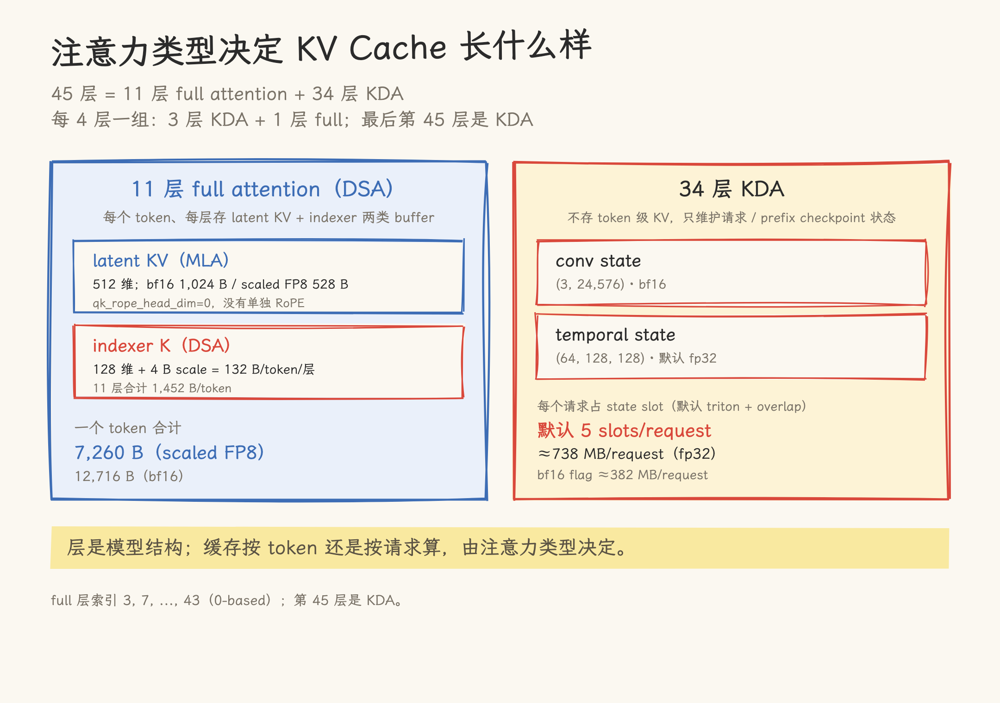
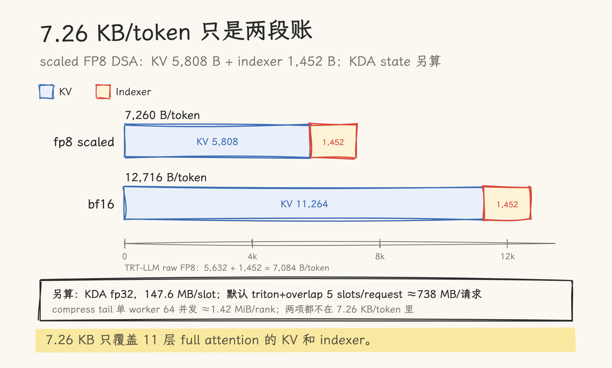
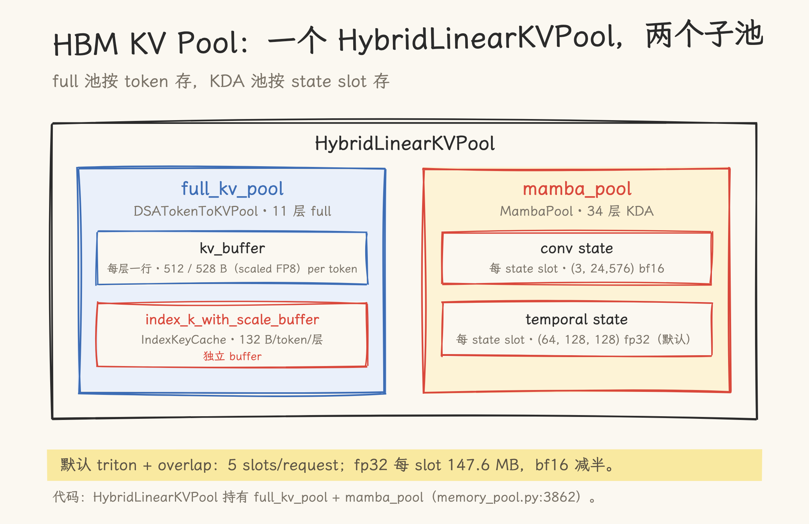
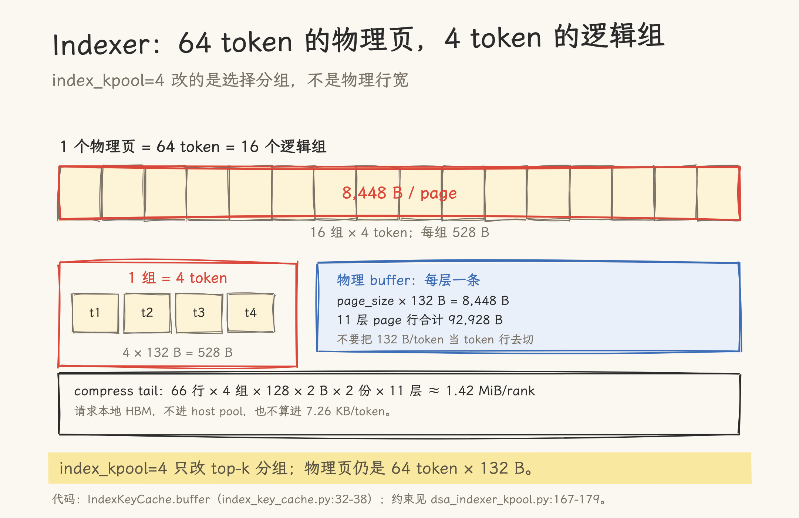
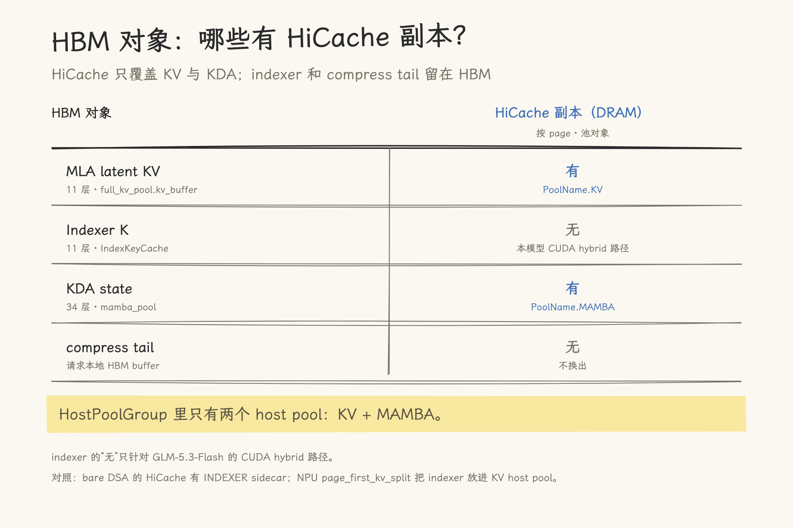

# 三本账：图解 GLM-5.3-Flash 的 KV Cache 布局

> 2026-10-27 | SGLang 源码分析。代码基线为 upstream `f4de6abee6`，模型 config 取自 `zai-org/GLM-5.3-Flash` 公开文件。字节数为 config + 源码公式值；换部署参数时按同一公式重算。
>
> 口径（先看这四条）：
>
> - 示例按单 rank、DP attention 且 `attn_dp_size=tp_size`（attn_tp=1）计。
> - KDA temporal 默认 fp32；显式 `--mamba-ssm-dtype bfloat16` 才减半。
> - Mamba 默认 triton + overlap 下走 `extra_buffer`，按 5 个 state slot/request 预留；关 overlap 是 4，no_buffer 或非 triton 是 3。
> - 本文示例按 scaled FP8（528 B）；官方 Blackwell recipe 是 TRT-LLM raw（512 B）。不开 MTP。
>
> 单位：GB=10^9 B，MB=10^6 B，MiB=2^20 B。

GLM-5.3-Flash 的 45 层都带注意力，但类型不同：34 层是 KDA 线性注意力，11 层是 full attention。两种层保存的状态不一样，所以 KV Cache 不能用一个“每 token 多少字节”概括。下面按四个问题走：

1. 一个 token：它在 full 层产生多少 KV 和 indexer；
2. 一个 request：它额外占多少 KDA 状态和 compress tail；
3. HBM KV Pool：数据放在哪几个池里，RadixTree 管什么；
4. DRAM：HiCache 备份哪些对象，宿主结构是什么。

## 读前须知：三本账 + 一个 tail 缓冲

| 状态                | 计量单位                                      | 跟什么增长    | HBM 位置        |
| ------------------- | --------------------------------------------- | ------------- | --------------- |
| 11 层 MLA latent KV | 每 token、每层                                | 上下文长度    | `full_kv_pool`  |
| 11 层 DSA indexer K | 每 token、每层                                | 上下文长度    | `IndexKeyCache` |
| 34 层 KDA state     | 每 state slot（默认 triton + overlap 5/请求） | state slot 数 | `mamba_pool`    |

前两本账按 token 线性增长，第三本按 state slot 数增长。把三者混成一个“每 token KV”数字，容量规划一定会偏。另外，compress tail 是请求级缓冲区，按 rank 整块分配，单独算，不在这三本账里。

## 一、从一个 token 出发

先补两个词：MLA 把 K/V 压成一条 latent；DSA 先用 indexer 选 top-k。下面按 token 算账。

### 1.1 full attention 的 latent KV

GLM-5.3-Flash 的 45 层就是 45 个 Transformer block 串联。每个 block 有注意力子层和前馈子层；token 的向量表示从第 1 层传到第 45 层，每层都会改写它。

45 个 block 里，34 个的注意力子层是 `linear_attention`（KDA），11 个是 `deepseek_sparse_attention`（full attention）。只有 full attention 的 block 需要保存 token 级 KV，所以 45 层里只有 11 层进入每 token 的 KV 账。Full 层的索引是 3、7、11……43（config 用 0-based），也就是每 4 层一个 full；换成日常说的第几层，是 4、8……44，最后第 45 层是 KDA。

MLA 在 KV Cache 里存一行 latent，不分开存 K 和 V，所以公式不乘 2。`kv_lora_rank=512`，`qk_rope_head_dim=0`；一般 MLA 会另存 RoPE 分量，这个模型没有，bf16 下一行就是 512 个元素：

```text
bf16 KV = 512 × 2 B × 11 层 = 11,264 B/token
```

fp8 DSA 的行宽取决于 backend。scaled layout 每 128 个元素带 4 字节 scale，行宽是 528；TRT-LLM 使用 raw layout，不带这份 scale，行宽仍是 512（`kv_cache_configurator.py:2585-2627`）：

```text
fp8 scaled:      kv_cache_dim = 512 + 512/128 × 4 = 528 B
                 KV = 528 × 1 B × 11 层 = 5,808 B/token
fp8 TRT-LLM raw: kv_cache_dim = 512 B
                 KV = 512 × 1 B × 11 层 = 5,632 B/token
```

### 1.2 indexer 的 K

DSA 先用 indexer 给历史 token 打分，再选 top-k 做精确注意力。`index_head_dim=128`，同样每 128 个元素带 4 字节 scale：

```text
indexer = 128 + 128/128 × 4 = 132 B/token/层
indexer 总计 = 132 × 11 = 1,452 B/token
```

indexer 的 K 和主 KV 是两条 buffer，但都按 token 增长。HBM 里，每个 full 层有一条 `kv_buffer`，token 的 latent 占一个 slot；indexer 的 132 B 落在 `IndexKeyCache` 的 64-token page 中。

### 1.3 一个 token 的合计

| 精度            | KV       | Indexer | 合计           |
| --------------- | -------- | ------- | -------------- |
| fp8 scaled      | 5,808 B  | 1,452 B | 7,260 B/token  |
| fp8 TRT-LLM raw | 5,632 B  | 1,452 B | 7,084 B/token  |
| bf16            | 11,264 B | 1,452 B | 12,716 B/token |

所以“7.26 KB/token”是 scaled FP8 的容量预留；TRT-LLM raw layout 下是 7.08 KB/token。两者都只覆盖 11 层 full attention 的 KV 加 indexer，不包含 34 层 KDA 的状态，也不包含 `index_kpool_compress` 的尾缓冲。FP8 是否生效还取决于部署：H100/H200 的 `auto` 默认可能是 BF16，需要显式指定；官方 Blackwell FP8 recipe 用 TRT-LLM raw layout。

一个 token 落在 KDA 层上时，不产生 token 级 KV。KDA 的状态按 state slot 保存，默认 triton + overlap 下每请求 5 个，下一节单独算。

把注意力层和缓存的关系压缩成一句话：full 层按 token 记账，KDA 层按请求记账。



**图 1**｜注意力类型决定缓存形态：11 层 full 每个 token 留下 latent KV + indexer；34 层 KDA 只维护请求级 state，不产生 token KV。

图 1 是概念对照；图 2 把 token 账按字节画出来。



**图 2**｜scaled FP8 的 7.26 KB 由 KV 5,808 B 和 indexer 1,452 B 组成；bf16 的 KV 接近翻倍，indexer 仍是 1,452 B。TRT-LLM raw layout 的 KV 是 5,632 B。这是按 64-token page 预留的容量账，不是实际 pooled 写入量。

## 二、从一个 request 出发

### 2.1 token slots

一个 request 包含一串 token。`ReqToTokenPool` 保存 request 到 token slot 的映射：

```text
req_to_token[req_pool_idx, :seqlen] -> token slot 列表
```

token 级 KV 和 indexer 都按这些 slot 存。请求占多少 token，就占多少 token 级 KV/indexer。

这里的 slot 是 **token slot**：token 级 KV/indexer 在 HBM 里的位置。KDA 用的是另一套 **state slot**，下一节讲。

### 2.2 KDA state

KDA 不按 token 存，而是按 state slot 存。一个 state slot 是 KDA state 在 HBM 里的一个座位。`MambaPool` 为每个 KDA 层分配两块状态：

- conv state：形状由 `(K-1, proj_size + 2 × proj_k_size)` 决定；
- temporal state：形状为 `(num_heads, head_dim, head_dim)`。

**先看 dtype。** 它不是统一 bf16。`mamba2_state_dtype()` 的默认是 conv bf16、temporal fp32（`mamba_utils.py:68-71`、`:107`）；公开 config 没有 `mamba_ssm_dtype`，只有显式 `--mamba-ssm-dtype bfloat16` 才把 temporal 降到 bf16。

**再看一个 state slot 多大。** 在 attn_tp=1 下，`KimiLinearStateShape.create` 算出的 conv 是 `(3, 24,576)`，temporal 是 `(64, 128, 128)`（`mamba_utils.py:324-369`）。默认 fp32：

```text
conv     = 3 × 24,576 × 2 B = 147,456 B
temporal = 64 × 128 × 128 × 4 B = 4,194,304 B
每层     = 4,341,760 B
34 层    = 147,619,840 B ≈ 147.6 MB/state slot
```

显式 bf16 时 temporal 减半，每 state slot 是 76,316,672 B ≈ 76.3 MB。

**再看一个请求占几个 slot。** `mamba_cache_per_req` 是每个 state slot 的字节数（`mamba_utils.py:116-125`），不是每请求一个 slot。GLM-5.3 默认走 `extra_buffer`（`overrides.py:446-455`；默认 `linear_attn_backend=triton`、overlap 开启）：调度侧按 base 3 + overlap 2 = 5 个 state slot/request 预留（`kv_cache_configurator.py:174-184`、`:2232-2261`）。`--disable-overlap-schedule` 时是 4；`no_buffer` 或非 triton 后端是 3。所以默认配置下每 request 的 KDA 预算是 `5 × 147.6 ≈ 738 MB`；显式 bf16 时约 `5 × 76.3 ≈ 382 MB`。

这是预留上限，不是实际 resident：prefix checkpoint 会额外占 state slot，请求结束后 state 也可能留在树节点里，直到节点被逐出或备份到 host。实际池大小由 `max_mamba_cache_size` / `mamba_full_memory_ratio`（默认 0.9）约束。

**最后看 TP 切分。** `attn_tp_size = tp_size // attn_dp_size // attn_cp_size`。只有 `attn_dp_size == tp_size` 且 `attn_cp_size=1` 时 `attn_tp=1`；TP8/DP4/cp1 时 `attn_tp=2`，TP8 非 DP 时 `attn_tp=8`。其它形态下每 rank 的 state 按 TP 切分，上面的 147.6 / 76.3 MB 不能直接套。

### 2.3 compress tail

`index_kpool_compress=True` 还会给每个请求保留一个 tail 槽（宽 `tail_width × index_head_dim`），整块 `_compress_tail_k` / `_compress_tail_score` 按 `req_to_token` 行数分配（`memory_pool.py:4996-5048`）：

```text
tail_rows  = req_to_token 行数 + 1 = max_num_reqs_per_worker + 2
tail_width = index_kpool + tail_extra_slots
```

单 worker、每 worker 最大请求数 `max_num_reqs_per_worker=64`、无 MTP、11 个 full 层、bf16 的情况下：

```text
66 × 4 × 128 × 2 B × 2 份 × 11 层 ≈ 1.42 MiB/rank
```

DP8、全局 `max_running_requests=64` 时，每 worker 约 8 个请求，tail 约 10 行，约 0.215 MiB/rank。这份 tail 是 HBM 里的请求槽缓冲，不进入 HiCache，也不参与 HiCache 容量计算。

### 2.4 请求的账

一个 request 的占用至少有三块：

| 组成                   | 计量单位                             | 典型值                                                           |
| ---------------------- | ------------------------------------ | ---------------------------------------------------------------- |
| token 级 KV + indexer  | 每 token                             | 7,260 B（scaled FP8）/ 12,716 B（bf16）                          |
| KDA state（默认 fp32） | 5 个 state slot/request（默认策略）  | 5 × 147.6 MB ≈ 738 MB/请求（attn_tp=1）                          |
| KDA state（bf16 flag） | 5 个 state slot/request（默认策略）  | 5 × 76.3 MB ≈ 382 MB/请求（attn_tp=1）                           |
| compress tail          | 每请求一个 tail 槽，整块按 rank 分配 | 单 worker 64 并发约 1.42 MiB/rank；DP8 全局 64 约 0.215 MiB/rank |

token 总数和请求数没有固定比例：一个请求可以有很多 token，也可以只有几个 token。所以容量要同时看 `max_total_tokens`、`max_running_requests`，以及 mamba 池的 `max_mamba_cache_size` / `mamba_full_memory_ratio`；后者会反向限制可并发的请求数。

## 三、HBM KV Pool：一个 HybridLinearKVPool，两个子池

### 3.1 池的结构

45 层 = 11 层 full attention + 34 层 KDA，这是模型的层数构成，不是两个池。默认路径下，SGLang 只建一个 `HybridLinearKVPool`（`memory_pool.py:3862`），数据分别放在两个子池里：

- `full_kv_pool`：`DSATokenToKVPool`，只包含 11 个 full-attention 层（`memory_pool.py:3960-3983`）；
- `mamba_pool`：`MambaPool`，只包含 34 个 KDA 层。

`--enable-unified-memory` 下会换成 `UnifiedHybridLinearKVPool`；开 MTP 还会多出 draft pools。本文的池数量按默认路径写。

`DSATokenToKVPool` 继承 `MLATokenToKVPool`，每个 full 层有一条 `kv_buffer`，行宽是 `kv_cache_dim`（bf16 512；scaled FP8 528；TRT-LLM raw FP8 512）。另外，每个 full 层还有一条独立的 `index_k_with_scale_buffer`，由 `IndexKeyCache` 管理（`memory_pool.py:4985-4994`、`index_key_cache.py:14-38`）。



**图 3**｜HBM 里只有一个 `HybridLinearKVPool`，它下面分 `full_kv_pool` 和 `mamba_pool` 两个子池；indexer 是 full 池里的独立 buffer。

### 3.2 indexer 的物理页

Indexer 是最容易写错的部分。先记结论：一页 64 个 token，每 token 132 B，一页 8,448 B。page 是分配和迁移的最小单位，这里说的是 64 个 token，不是 64 个请求。

`IndexKeyCache` 为每个 full 层分配一条 `uint8` buffer，形状是：

```text
(num_pages, page_size × (index_head_dim + index_head_dim/128 × 4))
= (num_pages, 64 × 132)
= (num_pages, 8,448 B)
```

也就是说，物理页仍然是 64 个 token，每 token 132 B，一页 8,448 B（`index_key_cache.py:32-38`）。CUDA 上 `DSATokenToKVPool` 会断言 `page_size == 64`（`memory_pool.py:4971-4972`）。

config 里 `indexer_types` 全是 `full`，`dsa_layer_skips_topk()` 因此推出全 False（`model_config.py:354-361`、`kv_cache_configurator.py:1649-1650`）；11 个 full 层都分配 indexer buffer。

`index_kpool=4` 改的是 top-k 的选择分组：4 个 token 合成一个 pooled index，一个 64-token 物理页里因此有 16 个逻辑组；2048 个 token 的 top-k 也就折成 512 个组来打分。它的约束在 attention 后端：

```text
index_topk % index_kpool == 0
64 % index_kpool == 0
```

（`dsa_indexer_kpool.py:167-179`）

这两个约束说明的是分组关系，不是把物理 buffer 的行宽改成 16 token。物理 buffer 仍按 64-token page 分配；不要按 132 B/token 直接切 token 行。

容量预留和实际写入要分开。`IndexKeyCache` 按 `64 × 132` 分配容量，所以容量账按 132 B/token/层算；但 `index_kpool=4` + compress 时，每 4 个 token 只写一个 pooled K（`kpool_fp8_index.py:392-404`）。有效 indexer payload 约 33 B/token/层，11 层约 363 B/token。7,260 B/token 是容量预留，不是有效写入量。



**图 4**｜物理页是 64 token × 132 B = 8,448 B；`index_kpool=4` 把 4 个 token 合成一个逻辑组，一页 16 组；compress tail 是请求本地缓冲。

## 四、RadixTree：value 与 host_value

### 4.1 树节点存什么

可以把 RadixTree 节点想成目录卡片：卡片上写的是页码，不是正文。

RadixTree 不存 KV 字节，存索引。SGLang 的 `UnifiedTreeCore` 按 token 前缀组织节点，每个节点上每个 component 有一份 `ComponentData`（`components/base.py:47-55`）：

| 字段            | 含义                                       |
| --------------- | ------------------------------------------ |
| `value`         | HBM 里的索引                               |
| `host_value`    | DRAM host pool 里的索引；没备份时为 `None` |
| `lock_ref`      | 保护 `value`，防止被逐出                   |
| `host_lock_ref` | 保护 `host_value`，防止恢复期间被回收      |

`value` 和 `host_value` 都不是数据本体。数据在 `HybridLinearKVPool` 和 `HostPoolGroup` 挂的 host pool 里，树只记录“这个前缀对应哪几个 slot”。

### 4.2 FULL 和 MAMBA 两个 component

GLM-5.3-Flash 的 hybrid 树有 FULL 和 MAMBA 两个 component（`registry.py:167-171`、`unified_radix_cache.py:178-196`）：

| component | `value` 指向                | `host_value`               | 说明                                                                                                                                       |
| --------- | --------------------------- | -------------------------- | ------------------------------------------------------------------------------------------------------------------------------------------ |
| FULL      | 11 层 KV 的 token slot 索引 | 备份后指向 KV host slot    | indexer 没有独立 component，也没有 `host_value`；它和 FULL 共用同一组 token slot，物理 buffer 由 `IndexKeyCache` 按 page 单独管理          |
| MAMBA     | `mamba_pool` 的 state slot  | 备份后指向 MAMBA host slot | KDA state 可以挂在多个深度的 prefix checkpoint 节点上，不按 token 增长；split 时 `host_value` 留在 child（`mamba.py:219-245`、`:305-315`） |

所以 RadixTree 上能看到的，是“哪个 token 前缀对应哪些 KV slot、哪份 KDA state”，不是 KV 张量本身。比如一个 128 token 的前缀：`FULL.value` 指向 128 个 token slot，`FULL.host_value` 指向 128 个 host slot（按 64 token 一页组织）；`MAMBA.value` 指向一个 mamba slot。

### 4.3 哪些数据能备份到 DRAM

一句话：树节点上有 `host_value` 的对象，才是 HiCache 能备份、下次能加载回来的对象。

HiCache 给树节点写 `host_value` 的范围，就是能换出到 DRAM 的范围：

| HBM 对象            | RadixTree 上的位置                             | HiCache 备份到 DRAM           |
| ------------------- | ---------------------------------------------- | ----------------------------- |
| 11 层 MLA latent KV | FULL 的 `value` / `host_value`                 | 有，`PoolName.KV`             |
| 11 层 indexer K     | 跟随 FULL，但没有独立 component / `host_value` | 无（本模型 CUDA hybrid 路径） |
| 34 层 KDA state     | MAMBA 的 `value` / `host_value`                | 有，`PoolName.MAMBA`          |
| compress tail       | 不在树上                                       | 无                            |

表里 indexer 的“无”只针对 GLM-5.3-Flash 的 CUDA hybrid 路径；bare DSA 有独立的 INDEXER sidecar，`page_first_kv_split` 布局把 indexer 放进 KV host pool。



**图 5**｜GLM-5.3-Flash 的 HBM 四类对象：HiCache 只覆盖 KV + KDA；indexer 和 compress tail 没有 HiCache 副本。

## 五、DRAM：HostPoolGroup 的数据结构

### 5.1 HostPoolGroup 是容器

DRAM 侧的入口是 `HostPoolGroup`。它的 docstring 说它是“anchor host pool 和 side pools 的分配门面”（Allocation facade for an anchor host pool and its side pools，`pool_host/group.py:35-50`）。它是一个分配门面，不是一个数据缓冲区；真正的数据在 `PoolEntry` 挂的 host pool 里。

`_MambaStrategy` 构建的 `HostPoolGroup` 只有两个 entry（`hybrid_pool_assembler.py:1118-1222`、`:1785-1838`）：

- `PoolName.KV`：`MLATokenToKVPoolHost`，覆盖 11 个 full 层；
- `PoolName.MAMBA`：`MambaPoolHost`，覆盖 34 个 KDA 层。

### 5.2 KV host pool

`MLATokenToKVPoolHost` 默认用 `page_first`（direct IO 时切到 `page_first_direct`），page_size 64。它的行宽是 `kv_lora_rank + qk_rope_head_dim = 512`，不是 device 端 scaled FP8 的 528：`build_kv_host_pool` 没有传 `override_kv_cache_dim`，host pool 按 512 算（`pool_host/mla.py:244-247`、`hybrid_pool_assembler.py:1150-1159`、`fields/memory.py:145`、`hicache_hook.py:168-176`）。

Host pool 按 64 token 一页组织，allocator 以 64 token 为粒度分配；树节点的 `host_value` 是一组 host slot 索引，落在这些 page 里。

在 CUDA 的 `page_first` / `page_first_direct` 下，`MLATokenToKVPoolHost` 不分配 `index_k_buffer`；只有 `page_first_kv_split` 布局会分配（`pool_host/mla.py:297-376`）。`page_first_kv_split` 不是 NPU 专属，显式选择时 CUDA 也会分配；只有 memfabric 路径是 NPU 限定。GLM-5.3-Flash 的默认 CUDA 路径不走这个布局，所以 KV host pool 里没有 indexer。

### 5.3 MAMBA host pool

`MambaPoolHost` 存 34 层 KDA state，`page_size = 1`（`pool_host/mamba.py:74-123`）。一个 page 是一个 state slot；一个请求默认会占多个 state slot，树节点的 MAMBA `host_value` 指向这些 slot。

KDA state 不是 token 级数据，所以 host 侧也不按 token page 组织。

### 5.4 host_value 如何连接两边

一次备份的路径可以概括成：

```text
RadixTree 节点
  FULL.value / MAMBA.value          (HBM 索引)
        │  备份
        ▼
  FULL.host_value / MAMBA.host_value (DRAM 索引)
        │
        ▼
  HostPoolGroup
    PoolName.KV    -> MLATokenToKVPoolHost 的 host slot（按 page 组织）
    PoolName.MAMBA -> MambaPoolHost 的 slot
```

恢复时反向走：`host_value` 找到 DRAM 里的 host slot，再写回 HBM 的 `value`。`host_lock_ref` 在这段时间保护 host slot 不被回收。

### 5.5 没有 indexer / tail host pool

HiCache 的 host pool 里没有 indexer buffer，也没有 compress tail buffer。原因不是“indexer 太小”，而是 hybrid 的 `HostPoolGroup` 只建了 KV + MAMBA 两个 entry；indexer 在 CUDA 的 `page_first` / `page_first_direct` 下没有 host buffer；compress tail 不在树上，也不是 `HostPoolGroup` 的 entry。

对照：bare DSA 走 `_DsaStrategy`，host 侧会建 `PoolName.INDEXER` sidecar，host index 从 KV pool 派生（`indices_from_pool=PoolName.KV`，`hybrid_pool_assembler.py:2015-2047`）；`page_first_kv_split` 则把 indexer 放进 KV host pool 内部。GLM-5.3-Flash 的 CUDA hybrid 路径两者都不走。

### 5.6 KDA state 也能 backup 到 DRAM

KDA state 和 KV 走同一套 `host_value` 逻辑，区别只是对象不同：

- KV：`FULL.value` → `FULL.host_value` → `PoolName.KV` 的 host slot（按 page 组织）；
- KDA：`MAMBA.value` → `MAMBA.host_value` → `PoolName.MAMBA` 的 host slot。

备份时，HiCache 把 HBM 里的 state 写到 DRAM；命中前缀时，再从 `host_value` 加载回 HBM。`host_lock_ref` 保护 host slot 不被提前回收。

KDA state 可以挂在多个深度的 prefix checkpoint 上（`components/mamba.py:219-245`），所以缓存没命中时不一定全量重算。但“命中”不等于“只 prefill 新后缀”：FULL KV 的命中可能比 KDA state 更深，这时 `finalize_match_result_in_tree_core()` 会把 `mamba_branching_seqlen` 设到 FULL 命中内最近的 checkpoint 对齐点；KDA 从更浅 state 重算到该点，并在该点追踪/保存 state（`components/mamba.py:156-186`、`schedule_batch.py:3088-3104`）。

| 命中情况                                       | 行为                                  |
| ---------------------------------------------- | ------------------------------------- |
| HBM 有 state | 从该 state 恢复；若 FULL 命中比它更深，按 `mamba_branching_seqlen` 对齐点重算中间段 |
| HBM 没有、DRAM 有 | 从 `MambaPoolHost` load back；同样，FULL 命中更深时重算到 `mamba_branching_seqlen` |
| 最近的 checkpoint 没有，但更浅的 checkpoint 有 | 匹配停在更浅 state；FULL 命中可更深，重算到 `mamba_branching_seqlen` 对齐点 |
| 连更浅的 checkpoint 都没有 | KDA 从头 prefill |

树和控制器层面，KDA 与 KV 用的是同一套 `host_value` 契约；但 transfer 形状不同：KV 的 loadback 可以沿 evicted ancestors 拼多个 page，Mamba 只加载 `best_match_node` 的一个 state slot（`components/mamba.py:737-790`、`components/full.py:364-389`）。所以更准确的说法是“同一 host_value / HostPoolGroup 契约”，不是“完全同构”。

## 六、容量：token 账与 request 账

把前面的账收起来，容量规划至少有两个独立公式。下面 `full_layers=11`，`itemsize` 是 KV dtype 的字节数，`slots_per_request` 默认 5：

```text
token 预算：
  KV+INDEX = full_layers × kv_cache_dim × itemsize
           + full_layers × 132
  再乘 max_total_tokens

请求预算（单 rank、attn_tp=1）：
  KDA = 34 × (conv_bytes + temporal_bytes)
      × slots_per_request × max_concurrent_requests
  compress tail = tail_rows × tail_width × 128 × 2 × 2 × 11
```

`slots_per_request` 默认是 5（默认 triton + overlap；`--disable-overlap-schedule` 是 4，no_buffer 或非 triton 是 3）；显式 bf16 时每 slot 的 temporal 减半。前者按 token 增长，后者按 state slot 数增长（默认 5 × 请求数）。

`max_total_tokens` 管 token 账，`max_running_requests` 管 request 账；请求数还受 `max_mamba_cache_size // ratio` 限制。上面的 KDA 公式是 active-request 的下界，真实 pool 按 `max_mamba_cache_size` 预算，prefix checkpoint 另占 slot。

用两个负载对比一下（单 rank、attn_tp=1、假设都同时驻留，只看量级）：

| 负载           | KV + indexer                    | KDA（默认 fp32，默认策略 5 slots） | KDA（bf16 flag，默认策略 5 slots） |
| -------------- | ------------------------------- | ---------------------------------- | ---------------------------------- |
| 10 个 32K 请求 | 10 × 32,768 × 7,260 B ≈ 2.38 GB | 10 × 738 MB ≈ 7.38 GB              | 10 × 382 MB ≈ 3.82 GB              |
| 100 个 1K 请求 | 100 × 1,024 × 7,260 B ≈ 0.74 GB | 100 × 738 MB ≈ 73.8 GB             | 100 × 382 MB ≈ 38.2 GB             |

默认 fp32 下，KDA 账通常比 token 账更大；上下文继续变长时 token 账也会上升，两者要一起算。上面的 KV 数字按 scaled FP8；TRT-LLM raw layout 要换成 7,084 B/token。

用 128K 上下文做一个粗算（scaled FP8，含 indexer）：

```text
7,260 B/token × 131,072 token ≈ 0.95 GB
```

一个 128K 请求的 token 账约 0.95 GB；同一个请求的 KDA 预算默认 738 MB（bf16 flag 382 MB）。

如果这 64 个请求都按 128K 算，token 账总量约 60.9 GB；DP8 时每 rank 约 8 个请求，token 账约 7.6 GB/rank。下面只看 KDA 账：单 rank 64 个请求约 47.2 GB（默认）或 24.4 GB（bf16 flag）；DP8 时每 rank 约 5.9 GB（默认）或 3.1 GB（bf16 flag）。这个例子只用来展示两条账的量级；换成实际启动参数，按同一公式重算。

## 七、最容易写错的几个点

1. 512、528、576 要分清：`qk_rope_head_dim=0`，bf16 的 `kv_cache_dim` 是 512；scaled FP8 是 528；TRT-LLM raw FP8 仍是 512；576 是 DeepSeek V3 系带 64 维 RoPE 的形状。
2. 7.26 KB 包含 indexer，不包含 KDA state：它是 scaled FP8 的 5,808 + 1,452，不是整个模型的状态总量；TRT-LLM raw layout 是 7,084 B/token。
3. 物理页还是 64 token：`index_kpool=4` 是选择分组，不是把 8,448 B 的页行改成 16 token。
4. compress tail 不进 HiCache：它是每请求的 HBM 缓冲，算 HiCache 容量时不要把它加进去。
5. 默认路径下 HBM 里只有一个 `HybridLinearKVPool`：`full_kv_pool` 和 `mamba_pool` 是它的两个子池，不是两个独立池；`--enable-unified-memory` 是另一套池。
6. INDEXER 在 hybrid 的 HiCache `HostPoolGroup` 里没有 entry：bare DSA 有独立 sidecar，`page_first_kv_split` 把它放进 KV host pool；本模型的默认 CUDA hybrid 路径两者都不走。
7. KDA state 按 state slot 计费，不按 token：默认 fp32 下每 slot 约 147.6 MB；默认 triton + overlap 的 `extra_buffer` 按 5 slots/request 预留，约 738 MB/请求（关 overlap 是 4，no_buffer 或非 triton 是 3）；显式 bf16 才是 76.3 MB/slot、约 382 MB/请求。
8. `attn_tp=1` 只在 `attn_dp_size == tp_size` 且 cp=1 时成立：TP8/DP4/cp1 是 2，TP8 非 DP 是 8；其它形态下每 rank 的 KDA state 按 TP 切分，不能直接套 147.6 / 76.3 MB。
9. 本文数字不含 MTP：`num_nextn_predict_layers=1` 只是 config 字段，没开 `--speculative-algorithm` 时不会建 draft pool；开 MTP 还会额外分配 draft pools 和 intermediate SSM state。

## 八、结论：三本账

GLM-5.3-Flash 的 KV Cache 不是一张表，而是三本账：

- 11 层 full attention 的 MLA latent KV：按 token 线性增长，scaled FP8 5,808 B/token，TRT-LLM raw FP8 5,632 B/token，bf16 11,264 B/token。
- 11 层 DSA indexer：按 token 线性增长，1,452 B/token；物理页 64 token、8,448 B，`index_kpool=4` 只改选择分组。
- 34 层 KDA state：按 state slot 计费，默认 fp32 每 slot 约 147.6 MB；默认 triton + overlap 的 `extra_buffer` 按 5 slots/request 预留，约 738 MB/请求；显式 bf16 时约 382 MB/请求。compress tail 另算，单 worker 64 并发整块约 1.42 MiB/rank。

默认路径下 HBM 侧只有一个 `HybridLinearKVPool`，两个子池分别装 11 层 full 状态和 34 层 KDA 状态。RadixTree 节点上的 `value` 是 HBM 索引，`host_value` 是 DRAM 索引；HiCache 只给 KV 和 KDA 写 `host_value`，indexer 和 compress tail 没有 HiCache 副本。

这也是为什么容量要同时看 token 和 request：token 是长度单位，request 是并发单位，两者不是换算关系。

## 名词表

| 名词                   | 一句话解释                                                                           |
| ---------------------- | ------------------------------------------------------------------------------------ |
| KV Cache               | 自回归生成时缓存历史 Key/Value，避免每生成一个 token 都重算                          |
| MLA                    | 把 K/V 压成一条 latent 向量来存，而不是分开存完整的 K 和 V                           |
| DSA                    | 稀疏注意力：先用 indexer 选 top-k 个历史 token，再做精确注意力                       |
| Indexer                | 给历史 token 打分的轻量索引；它的 K 缓存和主 KV 分开                                 |
| KDA                    | 线性注意力的一种；每个请求维护循环状态，默认 triton + overlap 下预留 5 个 state slot |
| Page                   | 分配和迁移的单位；indexer 和 KV host pool 默认一页 64 token                          |
| Token slot             | token 级 KV/indexer 在 HBM 里的位置                                                  |
| State slot             | KDA state 在 HBM 里的位置；默认 triton + overlap 下每请求预留 5 个                   |
| Host slot              | DRAM host pool 里的索引；KV 按 64-token page 分配，MAMBA `page_size=1`               |
| HiCache                | GPU HBM 之外的 DRAM 缓存层，按 page 换出/恢复                                        |
| `value` / `host_value` | RadixTree 节点上的 HBM 索引 / DRAM 索引，不是数据本体                                |
| Sidecar                | 依附主 KV 的独立 buffer；bare DSA 的 INDEXER 是这种，host index 从 KV 派生           |

## 参考资料

- 模型 config：[zai-org/GLM-5.3-Flash config.json](https://huggingface.co/zai-org/GLM-5.3-Flash/raw/main/config.json)
- SGLang upstream：`f4de6abee6`（本地 checkout：`/Users/wangtianqing/Project/ai-infra/sglang`）
- 背景：[注意力架构演进与 KV Cache](../../06_llm_theory_and_fundamentals/llm_basic_concepts/architecture_evolution/attention_evolution_kv_cache.md)
- 相关文章：[SGLang KV Pool 管理：物理存储、Radix Tree 索引与请求视图](sglang-kv-pool-management.md)
- 相关文章：[SGLang UnifiedRadixTree：一棵树，四种注意力](sglang-unified-radix-tree.md)

## 源文件索引

| 文件                                                                | 关键内容                                                                                        | 引用点                                                                                                           |
| ------------------------------------------------------------------- | ----------------------------------------------------------------------------------------------- | ---------------------------------------------------------------------------------------------------------------- |
| `python/sglang/srt/mem_cache/memory_pool.py`                        | `ReqToTokenPool`、`HybridReqToTokenPool`、`HybridLinearKVPool`、`DSATokenToKVPool`、`MambaPool` | `:274-306`、`:1224-1286`、`:3862`、`:3960-3983`、`:4893`、`:4939-4994`、`:4950-4955`、`:4971-4972`、`:4996-5048` |
| `python/sglang/srt/mem_cache/index_key_cache.py`                    | indexer buffer 的物理页布局                                                                     | `:14-38`、`:40-43`                                                                                               |
| `python/sglang/srt/layers/attention/dsa/dsa_indexer_kpool.py`       | `index_kpool` 的分组约束与 compress 断言                                                        | `:167-179`                                                                                                       |
| `python/sglang/srt/layers/attention/dsa/kpool_fp8_index.py`         | `compute_pooled_write_locs`，每 4 token 一个 pooled 写点                                        | `:392-404`                                                                                                       |
| `python/sglang/srt/configs/mamba_utils.py`                          | KDA state dtype、`mamba_cache_per_req` 与 shape                                                 | `:68-71`、`:107`、`:116-125`、`:324-369`                                                                         |
| `python/sglang/srt/configs/model_config.py`                         | `dsa_layer_skips_topk()` 从 `indexer_types` 推导                                                | `:354-361`                                                                                                       |
| `python/sglang/srt/configs/glm5_next.py`                            | GLM-5.3 的 `mamba2_cache_params`                                                                | `:264-272`                                                                                                       |
| `python/sglang/srt/mem_cache/kv_cache_configurator.py`              | KDA pool ratio、FP8 layout 选择、tail 行数                                                      | `:174-184`、`:2232-2261`、`:2585-2627`、`:1649-1650`                                                             |
| `python/sglang/srt/mem_cache/hybrid_cache/hybrid_pool_assembler.py` | `_MambaStrategy`、`build_hybrid_mamba_stack`、host pool 构建                                    | `:1118-1222`、`:1150-1159`、`:1785-1838`、`:2015-2047`                                                           |
| `python/sglang/srt/mem_cache/pool_host/group.py`                    | `HostPoolGroup` 与 `PoolEntry`                                                                  | `:15-50`                                                                                                         |
| `python/sglang/srt/mem_cache/pool_host/mla.py`                      | `MLATokenToKVPoolHost` 的容量、行宽与 page 布局                                                 | `:233-267`、`:244-247`、`:272-381`                                                                               |
| `python/sglang/srt/mem_cache/pool_host/mamba.py`                    | `MambaPoolHost`，`page_size = 1`                                                                | `:74-123`                                                                                                        |
| `python/sglang/srt/mem_cache/pool_host/dsa.py`                      | `DSAIndexerPoolHost` 的 page 几何                                                               | `:50-113`、`:152-192`                                                                                            |
| `python/sglang/srt/mem_cache/unified_cache/components/base.py`      | `ComponentData` 的 `value` / `host_value` / lock                                                | `:47-55`                                                                                                         |
| `python/sglang/srt/mem_cache/unified_cache/components/mamba.py`     | MAMBA state 的 checkpoint、branching、backup/load transfer、split 时 host_value 留在 child      | `:156-186`、`:219-245`、`:305-315`、`:737-790`                                                                   |
| `python/sglang/srt/mem_cache/unified_cache/components/full.py`      | FULL KV 的 loadback 可沿 evicted ancestors 拼 page                                               | `:364-389`                                                                                                       |
| `python/sglang/srt/mem_cache/unified_cache/unified_tree_core.py`    | `UnifiedTreeNode`、`backuped`                                                                   | `:110-163`                                                                                                       |
| `python/sglang/srt/mem_cache/unified_radix_cache.py`                | 树的 component 初始化                                                                           | `:178-196`                                                                                                       |
| `python/sglang/srt/mem_cache/registry.py`                           | hybrid 树的 `FULL + MAMBA` 选择                                                                 | `:167-171`                                                                                                       |
| `python/sglang/srt/arg_groups/fields/memory.py`                     | `hicache_mem_layout` 默认 `page_first`                                                          | `:133-145`                                                                                                       |
| `python/sglang/srt/arg_groups/overrides.py`                         | `mamba_radix_cache_strategy=auto` 时选择 `extra_buffer`                                         | `:378-419`、`:446-455`                                                                                           |
| `python/sglang/srt/arg_groups/fields/schedule.py`                   | `mamba_full_memory_ratio` 默认 0.9                                                              | `:214-221`                                                                                                       |
| `python/sglang/srt/arg_groups/hicache_hook.py`                      | direct IO 下切到 `page_first_direct`                                                            | `:168-176`                                                                                                       |
| `python/sglang/srt/runtime_context.py`                              | `tp_size = attn_tp_size × attn_dp_size × attn_cp_size`                                          | `:292-297`                                                                                                       |
