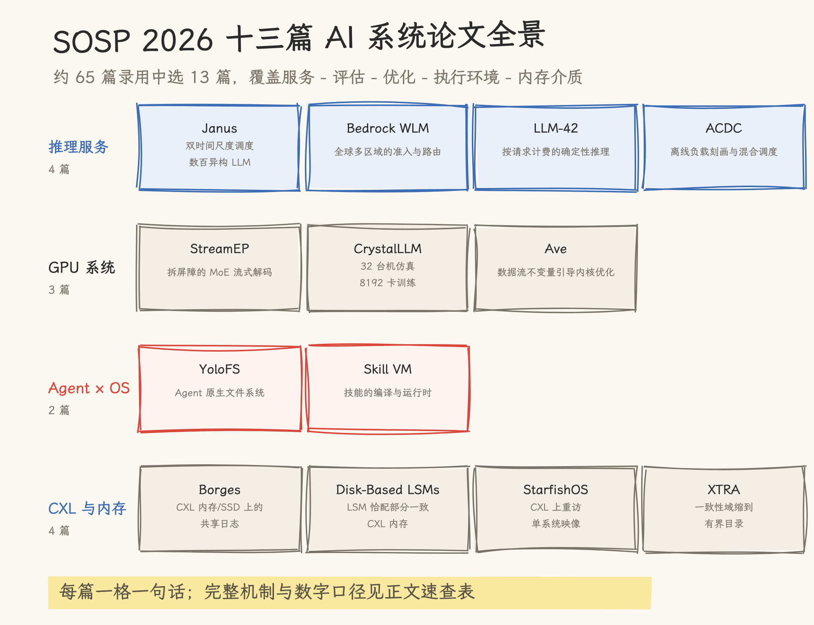
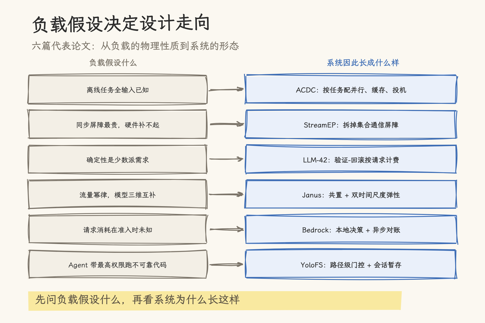
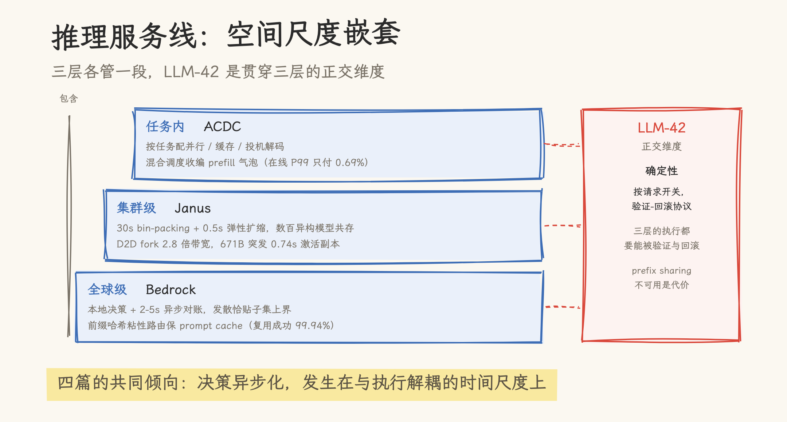
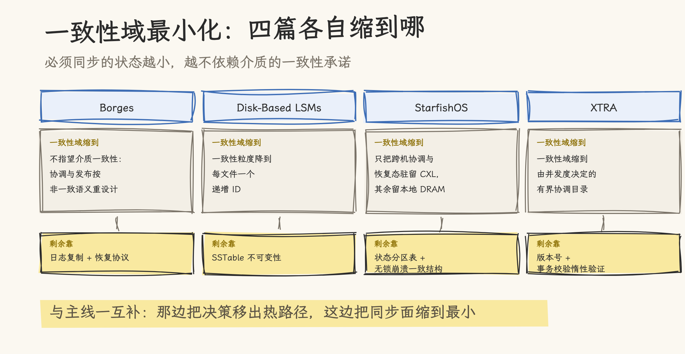
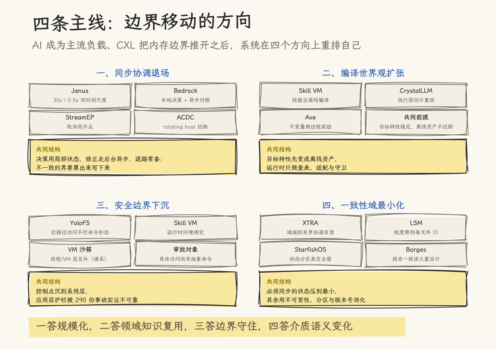

# 系统的边界在移动：SOSP 2026 十三篇论文精读

> SOSP 2026（第 32 届 ACM 操作系统原理大会，2026 年 9 月 29 日–10 月 2 日，布拉格）共录用约 65 篇论文。本文从官方录用名单中选出 13 篇论文做全文精读后的综述：9 篇与 AI 负载直接相关（推理服务、GPU 系统、Agent 执行环境三条线），4 篇 CXL 内存系统论文与 AI 负载无关，入选的理由是 CXL 内存池化是 AI 推理基础设施（KV cache 池化、主机内存分层）的直接介质层，且与前三线共享「边界移动」的主题。文中所有数字均为论文口径：生产系统论文（Janus、ACDC、Bedrock）的数字属厂商口径，03/05/08 三篇为 arXiv 预印本，与会议正式版可能有差异。十三篇的分篇精读笔记见本目录 `references/`，原文 PDF 在 `papers/`。

## 一、这批论文为什么值得整体读

操作系统的顶会在收 AI 的论文，这件事本身已经不新鲜；值得看的是收进来的是什么。数一遍 SOSP 2026 的约 65 篇录用论文：LLM 推理服务 8 篇，GPU 资源与调度 7 篇，Agent 与操作系统交叉 4 篇，CXL 内存系统 4 篇，再加上 RL 训练、AI 存储、晶圆级加速器等零散主题，AI 相关超过 20 篇。中国机构的产出约 18–20 篇：阿里、字节 Seed、京东、清华、华中科大、北大都在名单上，上海交大 IPADS 一家 5 篇。

这批论文的重心与两三年前不同。单点优化（一个更快 kernel、一个更好调度器）仍在，但相当一部分论文在做另两件事：把 AI 负载当物理对象刻画清楚，然后围绕刻画结果重新设计系统抽象。离线推理有了自己的系统性研究（ACDC），Agent 的事故有了 290 份报告的实证分析（YoloFS），Skill 生态有了 11.8 万样本的量化（Skill VM）。生产系统的第一手数据也第一次成规模出现：京东的多模型集群、AWS Bedrock 的全球调度、阿里云的离线平台，都把生产数字写进了论文。

本文选 13 篇，按四条线组织：

- **推理服务线（4 篇，AI）**：Janus、Amazon Bedrock、LLM-42、ACDC
- **GPU 系统线（3 篇，AI）**：StreamEP、CrystalLLM、Ave
- **Agent × OS 线（2 篇，AI）**：YoloFS、Skill VM
- **CXL 与内存线（4 篇，非 AI，介质层）**：Borges、Disk-Based LSMs、StarfishOS、XTRA

选文标准是覆盖「服务—评估—优化—执行环境—内存介质」的完整链条，同时每篇都有可以独立站住的机制贡献。十三篇的精读笔记（每篇 1500–2500 字，含论文页码引用与疑点清单）已经分篇成文，本文做的是把它们放在一起之后能看见的东西。

## 二、先立负载：十三篇论文各自假设负载长什么样

每一篇系统论文都压在一个负载假设上，假设不同，设计就走向不同方向。把十三篇的假设并排列出来，后面每一节的设计选择都能还原成「假设 → 推论」。

**离线任务是可预知的**。ACDC 从阿里平台三个月的 150 万离线任务里提炼出两个性质：天然确定性（提交时全输入已知）与吞吐导向（只关心任务整体完成时间，17 万任务平均 149 分钟完成、最长 1000 分钟，TTFT/TPOT 无约束）。作为对照，把在线的 TTFT=1 约束直接套在离线任务上，白白损失 45.1% 吞吐。Bedrock 从另一侧验证了同一件事的反面：它的限制章节明确写「agentic 工作流特别难估」，工具迭代让输出长度可变，token 计数到生成完成前都是近似。可预知性是推理服务设计的一根轴，ACDC 用尽它，Bedrock 承认它正在被 agent 破坏。

**同步屏障是最贵的原语**。StreamEP 引用的实测数字：commodity 集群上，MoE 每层的 dispatch/combine 集合通信屏障最多吃掉该层 75% 的执行时间。而能用专用硬件掩盖屏障的 hyperscaler 硬件大多数团队没有。学术集群调研的数字：840 台 pre-Hopper GPU 对 208 台 HGX，满足 DeepEP 硬件要求的免费 GPU 只有 6%。屏障贵、硬件又补不起，就有了拆屏障的整个设计。

**确定性是少数派需求**。LLM-42 给出的成本结构：让所有 kernel 用固定归约策略的 batch-invariant 路线，GEMM 慢 63%，RMSNorm 最差慢 70 倍；11 个请求里只要有 1 个声明要确定性，整批被拖进慢 kernel，吞吐掉 56%。把确定性做成全局开关是过度设计，这个数字是全文的立论点。

**流量是幂律的，模型是互补的**。Janus 从京东集群一天 4560 万请求里量出：头部 12% 的应用占 80% 请求；应用在 HBM 容量、SM 算力、HBM 带宽三个维度上画像互补，memory-heavy 与 compute-heavy 可以低干扰共存。共置与弹性这两个传统上互斥的目标，靠的是这张三维画像。

**Agent 在用最高权限执行不可靠代码**。YoloFS 的 290 份公开事故报告：写操作占 44%，40% 的伤害不可恢复，83% 的用户立即察觉、10% 延后发现、8% 全程无感。现有三道护栏（工具策略、命令过滤器、沙箱）各有结构性盲区，过滤器匹配命令字符串而命令可以换无数种形态。

**技能的执行环境是异构的**。Skill VM 统计 11.8 万个公开技能：同一技能跨模型得分差异巨大，启用技能反而让 15% 的任务变差；同一模型换 harness 结果就变，harness 引起的方差与模型间方差相当；53% 的技能要求外部依赖但只有 19% 声明了。技能被当成裸文本塞进上下文，而文本里藏着对模型、harness、机器三层的隐含假设。

CrystalLLM 与 Ave 的假设相对传统：前者假设千卡级训练实验贵到必须仿真（评估器的瓶颈），后者假设 agent 优化 kernel 的 reward 太稀疏（优化循环的瓶颈）。假设不同，一个去做高保真执行图，一个去找过程信号。

CXL 四篇与 AI 负载无关，假设压在介质侧：一致性是稀缺资源（硬件缓存一致性域有界，扩到 pod 规模不可行）、访问延迟不均（远端 CXL 内存比本地 DRAM 慢、带宽低一个量级）、部分故障成为常态。这组假设与负载无关，是介质的物理性质，第六节单独展开。

这排假设里有一条暗线：**可预估性正在从推理系统设计的朋友变成敌人**。ACDC 的全部收益压在「全输入已知」上，论文自己在经验教训一节承认多轮 agent 工作流部分破坏这个假设；Bedrock 的准入记账协议（估计-扣减-流式上报-终了对账）就是为「消耗不可预估」设计的。读后面几节时可以带着这个对照。

## 三、推理服务线：从任务内到全球级，再加一个正交维度

四篇论文天然按空间尺度嵌套：ACDC 管一个任务内部怎么摆，Janus 管一个集群里几百个模型怎么共存，Bedrock 管全球几十个区域怎么路由，LLM-42 处理一个贯穿各层的正交维度：确定性。

### 3.1 任务内：ACDC 的按任务定制

ACDC 沿三个轴改造离线推理：资源编排按任务的输入输出长度分布选 TP-DP-EP 组合（TP 超过 GQA 头数临界点后纯亏，T8-D1-E8 比 T4-D2-E8 慢 33%）；缓存管理把 LRU 被动驱逐换成任务粒度的前缀树深度优先调度（离线任务 KV 命中率最高提 35.5%，因为同一任务内的请求比在线杂散请求相似得多）；执行流对投机解码做自适应调 γ（短输入任务持续负收益，长输入收益明显，吞吐随 γ 非单调）。三轴叠加，生产环境拿到最高 3.9× 的输出成本效率提升（阿里 Model Studio，10 个模型 2000+ 实例稳定运行三个月）。

更有参考价值的是混合调度：PD 分离架构下，在线 prefill 实例利用率实测只有 61.7%，38.3% 的容量是气泡（中位时长 345 毫秒）。ACDC 把离线 prefill 切成 2048 token 的块，检测到气泡就按「计算时间 × 未被抢占概率」选块填入，在线请求的 TPOT 完全不受影响，TTFT 尾延迟全程只付 0.69%（P99）。论文的经验教训一节记录了三个踩坑：并行策略与投机 γ 共享吞吐触发信号导致振荡，解耦指标才稳定；「新块优先」策略让半成品请求的 KV 滞留显存，被抢时全部作废，完成已有任务比开新任务更重要；以及 clairvoyance 这个功臣假设在 agent 工作流下的边界。

### 3.2 集群级：Janus 的双时间尺度

京东的问题陈述：62 个应用、9 个模型（规模跨三个数量级）共享一个集群，头部应用请求率数秒内涨 5–10 倍，传统 autoscaling 光权重加载就要 0.4–2.7 秒。Janus 的答案是两条时间尺度：慢路每 30 秒做一次三维资源画像（HBM-C/SM/HBM-BW）的 bin-packing，把互补模型共置进 Steady Pool；快路每 0.5 秒用 Gaussian process 预测加二分搜索调整 Elastic Pool 的实例数。突发副本不走权重加载，而是 D2D fork：目标设备直接从源设备拉权重，实测带宽是 H2D 的 2.8 倍，671B 模型突发下 0.74 秒激活副本。

消融数据把贡献拆得很干净：去掉跨应用协调后，平均 SLO 只从 99.4% 降到 96.9%，但最差应用从 90.0% 跌到 82.0%；只保留单一池子，达标率分别是 37.1%（纯 Steady）和 59.0%（纯 Elastic）。共置与弹性必须同时要。要打的折扣：主实验把 24 小时压成 30 分钟、约 64 倍平均到达率的 open-loop 回放，绝对时延数字是压缩口径的产物；D2D fork 的带宽优势绑定昇腾 CloudMatrix 384 的 UnifiedBus 互联，换到 PCIe 场景要重算。

### 3.3 全球级：Bedrock 的有界不一致

Bedrock 的 WLM 面对的是准入控制三个传统 RPC 没有的要求：每个推理请求都必须过准入、请求路径 p99 压在 10 毫秒内、请求会消耗多少资源在准入时未知。同步全局协调直接出局：一次跨区往返 60–170 毫秒，比整个预算高一个数量级。WLM 的原则是把「有界不一致」用到底：每个配额用一致哈希分给每区域 3 个准入实例独占记账，本地令牌桶决策（每请求中位约 2 毫秒），后台每 2–5 秒异步对账。短期发散的上界等于负责子集大小，实测恰贴上界：6 实例突发下准入 5.92/上限 6，9 实例 8.65/9。

跨区路由 CRIS 的目标优先级是固定的：可用性 > prompt-cache 局部性 > 延迟利用率。固定序而非混合打分，冲突才可判定。prompt cache 的局部性靠前缀哈希粘性路由保住：权重每 5 分钟重算期间，99.94% 的前缀复用仍然成功；全天 warm profile 的首 token 延迟 p99 降 61%（8687→3397 毫秒）。每个子系统都写明了挂掉时保什么丢什么：配额存储不可用就继续本地决策，分类器失效就保持 STANDARD 禁用降级，区域调度器失效就断路器秒级切区。

### 3.4 正交维度：LLM-42 把确定性变成调度性质

LLM-42 的核心动作是把确定性从 kernel 工程问题挪回调度问题。验证-回滚协议（DVR）：解码照常走快路径，验证器按固定窗口补齐 dummy token 后以恒定形状重放候选，不一致就回滚到最后一个匹配 token。一个容易被忽略的实现细节：即使窗口内 token 全部通过验证，解码阶段写入的 KV cache 也不可信（产自非确定性执行），要用验证 pass 的 KV 覆盖。确定性做成按请求开关（is_deterministic 默认关）：11 个请求里 1 个要确定性时，吞吐是全局确定性模式的 2.2 倍，只比非确定性最优慢 3%。代价也要如实记录：prefix sharing 不可用（对多轮对话是实打实的成本），验证 pass 会拖慢所有在途请求，实验只覆盖单节点 4 卡 PCIe 上的 8B 模型。

四篇放在一起看，共同倾向是决策的异步化与局部化：没有任何一篇在请求热路径上做全局同步决策。Janus 的慢路 30 秒、Bedrock 的对账 2–5 秒、ACDC 的重估窗口 5%、LLM-42 的验证窗口。决策都发生在与执行解耦的时间尺度上。

## 四、GPU 系统线：动通信范式、动评估方法、动优化循环

### 4.1 StreamEP：把屏障拆掉

StreamEP 的范式转换一句话可以说清：去掉 MoE 解码每层的 dispatch/combine 集合通信，每个 GPU 独立收发 token、就绪即算、结果一好就转发。慢链路只延迟它自己携带的 token，最差 straggler 不再为全体定速。落地系统 StreamInfer 建在 vanilla NCCL 上（不需要 IBGDA/NVSHMEM，这正是它针对 commodity 集群的立意），四个组件里最有分量的是去碎片调度器：朴素的最队先服务会把执行摊到几十层上产生大量微批，首层优先会饿死老请求，最终方案用 lookahead 打分加历史占用衰减，单这一项贡献 3.2× 吞吐。

16 卡 L40S 集群上 GPT-OSS-120B 解码吞吐比最佳实践 EP 高 1.7×。最有说服力的实验是网络干扰：注入 AWS 生产 trace 拥塞后，EP 损失约 24% 吞吐，StreamEP 吞吐几乎不动。读数字时注意两个口径：对比基线是 SGLang 的可移植 EP 实现（all-gather/all-reduce），评估硬件跑不了 DeepEP 这类专用栈，与最强方案的对比只能以理想投影呈现；优势集中在 100–200 Gbps 互联的 commodity 档位，NVL72 这类全互联场景屏障本就被带宽压得很低。

### 4.2 CrystalLLM：仿真万卡训练

CrystalLLM 解决评估瓶颈：调度策略、故障恢复、新硬件这些实验动辄需要数千卡跑数小时，物理上不可能每次都真跑。做法是把一次真实训练的执行过程录成带通信依赖的执行图，切片后映射到少量 GPU 重放，配合混合仿真运行时补齐真实计算。保真度：迭代时间平均误差 0.58%、峰值显存误差小于 0.01%，8192 GPU 的训练用 32 台物理机仿真（不到原规模的 0.4%）。

一个容易被误解的设计：仿真以与真实训练相同的每迭代 wall-clock 推进，不提供时间压缩，收益全部在资源侧与可复现性。这让「仿真 24 小时训练」仍然要 24 小时，但换来的是调度器实验里时间行为的可信。论文明确列出三类不适用：数据相关控制流（RL 训练）、收敛性等统计性质、硬件尚不存在（该用模拟器而非仿真）。

### 4.3 Ave：领域知识当过程奖励

Ave 处理的是 agent 优化 GPU kernel 的老问题：试错盲目、reward 稀疏、改错发现晚。它的注入物是数据流不变量：编译期可静态检查的领域约束，用来在优化循环中尽早定位变换错误。消融数据说明信号分量：同样的知识库，只去掉不变量，flash attention 从 388 TFLOPS 掉到 194，甚至低于知识库不加过程引导的 255。成本对比同样悬殊：GEMM 单工作负载完整优化，Ave 花 6.49 美元 12 轮，对照方案 146.26 美元 327 轮。在 attention kernel 上达到手写汇编库（AITER）0.99 倍的水平。

## 五、Agent × OS 线：文件系统与技能运行时

### 5.1 YoloFS：把安全边界沉进文件系统

YoloFS 的研究部分是这届会议里最扎实的数据工作：290 份公开事故报告（GitHub 205 份、社媒 31 份、论坛 25 份），覆盖 13 个 harness，人工标注 100 份定标签体系后由 agent 全量标注并交叉验证。结论归成两个缺口：信息缺口（用户和 agent 都认不出一条命令的真实文件系统效果，审批弹窗里一条 352 字符的 sed 命令无从判断）与控制缺口（现有机制不能可靠阻止或恢复，40% 的伤害不可恢复）。

原因拆到三个角色：模型是不可靠执行者（错误目标、错误范围、忽略指令、上下文压缩后丢指令）；harness 是有限的守卫（工具策略管不到 shell，过滤器匹配字符串而非效果，`rm` 与 `rm -f`、`;` 与 `&&`、子 shell 都能换形态绕过）；用户是不堪重负的审批者（80 份报告是 YOLO 全放行）。系统侧的三个原语对应三个缺口：staging（所有变更停在暂存态，review 后才落盘）、snapshots and travel（日志加代数标记，可回滚也可「回到未来」）、progressive permission（路径级五档规则，agent 访问触发时实时询问，决策持久化）。控制点从「命令字符串」挪到「路径访问」，一步绕开过滤器军备竞赛。

效果：11 个隐藏破坏性副作用的任务，基线 harness 没有可靠防住的，YoloFS + Claude Code 11/11 保住文件系统，其中 8 起 agent 自己检视回滚；112 个例行任务上每任务用户交互平均 0.4 次（Claude 0.9、Gemini 2.2），成功率 99%。性能贴近 Ext4，而作为对照的 OverlayFS 在约 50 个快照后挂掉。

### 5.2 Skill VM：技能当源码编译

Skill VM 的世界观转换：技能是代码，LLM 是异构处理器，当前「技能当裸文本塞上下文」的做法等价于只有解释执行。它先做了生态量化（两个平台 11.8 万技能，89% 下载量不足 100 次；三种失配的量化见第二节），然后给出编译方案：26 个原语能力（gen_code、tool_exec 等，各分三级熟练度）作为抽象词汇表，安装时对照目标的实测能力剖面生成特化变体（能力差距小就补偿性改写，差距大就换实现路径），环境绑定脚本在执行前修复依赖，并发提取把顺序散文分解成 workflow DAG 挖并行。运行时两层 JIT：系统性失败才触发重编译（有准入门），重复出现的代码模式固化成可执行函数旁路模型推理（PDF 提取延迟降 19–50 倍）。

结果：任务完成率平均提 15.3%，token 最多省 40%，弱模型受益最大（qwen3-30b 提升 25%）。边界同样清楚：固化的代码只被检查「执行无异常且模型接受输出」，不保证语义正确，错的模板只要不抛异常照样晋升；并行提取的三级里有两级要求 harness 提供批量工具分发或子代理支持。

## 六、CXL 与内存线：介质语义变化后的系统重排

先把口径说清楚：这四篇与 AI 负载没有直接关系，四篇里没有一篇讨论模型、推理或 Agent。它们入选有两个理由：其一，CXL 内存池化是 AI 推理基础设施的介质层，本仓库 KV Cache 池化、LMCache 一脉的方案往下走一层就是它；其二，它们与前三线共享「边界移动」这个主题，介质语义变化驱动的系统重排是同一种信号。

四篇共享的出发点是：CXL 把远端内存以 load/store 语义接到主机上，但硬件缓存一致性域有界、访问延迟不均、部分故障成为常态。四篇各自选了一个经典结构（共享日志、KV 索引、单系统映像、分布式事务），问它在新的介质语义下要怎么重排。

### 6.1 Borges：按非一致共享内存重设计共享日志

Borges 最有力的论证是双向对照（§4.2）：把 Borges 的设计从 CXL 传输换到 RDMA，吞吐掉 4.22 倍；反过来，把 Scalog、Boki 只做 CXL 传输移植而不重设计协调，也追不上 Borges。两头夹住一个结论：收益来自按非一致共享内存的语义重新设计协调与数据发布，单纯换介质不够。系统把数据分布跨 CXL DRAM 与 SSD 混合介质，容错与恢复路径围绕 CXL 的部分故障模型设计。读数字时的折扣：评估在单台服务器加单块 Samsung CMM-H 上模拟 8 台 pod（一块物理设备拆两个逻辑副本争同一带宽），原子操作是建模而非真实硬件；真实双设备部署与 NAND 刷写长期行为的数据还缺。

### 6.2 Disk-Based LSMs：可更新表面积决定索引命运

这篇贡献了一个分析框架：**可更新表面积**（updateable surface area）。ART、B 树这类从根到叶都可原地修改的结构，要在「版本号元数据装不下有限的低带宽存储」与「节点大导致无关数据被误失效」之间两难（write-heavy 负载下硬件辅助的 SC-BTree 只有 1.8 Mops/s）。LSM 树因为 SSTable 不可变，把一致性粒度降到「每文件一个递增 ID」，天然绕开这个两难。两个反直觉的工程决策值得注意：memtable 被反转为热点键缓存（冷键经单次访问过滤后永不占用稀缺介质），以及明确去掉 Bloom filter（SSTable 内置 ART 的探查代价已与查 Bloom 相当）。折扣：评估全部基于模拟（Xeon 降 uncore 频率模拟 CXL 延迟），无真实 CXL 设备。

### 6.3 StarfishOS：状态分区表决定什么才配上 CXL

StarfishOS 重访单系统映像（SSI）这条老路线，核心可迁移资产是一张状态分区表：只被一台机器访问的状态留本地 DRAM，跨机协调与恢复态放 CXL，并为每类 CXL 驻留状态配无锁加崩溃一致的数据结构（DurableQueue、LLFree、per-CPU slab undo 日志）。全量状态放 CXL 比全 DRAM 慢最多 2.4 倍，分区后比「只分区内核」再高最多 38%。可信度边界要留意：实验用 4 台物理机以 QEMU/KVM 模拟 8 机 pod，CXL 1.1 设备无硬件缓存一致性、实测带宽仅 2 GiB/s（论文引用 ASIC 方案为 32 GiB/s）；系统明确不做应用状态与 POSIX 锁的弹性恢复。

### 6.4 XTRA：把一致性域缩到有界目录

XTRA 的核心洞察是把两件通常分开处理的事合一：OCC 事务的版本校验与缓存一致性校验回答同一个问题（对象自上次读取后是否变过）。于是写路径完全不发失效消息，只推进协调目录里的 50 位版本号，读路径复用事务校验来惰性验证本地缓存副本的新鲜度。硬件一致性域从「必须覆盖数据」缩小到「只覆盖一个协调目录」，目录大小由并发度而非数据集决定。方案还有回退到 CXL 2.0 纯软件的版本（XTRA-NHCC），不押注硬件到位。折扣：CXL 3.0 跨主机缓存一致性尚无商用硬件，全部实验在 CXL 2.0 设备上用 8 个 VM 模拟，VM 间一致性走物理机总线、强于真实跨主机条件；RDMA 基线跑在原生物理机上，硬件不对齐。

## 七、四条主线与总评

### 主线一：同步全局协调集体退场

四篇服务论文加 StreamEP，没有一个在执行热路径上做全局同步决策，但退场的方式各不相同：Bedrock 用本地决策加异步对账，发散上界精确到负责子集大小；Janus 用 30 秒/0.5 秒两条时间尺度把全局重排和局部弹性分开；StreamEP 干脆取消同步点，让执行由 token 到达驱动；ACDC 用 rotating host 让并行策略切换不中断任务。共同结构是：决策用局部状态，修正走后台异步，每个子系统都备好退路（Bedrock 的逐子系统 fail-open、StreamEP 的降级调度、Janus 的防抖窗口）。这组设计对任何要规模化的平台都是可以直接对照的参考答案。前提是接受短暂的不一致，并把不一致的界算出来写下来。

### 主线二：编译世界观扩张到 AI 系统的三个角落

Skill VM 把技能当源码（LLM 当异构处理器），CrystalLLM 把训练执行录成带依赖的执行图再切片重放（本质上是为仿真造 IR），Ave 把领域不变量做成优化循环的过程信号。三篇共享一个结构：把「目标的特性」变成离线可测量的资产（能力剖面、执行图、不变量库），运行时只做查表、适配与守卫。这个模式的前提也一致：目标特性要稳定（模型能力、训练负载、kernel 变换空间），目标漂移时离线资产会过期。Skill VM 的能力剖面缓存、CrystalLLM 对负载外推的限制，都是这条前提的裂缝。

### 主线三：安全与资源边界从应用层沉到系统层

YoloFS 用 290 份报告实证了应用层护栏的不可靠，然后把控制点沉到文件系统：拦截的是路径访问而非命令形态，审批的是具体访问而非抽象命令。这与仓库 agent_infra 目录已有的谱系接上了：进程/VM 沙箱（Bubblewrap、DSec、Agent Substrate）解决「代码能不能跑」，YoloFS 解决「跑了的代码动没动不该动的东西」，两层互补。Skill VM 则把「技能怎么在异构环境里安全高效地跑」做成了运行时问题。OS 社区开始为 agent 重新设计基本抽象，这可能是这批论文里影响最远的信号。

### 主线四：一致性域的最小化

CXL 四篇（与 AI 负载无关，属介质层）共享一个与主线一互补的结构。主线一在控制流层把决策移出执行热路径，主线四在数据层把同步面缩到最小：XTRA 把硬件一致性域从覆盖全部数据缩小到由并发度决定的有界协调目录；Disk-Based LSMs 把一致性粒度降到每文件一个递增 ID，代价是不可变性；StarfishOS 用状态分区表决定什么状态才配驻留 CXL，其余留本地；Borges 干脆按非一致共享内存的语义重新设计协调与发布。共同做法是把必须同步的状态压到最小，其余用不可变性、分区与版本号消化。这条主线的成立前提是介质侧的进步（CXL 3.0 跨主机一致性、ASIC 带宽），而四篇的实验环境全部是模拟，见折扣清单第 6 条。

### 折扣清单

读这批论文的数字时，以下口径需要一并带上：

1. **生产数字是厂商口径**。Janus（京东）、ACDC（阿里）、Bedrock（AWS）的核心数字全部来自自家生产环境，无独立第三方复现；Bedrock 的对比基线（同步全局准入）是刻意构造的最弱对照，60–170 毫秒的跨区往返让「同步不可行」天然成立。
2. **实验口径各有压缩**。Janus 主实验是 64 倍到达率的压缩回放，绝对时延不可直接外推；StreamEP 的基线是可移植 EP 实现而非 DeepEP；LLM-42 只覆盖单节点 4 卡 PCIe 的 8B 模型，多卡性能未充分评估。
3. **三篇是预印本**。LLM-42、Ave、YoloFS 引用的是 arXiv 版本，与会议 camera-ready 可能存在差异（YoloFS 论文自带的两个附录也标注为未经同行评审）。
4. **硬件绑定**。Janus 全套跑在昇腾 CloudMatrix 384 上，D2D fork 2.8 倍的带宽优势绑定 UnifiedBus 互联；StreamEP 的优势集中在 commodity 档位。跨硬件栈引用这些数字时要重新核算。
5. **复现材料参差**。YoloFS、Skill VM（SkVM）、LLM-42（microsoft/llm-42）开源，Janus 部分开源，ACDC 开源了 trace（ServeGen）但系统未开源，Bedrock 闭源。
6. **CXL 四篇的实验环境全部是模拟**。Borges 在单块 Samsung CMM-H 上拆逻辑副本模拟 8 机 pod（原子操作为建模）；Disk-Based LSMs 用 Xeon 降频模拟 CXL 延迟，无真实设备；StarfishOS 用 QEMU/KVM 模拟 8 机（CXL 1.1，无硬件一致性，实测 2 GiB/s）；XTRA 用 8 个 VM 模拟且 RDMA 基线硬件不对齐。结论的方向可信，具体倍数不可直接外推到真实 CXL 3.0 pod。

### 谁先读哪篇

| 读者                       | 先读              | 理由                                                   |
| -------------------------- | ----------------- | ------------------------------------------------------ |
| 推理平台/运维              | 09 → 01 → 02      | 离线任务摆放、多模型集群、全球调度三层递进             |
| 评测/RL 工程               | 03                | 确定性推理的按需开关，RL 奖励稳定直接受益              |
| MoE 部署（非 hyperscaler） | 06                | commodity 集群上的 EP 替代范式                         |
| 训练平台/集群调度          | 04                | 少卡仿真千卡实验，调度实验的成本数量级下降             |
| 内核/AI 编译               | 05                | agent + 领域不变量优化 kernel 的完整范例               |
| Agent 平台                 | 08 → 07           | 执行环境的安全边界，技能分发与运行时                   |
| 存储/内存系统              | 13 → 11 → 10 → 12 | 一致性域最小化的四个样本：事务、索引、日志、单系统映像 |

十三篇论文合起来回答的其实是一个问题：当 AI 负载成为主流负载、CXL 把内存边界推开之后，系统该长什么样。答案分布在不同层：调度的时间尺度被重新划分（Janus、Bedrock），通信的同步点被拆除（StreamEP），评估的方法被替换（CrystalLLM），执行环境的安全边界被下沉（YoloFS），「一段自然语言写的技能」有了编译器（Skill VM），硬件一致性域被压缩到由并发度决定的有界目录（XTRA）。每条边界移动了多远、哪些数字只能按论文口径引用，十三篇分篇笔记的疑点与待核节各自留了账。

## 附：十三篇论文速查

| #   | 论文            | 一句话                                             | 精读笔记                                                                           |
| --- | --------------- | -------------------------------------------------- | ---------------------------------------------------------------------------------- |
| 01  | Janus           | 双时间尺度调度数百异构 LLM，快照激活副本吃突发     | [01-janus-multi-llm-serving](references/01-janus-multi-llm-serving.md)             |
| 02  | Bedrock WLM     | 全球多区域推理的准入、分类、路由与调度             | [02-bedrock-fm-serving](references/02-bedrock-fm-serving.md)                       |
| 03  | LLM-42          | 验证-回滚协议把确定性做成按请求计费的调度性质      | [03-llm-42-determinism](references/03-llm-42-determinism.md)                       |
| 04  | CrystalLLM      | 执行图切片重放，32 台机器仿真 8192 卡训练          | [04-crystalllm-training-emulation](references/04-crystalllm-training-emulation.md) |
| 05  | Ave             | 数据流不变量做过程奖励，指导 agent 优化 GPU kernel | [05-ave-agentic-gpu-optimization](references/05-ave-agentic-gpu-optimization.md)   |
| 06  | StreamEP        | 拆掉 MoE 解码的集合通信屏障，commodity 集群 1.7×   | [06-streamep-moe-decoding](references/06-streamep-moe-decoding.md)                 |
| 07  | Skill VM        | 技能当源码编译：能力剖面 + AOT/JIT + 环境绑定      | [07-skill-vm](references/07-skill-vm.md)                                           |
| 08  | YoloFS          | 290 份事故研究 + Agent 原生文件系统的三个原语      | [08-agent-native-filesystems](references/08-agent-native-filesystems.md)           |
| 09  | ACDC            | 离线推理刻画与三轴优化，混合调度收编在线气泡       | [09-acdc-offline-inference](references/09-acdc-offline-inference.md)               |
| 10  | Borges          | 按非一致共享内存重设计的 CXL 内存/SSD 共享日志     | [10-borges-cxl-shared-log](references/10-borges-cxl-shared-log.md)                 |
| 11  | Disk-Based LSMs | 可更新表面积框架：LSM 恰好匹配部分一致 CXL         | [11-disk-based-lsms-cxl](references/11-disk-based-lsms-cxl.md)                     |
| 12  | StarfishOS      | 状态分区微内核：CXL 上重访单系统映像               | [12-starfishos-cxl-ssi](references/12-starfishos-cxl-ssi.md)                       |
| 13  | XTRA            | 一致性域缩到有界目录：CXL Pod 分布式事务           | [13-xtra-cxl-transactions](references/13-xtra-cxl-transactions.md)                 |

## 来源

- [SOSP 2026 官方录用名单](https://sigops.org/s/conferences/sosp/2026/accepted.html)
- 论文 PDF：01/04/06/07/09/12 作者或实验室公开版，02 Amazon Science，03/05/08 arXiv 预印本（2601.17768、2604.18616、2604.13536），10 Witchel 主页、11 作者主页（kstark007.github.io，ACM DL 无开放 PDF）、13 Yu Hua 主页；下载日期 2026-11-14，全文见本目录 `papers/`
- 分篇精读笔记十三篇见 `references/`，含论文页码引用、口径标注与疑点清单
