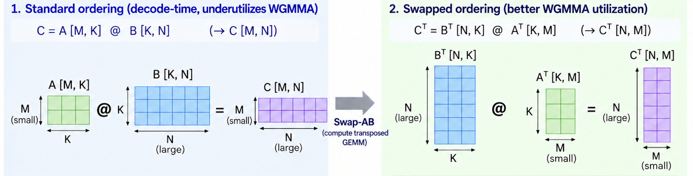

# 一行 do_not_specialize，9% TTFT：vLLM fused MoE 的低成本 kernel 优化

> 素材：AWS 官方博客《Mixture-of-Experts kernel engineering on Amazon SageMaker AI》（2026-10-13）
> 核对：本地 vLLM 仓 HEAD `c2320e37f1`（2026-11-09），两个上游 PR 的 diff 逐行核对
> 数字口径：本文全部性能数字来自 AWS 博客自述（厂商口径），未独立复现

2026 年 10 月，AWS 发了一篇讲 MoE kernel 工程的博客，内容是他们在 Amazon SageMaker AI 的 LMI 容器里做的三项 fused MoE 优化，代码全部上游进了 vLLM 主仓。三项里最重的一项是 kernel 内的矩阵布局交换，另外两项的改动量分别是「换一个后端配置」和「一行注解」。博客给的合计口径：H200 上吞吐最高 +10%，TTFT 最高 -9%。

这三项分属推理 kernel 优化的三个层面：硬件 ISA 布局、后端选择、编译器语义。我们把两个 PR 的源码逐行核对了一遍，发现的第一个问题是：博客有一处版本断言是错的（第二节详述）。

## 一、问题：decode 薄批次撞上 WGMMA 的固定布局

Hopper 的 Tensor Core 吞吐靠 WGMMA（Warp Group Matrix Multiply Accumulate）指令撑起来，一条指令由一个 warpgroup（128 线程）协作执行。它的 PTX 定义 `wgmma.mma_async` 有一条硬约束：矩阵的 M 维固定为 64，这是线程映射拓扑的基准。操作数 A 沿 M 维铺（寄存器或共享内存），操作数 B 沿 N 维铺（共享内存描述符），两个槽位在 ISA 层面不可互换。

decode 阶段的 MoE 是最差的形状。每个用户序列一次只出一个 token，批量大小 M 常年小于 64，多数时候是 1。此时操作数 A 是一条 1×4096 的细条，而硬件要求它填满一个 64 行的固定布局桶。Tensor Core 的计算阵列大量格子空转，时钟周期照花，有效算力没出来。

fused MoE 会把这个失衡进一步放大。为了让 GPU 一次处理所有被选中的专家（而不是每个专家各起一个 kernel），fused kernel 里的 N 维是「选中的专家数 × 专家中间维」。topk=8、intermediate size 8192 的模型，有效 N 到 65536 这个量级。M=1 对 N=65536，布局失衡拉到极端。



图 1 来自博客原文：转置后的大专家维进入 A 槽位，64 行布局桶被填满。

标准 dense 层权重静态连续，问题没这么尖锐；MoE 的负载拆在一群独立专家子网上，内存与布局瓶颈让这套 WGMMA 约束的杀伤力放大了一层。AWS 的三项优化都从这个形状问题入手。

## 二、Swap-AB：在 kernel 里把乘法翻过来

数学上这是一次恒等变换。原式 `C[M,N] = A[M,K] × B[K,N]`，两边转置得 `Cᵀ[N,M] = Bᵀ[N,K] × Aᵀ[K,M]`。转置后，大专家维 N 进了 A 槽位，轻松填满 64 行；权重块 Bᵀ 变成 leading 操作数后，Hopper 的异步预取引擎顺着连续大块地址滑动，计算流水线不断供。

落到 vLLM 的 Triton fused MoE kernel，是 PR [#36559](https://github.com/vllm-project/vllm/pull/36559)（作者 Xin Yang，Amazon），改动两个文件共 +59/-14 行。`fused_moe_kernel` 加了一个 `SWAP_AB: tl.constexpr` 开关，开启时索引构造反转：

```python
if SWAP_AB:
    a_ptrs = a_ptr + (offs_k[:, None] * stride_ak
                      + offs_token[None, :] // top_k * stride_am)
    b_ptrs = b_ptr + off_experts * stride_be + (
        offs_bn[:, None] * stride_bn + offs_k[None, :] * stride_bk)
```

累加器直接按 `(BLOCK_SIZE_N, BLOCK_SIZE_M)` 形状分配，`tl.dot(b, a)` 以 B 为左操作数，写回前 `tl.trans(accumulator, (1, 0))` 转回 (M, N)，下游的 store 路径一行没动。权重加载、量化、moe_align 逻辑全部保持原样，数学结果不变。

启用条件由 tuning config 静态判定，四个条件同时满足才生效（vllm/model_executor/layers/fused_moe/utils.py:837-843、fused_moe.py:825-828），并不是运行时发现 M<64 再切换：

1. 量化方式为 fp8_w8a8（int8 / w8a16 一律关闭）；
2. 设备为 Hopper（`is_device_capability(90)`）；
3. `BLOCK_SIZE_M < 64`；
4. `BLOCK_SIZE_N >= 64`。

BLOCK 尺寸来自按 batch size 查表的 tuning config；小 batch 场景的 config 带小 BLOCK_M、大 BLOCK_N 时，Swap-AB 自动打开。它还与 tensor-descriptor gather 路径互斥（fused_moe.py:447-448 有一条 `static_assert` 兜底）。

这里要修正博客的一处错误：博客称该优化「v0.24.0 及以后可用」。我们用 `git merge-base --is-ancestor` 对 release tag 逐个验证，PR #36559 最早进入的是 **v0.25.0**，v0.24.0 里没有这个提交。按博客的版本号去升级，吃不到这项优化。

另有一处容易混淆：vLLM 的 CUTLASS grouped-GEMM 路径（csrc 侧）也有一个 `swap_ab` 模板参数，运行时按真实 token 数判断（experts/cutlass_moe.py:213-214，`swap_ab = a1q.size(0) <= 64`）。那是另一条独立路径，与 PR #36559 的 Triton SWAP_AB 无关。

效果口径：大规模 MoE 模型、H200，端到端吞吐 +2~4%（厂商口径）。

## 三、FP8 后端路由：选择比实现便宜

第二项不动任何 kernel 代码，改的是「哪个后端来算」。vLLM 的 MoE oracle 负责在 Triton、FlashInfer+CUTLASS 等后端之间路由，决策代码在 vllm/model_executor/layers/fused_moe/oracle/fp8.py。后端枚举 `Fp8MoeBackend` 在 fp8.py:56-83，候选优先级表 `_AVAILABLE_BACKENDS` 在 fp8.py:94-110，安装了 FlashInfer 时 FLASHINFER_CUTLASS 默认排在 TRITON 前面。

博客的说法是「把路由策略改成 Triton 是纯配置改动」。这句话需要限定后才准确：

- **用户侧**，纯配置成立：`--moe-backend triton` 显式指定后，`select_fp8_moe_backend`（fp8.py:433-436）直接映射到 TRITON（fp8.py:277-289），不碰 kernel 代码。`moe_backend` 参数默认 `"auto"`（kernel.py:319）。
- **源码默认**，则是代码改动而非配置：commit `81bfc21a6a`（PR #34260）给 oracle 加了 Hopper 分支（fp8.py:128-138）——SM90 + 动态 per-tensor-128 激活量化 + block-FP8 权重时，TP 部署把 TRITON 置顶，EP 部署仍把 FLASHINFER_CUTLASS 置顶。这个分支的父提交里没有任何 capability(90) 判断。
- **覆盖面**，默认切换只针对 block-FP8（128-block scales）。per-tensor FP8 没有这个分支，装了 FlashInfer 的环境仍按默认优先级落到 FLASHINFER_CUTLASS。仓库里也不存在 `VLLM_MOE_BACKEND` 这样的环境变量开关。

为什么 Triton 在低并发 decode 赢过 CUTLASS：Triton 后端把 FP8 缩放、矩阵乘、专家聚合融进一个硬件 pass，数据从 HBM 读一次全程留在寄存器里；CUTLASS 的 C++ 模板把这三步当离散操作处理，中间缩放步骤要往返全局显存。加上 Triton 的动态 token bucketing 对 M<64 的薄批次铺排更从容，CUTLASS 的块划分在这种形状下要么 warp 大量空转、要么靠 padding 硬凑。

效果口径：FP8 量化 fused MoE、H200，端到端吞吐 +10%（厂商口径），SageMaker 的 LMI v28 容器已含该配置。LMI 容器内部具体如何设置，博客未给出细节，vLLM 仓也查不到，无法核实。

## 四、一行 do_not_specialize：把编译器当成优化面

Triton 对整数参数默认做 specialize：kernel 每次以一个新值调用此前没见过的被 specialize 参数，就触发一次重新 JIT 编译。推理服务里 sequence length 和 batch size 连续变化，被 specialize 的可变参数制造出源源不断的编译开销，TTFT 直接受损。

中招的是 `_fused_inv_rope_fp8_quant_per_head` kernel（fused 旋转位置编码 + FP8 量化，位于 DeepSeek V4 相关的 ops 里）：每个新的 `num_tokens` 值都会让它重编译一次。修法是 PR [#42849](https://github.com/vllm-project/vllm/pull/42849)，整个改动一行：

```python
-@triton.jit
+@triton.jit(do_not_specialize=["num_tokens"])
```

多卡部署把这个问题放大：TP=8 时八张卡的 kernel 必须微秒级同步，任何一张卡因为本地 batch 数变化停下来重编译，另外七张卡全部空等。把重编译消掉，收益按集群口径兑现：TTFT -9%（H200、TP=8，厂商口径），v0.22.0 起可用（这条版本断言我们核对无误）。

vLLM 源码里同类注解随处可见：`sparse_utils.py:751`、`indexer.py:731`（一次注解三个参数 `["num_reqs", "num_actual_tokens", "num_tokens"]`）、`metadata.py:23`、`mamba_utils.py:39`，都是拿 `do_not_specialize` 对付每步可变的尺寸参数。

代码现状：PR #42849 时的文件路径和 kernel 名已经变了。#43073 把它迁到 vllm/models/deepseek_v4/common/ops/fused_inv_rope_fp8_quant.py 并重构为 `_fused_inv_rope_fp8_quant_kernel_impl`；后续 #63540 又给 `do_not_specialize` 追加了 `scale_stride_k`，注释写得很直白：这个参数是 `align(num_tokens, 4)`，随 batch 变化，不 specialize 才能让一个 warmup key 覆盖所有形状。按博客的文件路径去找代码会扑空。

## 五、数据与口径

三项优化的数字与条件汇总：

| 优化 | 改动量 | 口径数字 | 条件 | 上游版本 |
| --- | --- | --- | --- | --- |
| Swap-AB（PR #36559） | kernel 布局交换，+59/-14 行 | 吞吐 +2~4% | H200、fp8_w8a8 | **v0.25.0+**（博客写 0.24.0，有误） |
| FP8 后端路由 | 配置 / oracle 分支 | 吞吐 +10% | H200、block-FP8、TP | LMI v28 容器；源码默认经 #34260 |
| JIT 重编译消除（PR #42849） | 1 行注解 | TTFT -9% | H200、TP=8 | v0.22.0+（无误） |

博客的合计口径「最高 +10% 吞吐、-9% TTFT」取的是单项最大值。

三点口径说明：数字全部来自 AWS 自述，git 仓内的 commit message 只有标题和 Signed-off-by，性能数据无处独立复核；PR 页面描述未在本次核对范围内。引用这些数字时按厂商口径处理，时效上也建议以 vLLM 实际 release 为准。

## 六、总评

三项优化没有一项是新算法。Swap-AB 是一次恒等转置，路由是选一个已有后端，JIT 消除是一行注解。它们共同的地方在于：优化者对底层机制的理解比常规实现细一层。Swap-AB 建立在对 `wgmma.mma_async` 操作数槽位约束的理解上，路由靠的是 oracle 优先级表和两种后端在薄批次下的行为差，JIT 消除靠 Triton 的 specialize 语义。这些约束是 ISA 与编译器的固有属性，换了负载仍然成立，同类思路可以复用。

需要注意的折扣清单：

1. **数字无法独立复现**。三项全部是厂商口径，git 仓内没有对应数据，模型名、负载分布、请求模式博客都没有给出；
2. **版本断言一处硬伤**。Swap-AB 实际 v0.25.0 起可用，按博客的 0.24.0 升级吃不到；
3. **代码位置已漂移**。RoPE kernel 经 #43073、#63540 两次重构，路径、kernel 名、注解参数都与博客描述不同，按 HEAD 读代码不要按博客找文件；
4. **「纯配置」仅指用户侧**。源码默认行为已由 #34260 代码改动切换，且只覆盖 Hopper + block-FP8 + TP；per-tensor FP8 和 EP 部署不在默认切换范围内；
5. **Swap-AB 适用面有限**。fp8_w8a8 量化 + SM90 + 特定 BLOCK 组合才生效，BF16 权重、非 Hopper 卡均不适用；
6. **LMI v28 容器的具体配置**博客未披露，无法核实其与上游代码的对应关系。

自己维护 vLLM + Hopper + FP8 MoE 服务时，先确认版本是否达到 v0.25.0，再看 oracle 实际选中了哪个后端（`--moe-backend` 的 auto 决策结果），最后检查日志里有没有反复的 JIT 编译记录。三步对应本文的三项优化；三项本身的改动量，从 Swap-AB 的 59 行到注解的 1 行。

## 参考资料

- AWS 博客：[Mixture-of-Experts kernel engineering on Amazon SageMaker AI](https://aws.amazon.com/cn/blogs/machine-learning/mixture-of-experts-kernel-engineering-on-amazon-sagemaker-ai/)（2026-10-13，全文快照见 [references/aws-blog-moe-kernel.md](references/aws-blog-moe-kernel.md)）
- PR [#36559](https://github.com/vllm-project/vllm/pull/36559) Add swap AB optimization to fused_moe_kernel（commit `1273a8f05a`）
- PR [#42849](https://github.com/vllm-project/vllm/pull/42849) Add do_not_specialize in fused FP8 RoPE kernel（commit `998714b21b`）
- PR [#34260](https://github.com/vllm-project/vllm/pull/34260) Improve FP8 Oracle for Config Specific Kernel Selection（commit `81bfc21a6a`）
- PR [#43073](https://github.com/vllm-project/vllm/pull/43073) Move deepseek_v4_ops to models/deepseek_v4（commit `b14be81c1f`）

## 源文件索引

| 文件 | 关键内容 | 引用点 |
| --- | --- | --- |
| vllm/model_executor/layers/fused_moe/fused_moe.py | Triton fused MoE kernel 本体 | SWAP_AB 分支与索引反转、`tl.dot(b, a)`、写回前 `tl.trans`；825-828（启用评估）；447-448（与 TD 路径互斥的 static_assert） |
| vllm/model_executor/layers/fused_moe/utils.py | `enable_swap_ab` 判定 | 837-843（SM90 + BLOCK_SIZE_M<64 + BLOCK_SIZE_N>=64） |
| vllm/model_executor/layers/fused_moe/oracle/fp8.py | MoE FP8 后端路由 | 56-83（后端枚举）、94-110（优先级表）、128-138（Hopper block-FP8 TP→TRITON 分支）、277-289（显式映射）、433-436（select 入口） |
| vllm/model_executor/layers/fused_moe/kernel.py | `moe_backend` 参数 | 319（默认 `"auto"`） |
| vllm/models/deepseek_v4/common/ops/fused_inv_rope_fp8_quant.py | fused RoPE + FP8 量化 kernel（#43073 迁移后） | 55 行 `do_not_specialize=["num_tokens", "scale_stride_k"]`；571-575 torch op 注册 |
| vllm/v1/attention/backends/mla/indexer.py | `do_not_specialize` 多参数先例 | 731 |
| experts/cutlass_moe.py | CUTLASS 路径的运行时 swap_ab | 213-214 |

核对基准：vLLM HEAD `c2320e37f1`（2026-11-09）；commit 摘要 `1273a8f05a`（PR #36559）、`998714b21b`（PR #42849）、`81bfc21a6a`（PR #34260）、`b14be81c1f`（PR #43073）。vLLM 代码演进较快，行号以核对基准为准。
