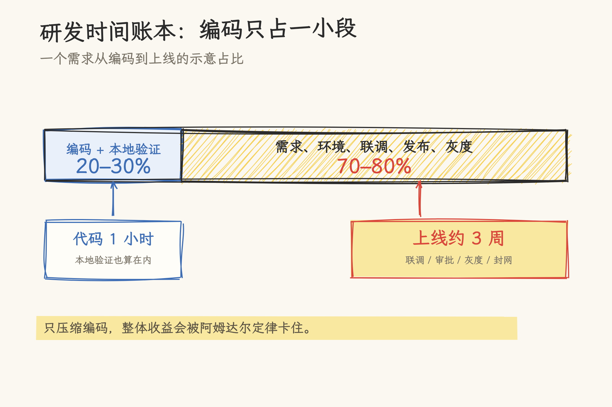
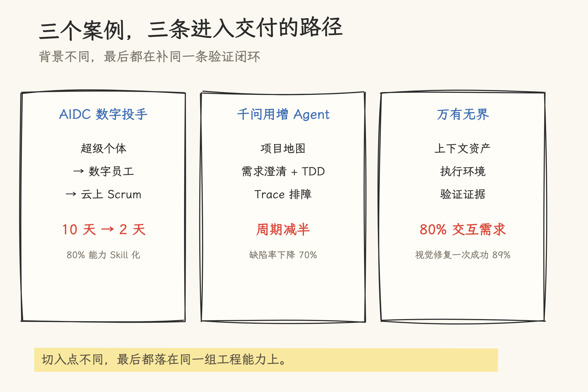
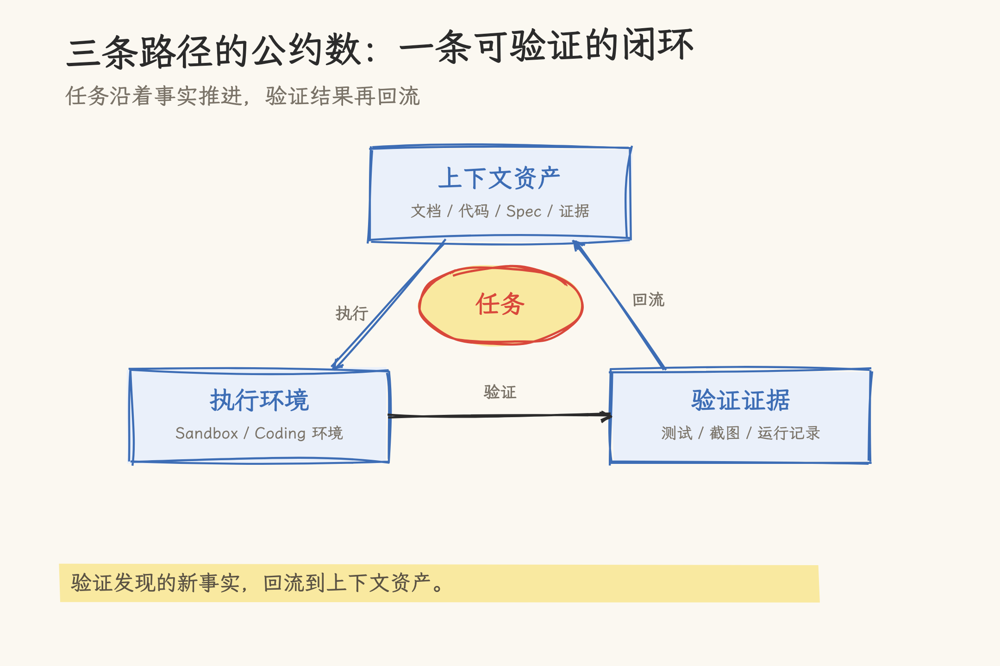
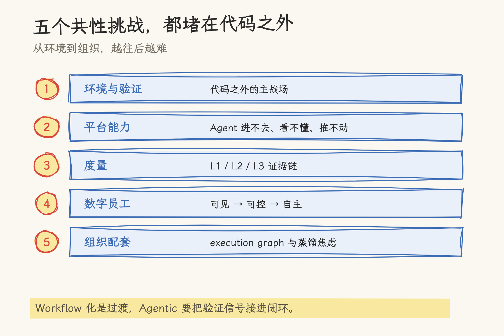
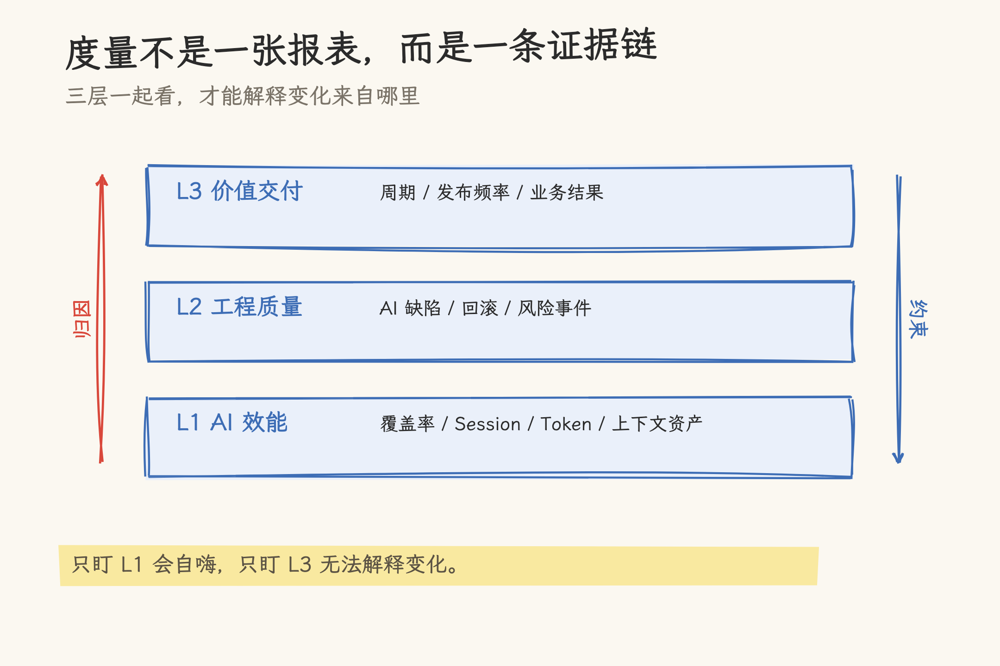
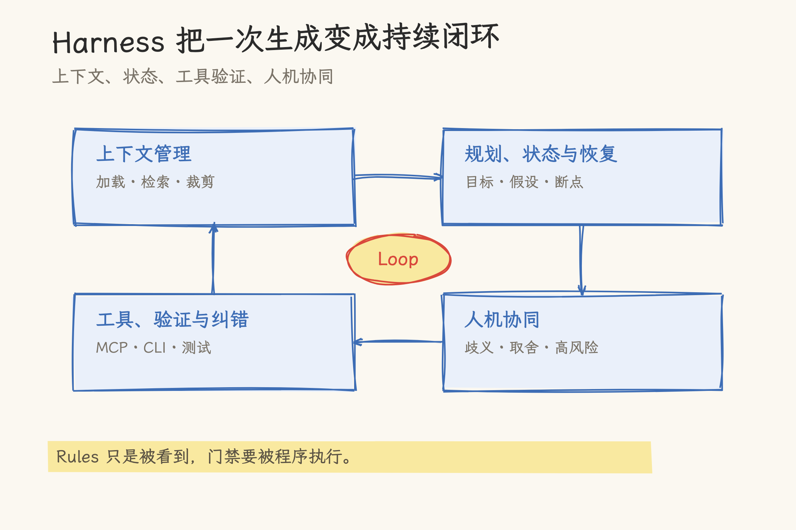
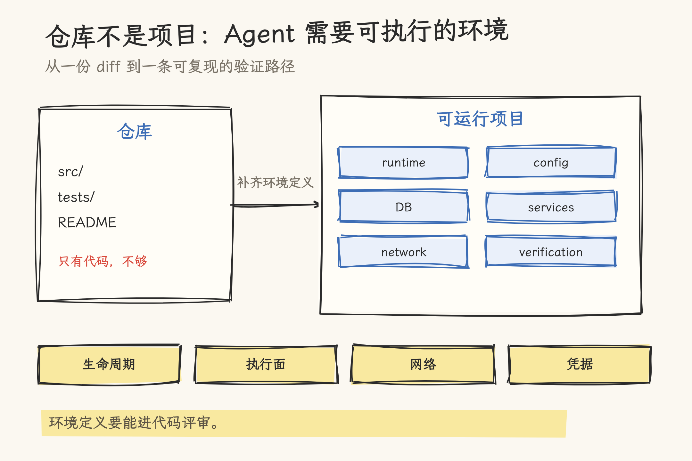
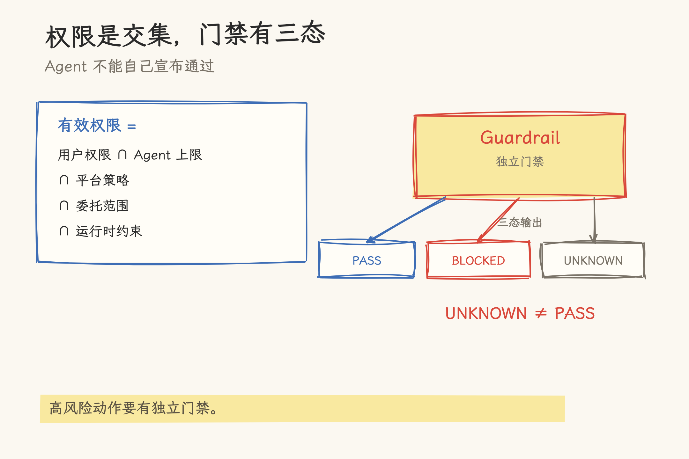
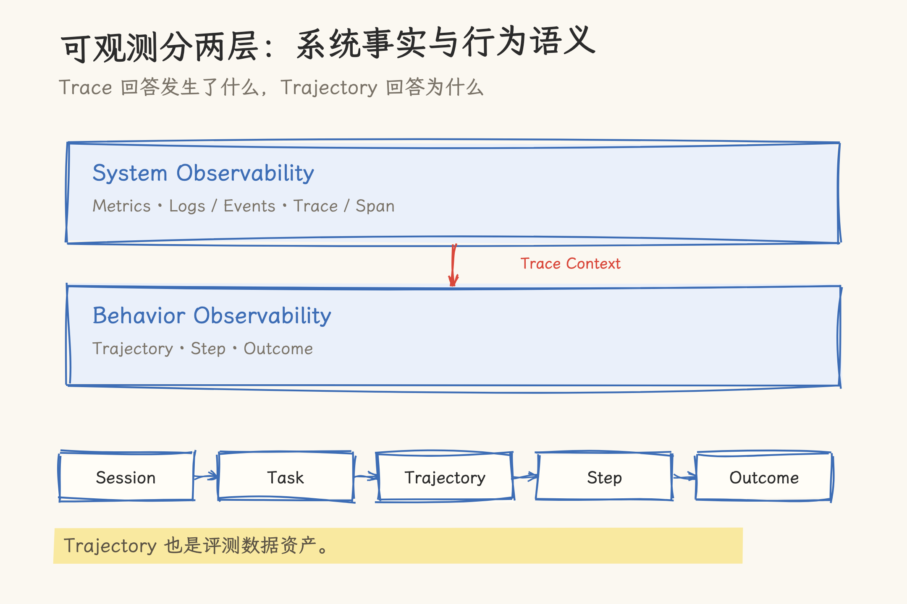
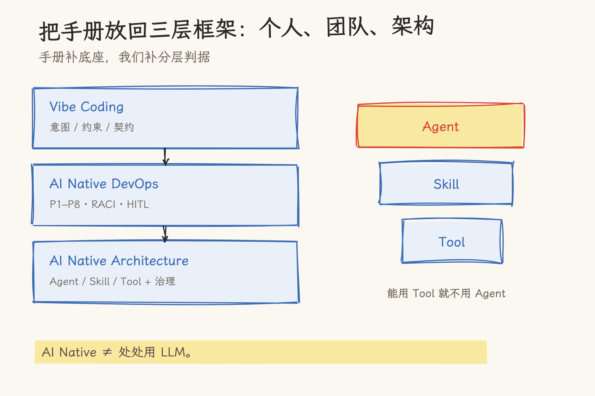

# 代码只占三成：AI Native 的瓶颈为什么在代码之外

> 读阿里《AI Native 研发范式实践手册》，兼谈我们自己的三层框架
>
> 写作日期 2026-10-30。手册中的案例数据为阿里团队自报口径，benchmark 成绩为 2026 年 7 月快照，来源和统计范围不一；文中会标出引用边界，不把厂商口径当成独立测量。

2026 年云栖大会，阿里巴巴发布了一本 68 页的《AI Native 研发范式实践手册》。手册由集团工程生产力团队牵头，三个业务团队供稿，主编许晓斌，署名作者 19 人。开篇几页讲的是一个不太讨喜的事实：AI 写代码越来越快，但软件交付没有同比例变快。

手册里有一个很具体的例子。某个 C 端用户动线改造需求，编码和本地验证 1 小时就能完成；真正上线还要经过跨团队影响分析、联调环境准备、多平台联调、发布审批、灰度验证、封网期等待，前后大约 3 周。按团队内部粗略统计，生成代码本身只占研发链路的 20%～30%，甚至更低。

_图 1：一个需求的时间账本。编码之外，还有联调、审批、灰度和封网。_

这就是整本手册的起点，也是这篇文章想讨论的问题：当编码环节被 AI 压缩到接近零，剩下的 70%～80% 会发生什么？如果只盯着“AI 能写多少代码”，我们可能把最重要的一段路留在了视野之外。

## 一、三个案例：AI 进入的是交付现场

手册挑了三个团队，背景不同，切入点也不同。

_图 2：AIDC 补协作，千问补可靠编码，万有补需求事实链。_

### 1. AIDC 数字投手：从超级个体到云上 Scrum

AIDC 数字投手是国际广告业务里的一支 6 人小队，目标是为商家提供能自动诊断广告效果、优化投放策略的“数字投手”。团队经历了三个阶段。

第一阶段是超级个体。成员统一使用一款 Coding Agent，一个人同时指挥 3～5 个会话，夜里也能推进策略生产、数据分析和知识整理。体感上，一个人能干出原来两三个人的活。问题很快暴露：产物留在个人电脑和单个会话里，同事接不上；会话里积累的知识很难复用，团队协作被卡在“个人产能”上。

第二阶段是数字员工。团队把本地会话搬到云上运行时，让 Agent 具备自验证、可并行、可推进流程的能力，覆盖产品、研发、评测和数据分析。个人产能第一次变成团队产能，但新的瓶颈出现了：数字员工各有角色，串任务还要人肉当调度员；产物质量随任务和模型波动；新任务没有人主动认领。用手册里的话说，“员工有了，但卡在协作上，人更多是传令兵”。

第三阶段是云上 Scrum。团队给数字员工建了“自己的钉钉”，按业务域组织 Agent，让它们通过结构化契约交接。策略交付周期从约 10 天降到 2 天，约 80% 的核心能力实现 Skill 化。人的工作收敛到两件事：维护 Loop（环境、验证、评测）和寻找真需求。

“10 天变 2 天”之外，团队还承认了一次“技术架构成功、业务效果不达预期”。他们最初把数字投手拆成“经验、手脚、头脑”三个组件，用预计算和工程收口约束 Agent 的自由度；架构原则上成立，但上线后调控效果仍低于预期。让系统转起来的是后来的数据闭环：把线上执行漏斗拆成可评测的层，用失败轨迹反推策略和能力，再回流到下一轮。

Agent 协作的难点，是让几个 Agent 围绕同一组事实持续运转；把它们连起来只是第一步。

### 2. 千问用增 Agent：把代码变成可靠交付

千问用增 Agent 的目标是用 Agent 重构用户增长体系，覆盖投放执行、策略、数据分析、预算规划和素材生产。团队由用户增长运营、产品负责人、全栈工程师、数据工程师和质量工程师五类角色组成。

他们的实践分三个阶段。第一阶段是粗放探索，约 15 名服务端工程师各自尝试 AI Coding，代码生成速度在部分场景达到传统方式的数倍甚至约 10 倍，团队开始跨前端、服务端和 Agent 开发。第二阶段是标准化与存量工程适配，问题从“AI 会不会写代码”变成“AI 能不能看懂老代码、遵守工程约束”。第三阶段是把 AI Coding 扩展到完整 SDLC，参与需求理解、方案设计、任务拆解、编码、联调、排障和文档整理。

团队最后把工程能力收敛到四个环节：项目理解、需求理解、可靠编码、线上排障。

- 项目理解：Code Docs 解释模块职责和设计背景，Code Graph 查询定义、调用关系和影响范围，Rules 固化团队约束。
- 需求理解：不假设需求描述已经完整，让 AI 主动追问权限边界、并发、幂等、数据一致性等隐含决策，把确认结果写成可追溯的 Spec 和 Tasks。
- 可靠编码：引入 TDD，用失败测试固定需求边界；测试重点覆盖需求边界、关键分支和已知故障模式，而不是追求覆盖率数字。
- 线上排障：用统一 TraceId 串起日志、上下游状态和代码调用关系，先收集事实证据，再判断根因；证据不足时升级给具备完整代码上下文的 Agent。

三个月后的数据是：平均交付周期缩短一半，千行代码缺陷率下降 70%，变更失败率下降 90% 以上。数据来自同一团队、同一业务的纵向对比，没有对照组；它说明趋势，不能直接外推到其他组织。团队自己的反思更说明问题：AI Coding 的上限很大程度取决于基础设施是否 AI 友好，需求文档、数仓、接口和技术方案能不能被模型稳定读取，比换一个更强的模型更能提升稳定性。

### 3. 万有无界：让需求沿着事实推进

万有无界是企业级人与 Agent 协作平台。它的研发场景更复杂：一个需求往往横跨身份权限、消息协作、任务与资产管理等多个模块，还要在 Web 端、桌面端保持一致的业务规则和设计规范。

团队把研发任务拆成三个相互依赖的部分：

- 上下文资产：说明这次任务要解决什么问题，包括产品文档、技术文档、设计文档、前后端工程事实、测试用例与证据。
- 工程执行环境：决定修改发生在哪里，包括真实路由、组件树、服务端点、版本配置和依赖关系。
- 验证证据：证明结果成立，包括版本、环境、截图、运行记录和待确认项。

三者首尾相接。验证过程中发现的新事实，会写回文档、代码、测试和规则。

实践效果是：近四个版本中，约 80% 的交互体验类需求可以基于 Git 快速可交互的原型套件承接；视觉类问题一次修复成功率约 89%；统计范围内线上千行代码缺陷率千分之 0.01。但团队也记录了一个反常数据：auto bug fix 比例在 60% 以上，bug 日清率却只从 53% 升到最高 63%。原因不复杂：触发依赖人，校验也依赖人。单点自动化率很高，端到端吞吐没有同步变化。

这就是手册反复提到的“阿姆达尔定律”在研发流程里的现实版本：只优化一段占比较小的环节，整体收益有上限。

### 4. 三条路径的公约数

三个案例的切入点分别是 Agent 协作、可靠编码、需求事实链，但最后都落到同一组东西上：

- 一套可执行的验证机制；
- 一份可持续维护的上下文资产；
- 一个让 Agent 和人能交接任务的协作协议。

这三点听起来像口号，手册却用三个团队的失败和返工把它们撑了起来。AIDC 的“架构成功、业务失败”，千问的“方法论难以稳定执行”，万有的“自动修复率高、日清率不动”，都在说明同一件事：AI 进入研发之后，工程量从“生成”转移到了“让生成结果被验证、被复用、被接住”。

_图 3：上下文资产、执行环境、验证证据，三者首尾相接。_

## 二、五个挑战：为什么 workflow 化不够

手册从三个案例里提炼了五个共性挑战。五个挑战串成一条链，彼此并不独立。

_图 4：环境、平台、度量、数字员工、组织，越往后越难。_

### 1. 环境与验证驱动

书里的判断是：AI 总是优先解决“反馈公开、验证可以规模化”的问题。Coding 和数学最先被突破，靠的是答案能被机器自动判对错：代码有编译、测试和运行结果，数学题有标准答案。这和题目难不难关系不大。企业研发环境里，答案藏在内部系统里，验证一次的成本很高，反馈也不公开。

所以，Coding 被解决得越快，瓶颈越会转移到 Coding 之外。手册用电气化做类比：早期工厂只是把蒸汽机换成大电动机，传动轴、皮带和机器布局不变，效率提升有限；生产率跃升发生在“单元驱动”普及之后，每台机器有自己的电机，工厂可以按生产流程重新布局。

放到研发上，把 AI 塞进 PRD、编码、测试、发布等既有节点，是“电力轴传动”；让 Agent 能自主获得验证信号、根据反馈推进任务，才接近“单元驱动”。手册承认 workflow 化是当前阶段的过渡形态。下一步的方向，是把验证和环境做成 Agent 可用的基础设施；继续把流程画细，收益有限。

这里要区分两件事：Spec 里的“约束”和“假设”。数据不能出域、接口必须向后兼容、延迟不能超过阈值，这些是约束，要长期保存并尽可能自动检查；微服务还是单体、用哪种缓存策略，这些是假设，应该允许 AI 根据实现和运行反馈调整。Spec 划定“什么算对”，不规定实现路径。

### 2. 平台能力升级

很多团队给 Agent 接了一堆 MCP 工具，结果 Agent 反而更笨。手册把原因拆成三个问题。

第一，Agent 很难稳定进入研发系统。内部平台围绕人设计，不同系统有不同认证方式和权限模型，很多操作依赖浏览器 Session、页面状态和工程师经验。Agent 通过 Web UI 模拟人，页面一改版就断；包成 OpenAPI 或 MCP，也还要解决认证、授权、环境选择、资源定位。

第二，Agent 很难获得完整而确定的研发上下文。当前代码仓库对应哪个应用、当前目录属于哪个项目、工作项挂在哪个空间、默认 trunk 是什么、创建 CR 用哪个 codeModuleId，这些事实人靠页面、目录、命名和经验补齐，Agent 一旦猜错，后面所有操作都在错误上下文里继续。

第三，现有工具能提供信息，却不一定能推进任务。流水线失败了，工具返回 stage、job、task、日志地址，但不会告诉你失败在哪一层、该看哪段日志、下一步能做什么。人自己会补这段，Agent 不会。

书里的解法是统一研发 CLI：给 Agent 一个稳定进入、稳定理解、稳定推进任务的研发操作面，而不只是把网页能力搬进终端。CLI 的参数明确、stdout 可被后续步骤消费、退出码可判成败；但 Agent 没有主动发现 CLI 的机制，所以 CLI 往往要配一个 Skill，告诉它什么时候调用。

MCP 解决了“模型如何调用工具”，没有解决“模型是否知道自己该操作哪个对象”。工具越多，选择空间越大，Agent 越容易在相似工具间选错。先有资源模型和上下文解析，再谈工具数量。

### 3. 度量：AI 是否真的带来了提效

手册对度量的批评很锋利：安装率会把“装了但没有效研发行为”的人算进去；Session 会把临时问答当成产能；AI 代码占比会反向激励无效生成；交付周期更接近结果，却解释不了效率为什么变化。

更麻烦的是，如果把这些指标拿去排名，团队会优化指标本身，而不是优化交付。这是 Goodhart 定律的标准剧本。

书中提出三层度量：

- L1 AI 效能层：覆盖率、Session、Token、AI 生成代码行数、Skill、MCP、上下文资产，用来证明 AI 真的进入了研发过程。
- L2 工程质量层：AI 缺陷率、回滚返工、自修复缺陷、风险事件，用来约束 L1 的增长不能以质量恶化为代价。
- L3 价值交付层：需求交付周期、变更周期、发布频率、AI 与非 AI 交付对比，用来证明业务真的更快更稳。

_图 5：L1 证明 AI 进入过程，L2 守住质量，L3 证明业务结果。_

三层要一起看。只看 L1，会为了 AI 而 AI；只看 L2，会变成质量审计；只看 L3，只能看到结果，解释不了变化来自哪里。

手册还特别提到一个容易被低估的指标：上下文资产。Skill、MCP、Spec、README/runbook、模板/checklist，这些资产决定 Agent 能不能稳定工作。如果不度量它们，团队会一直停留在“每个人临时问 AI”的阶段。可规模化的组织，要让上下文能被复用、更新、验证、接入 Agent Session。只让每个人更会提问，规模上不去。

### 4. 数字员工如何实现自主性

手册把人与 Agent 的协同分成三个阶段：本地辅助、云端自主、多 Agent 团队。每往下一阶段，信任边界就外移一次：从人身上，扩展到云端运行环境，再扩展到 Agent Team、工具链、任务状态和跨系统授权。

Agent 同时踩在人、应用、服务账号三类主体的边界上。复用人账号，审计分不清人和 Agent；复用服务账号，组织上看不清谁负责；只当应用管，又表达不出“代表某个人完成某个任务”的委托语义。所以手册提出两条路线：一条是把 Agent 做成组织里的“数字员工”，有工号、归属、导师、职责和评审；另一条是给 Agent 原生身份与授权，用复合身份、短期凭证和运行时策略做治理。

落地顺序是“可见 → 可控 → 自主”。先让 Agent 有名字、归属、负责人、职责范围、权限边界和任务记录；再围绕真实任务把能力、协作流程、交接、审核、异常处理和效果评估串起来；最后才谈更高自主性。

手册用“实习生”做类比，但提醒只能用一半。实习生需要导师、职责、权限边界、评审和成长路径；但 Agent 没有职业伦理、组织归属感和隐含常识，它不会因为“怕出事”而自我约束。所以治理不能只靠“像人一样管理”，还要靠机器可执行的护栏。

### 5. 组织能力如何配套

组织这一节是手册里最有勇气的一部分。它承认了转型的代价，没有停在“组织要变”这类口号上。

作者先拆了经典管理理论的前提：康威定律依赖“跨团队沟通成本高”，《人月神话》依赖“沟通成本随人数指数增长”，Taylor 分工依赖“人的注意力稀缺”，管理者评价制依赖“员工产出不可观测”。AI 恰好在这些前提上都是反面：没有沟通衰减、不需要激励、不会疲劳、上下文切换成本极小、记忆和注意力几乎无限。

于是组织设计的核心问题从 ownership（谁拥有这件事）转向 routing 和 governance（任务如何流转、能力如何组合、风险如何控制）。手册引用了一个说法：当 AI 具备行动能力之后，组织更像一张 execution graph，人、Agent、数据、权限、工具和审批关系都是节点，节点之间更重要的关系，是意图如何进入系统、如何转化为行动、什么约束保证行动安全；“谁向谁汇报”退到其次。

手册还写了一段很动人的观察：人既是协作的瓶颈，也是协作的兜底。一份不完整的需求、一段没注释的代码、一个不一致的 API 约定，系统之所以还能运转，是因为人用灵活性、推理和沟通悄悄把缺口补上了。Agent 接管得越多，这些隐性补丁越容易显形。流程本来就有洞，AI 只是让它们露了出来。

最尖锐的是“蒸馏焦虑”：员工每写一份 SOP、每教 AI 一个流程，确实是在把知识导出到组织资产里，结构上接近一种替代关系。当员工意识到“说得越多，被替代得越快”，关键知识开始藏匿，而 Harness 工作需要的，正是员工说出隐性约定。员工不说，转型就不可能完成。

作者没有假装有完美方案，给出了四条方向：明确 AI 红利的分享方式；提供真实的“接住”机制；诚实分类哪些岗位形态在变化；让评价系统跟着变。最后一条最硬：口头说“判断比执行值钱”，KPI 还是产出量，员工不会信。

## 三、基础设施：从“能写”到“能交付”

第三章把企业级 AI 研发基础设施拆成五层。它们回答的是五个递进的问题：Agent 能不能持续干活；知不知道该干什么、用什么干；干完能不能验证、能不能复现；有没有权限干、干错了能不能拦住；干得怎么样、为什么这么干。

### 1. Harness：把一次生成变成持续闭环

Agent Harness 的最小工作单元是一个持续运行的闭环：用户给出目标，框架组织模型获取上下文、规划下一步、调用工具、观察环境变化；验证不满足目标，新结果进入下一轮上下文；任务完成，返回结果与证据；遇到歧义或高风险决策，转交人工。

Harness 的职责有四项：

- 上下文管理：决定何时加载哪些内容，任务变长时检索、裁剪、压缩。上下文不是越多越好，无关内容会分散注意力，长期驻留的旧规则还可能和当前代码冲突。
- 规划、状态与恢复：记录目标、已完成步骤、未验证假设和下一步计划；会话中断、模型切换、环境重启后，能从最后一个可信位置继续。
- 工具、验证与纠错：文件读写、代码搜索、终端、构建、测试、MCP/CLI 都是行动接口；验证要尽量由编译、测试、静态检查和运行结果提供证据，不能只由模型自己说“修好了”。
- 人机协同：需求不清、方案有业务取舍、操作影响外部系统、多次尝试仍无法通过验证时，人进入循环。

_图 6：上下文、状态、工具验证、人机协同，四项职责围成一个 Loop。_

书中还给了两张表。一张是“程序性机制 vs 模型推理机制”：Rules、AGENTS.md、CLI、脚本、Codemod、MCP Tool 提供指引与行动；构建、测试、Lint、类型检查、拦截型 Hook 提供检查与反馈。另一张是“三种使用形态”：交互式、自动化、平台化嵌入。

一个关键判断是：Rules 和 AGENTS.md 的确定性在于加载方式固定，不代表模型一定会遵循。必须严格执行的安全和质量门禁，要靠程序控制，不能只靠提示模型“记得遵守”。

### 2. 知识库与工具：让 Agent 知道“该做什么、怎么做”

企业知识库不是 RAG 系统。手册把它拆成一条链路：整理 → 加工 → 治理 → 供给。

- 整理：把零散文档、概念、流程、案例和数据组织成边界清晰、可维护的知识单元；每条关键知识说明是什么、适用于什么范围、来自何处、由谁负责、何时更新。
- 加工：解析、索引、切片、构建关系；保留标题层级、适用范围和相互关系，而不是把所有内容都转成向量。
- 治理：识别过期、冲突、缺失，管理版本、责任、权限和安全边界；Agent 的使用反馈要回流到治理。
- 供给：RAG、API、结构化查询、本地文件搜索、业务系统连接，按场景选择，不是只有向量检索。

书中对知识库的定义是：工具决定 Agent“能做什么”，知识库决定它“在什么条件下应当做、依据什么做、何时停止或升级给人”。按这个定义，知识库同时承担检索和行为约束两个角色。

工具体系则分成两层：MCP/CLI 解决“能做什么”，Skill 解决“该怎么做”。MCP 是面向 Agent 客户端的通用协议；CLI 的参数明确、stdout 可消费、退出码可判成败，但 Agent 没有主动发现 CLI 的机制，所以 CLI 往往要配 Skill。Skill 是可复用的任务方法，包含任务说明、步骤、最佳实践、脚本、模板和参考资料，回答“面对这类任务应该怎么做”。

工具还需要评测。两个基础指标是命中率和成功率：命中率衡量 Agent 是否选对了能力，成功率衡量选对之后是否以正确的参数、顺序和权限完成操作。评测结果要反向推动能力演进：拆分过大的 MCP 服务，优化工具名称和描述，补全 Skill 的步骤与边界，删除长期低命中、低成功的能力。工具治理必须包含下线机制。

### 3. 运行环境：仓库不是项目

书中对 Sandbox 的定义是：把 Agent 放进一个容器，只解决了“在哪里运行”。生产级 Sandbox 还要回答：每次任务用什么镜像、多少 CPU 和内存、何时销毁；能执行哪些命令、读写哪些文件、访问哪些地址；调用仓库和模型服务时，怎样避免把真实凭据交给 Agent；任务中断后能否暂停、恢复或从快照重建；出错时能否保留足够信息还原过程。

OpenSandbox 的架构把边界拆成四层：生命周期控制面、实例内执行面、网络与访问边界、凭据边界。优先落地的两条是：默认拒绝出站，按任务放行；凭据只给占位值，由可信代理在出站请求匹配域名、路径和方法时注入真实凭据。

Coding 环境则解决另一个问题：代码改对了，项目跑不起来。一个干净的 Agent 工作空间通常不知道运行时版本、关联仓库、私有依赖、配置、数据库结构和基础数据，也不知道哪些外部请求走真实上游、哪些用测试替身、依赖初始化到哪一步、失败后先看哪里。手册用一个订单取消规则的例子说明：Agent 改了代码、补了单测，测试通过；启动服务时缺配置，访问数据库时缺字段，调用库存服务时被网络策略拒绝。开发者可以逐项修好，但修复只留在当前机器，下一个 Agent 进新实例还要重复三次失败。

解法是把环境做成可维护的系统对象：环境定义长期维护，实例随任务创建；依赖通过稳定接口接入；状态边界放在任务上；环境反馈也是接口。通过验证的配置、数据和服务桩成为候选基线；销毁当前实例，从同一份定义和候选基线重建，再执行同一组验证，结果一致才算可复现。交付物从“一份 diff”变成“一条可以重新运行和检查的验证路径”。

_图 7：仓库只是起点；可运行项目还要有 runtime、config、DB、services、network 和 verification。_

### 4. 身份、策略与 Guardrail：权限是交集，门禁有三态

Agent 的权限要在每次调用时重新计算，查一次表不够。手册给了一个公式：

`有效权限 = 用户权限 ∩ Agent 能力上限 ∩ 平台策略 ∩ 本次委托范围 ∩ 运行时约束`

五项缺一不可。只做第一项的系统，其余四项都是空的。

手册把 Agent 权限拆成四个对象：身份认证、委托、策略授权、凭证。对应四个角色：可信 Runtime 证明 Agent 身份、当前任务和运行环境；PDP 根据身份、委托、资源、操作和风险做判断；PEP 位于工具调用、服务访问和发布动作之前，拦截并执行判断；Credential Broker 把授权结果转换成内部系统可接受、可撤销、可审计的短期凭证。

信任是逐步扩大的：只读分析 → 受控修改 → 环境执行 → 高风险操作。高风险默认不授予；批准只覆盖特定操作、特定资源、特定条件和有效时间。一次内部 API 调用可能返回允许、拒绝，或者发起 Challenge：Agent 暂停，向用户说明要访问什么、为什么需要、会影响什么；用户确认后，平台只签发覆盖本次调用的短期凭证。

Guardrail 是 Agent 进入高风险生产动作前的独立门禁。它是夹在 Agent、验证系统、审批系统和发布系统之间的第三方核验者，比普通测试或审批多一层独立判断。Agent 提出变更、执行验证、提交证据；验证系统产生测试、构建、预发布、观测和差异证据；审批系统记录谁在什么条件下承担风险；Guardrail 核验证据是否完整，判断能否进入高风险动作；发布系统只执行已经通过的变更。

Guardrail 的输出有三态：PASS、BLOCKED、UNKNOWN。传统门禁只有通过/不通过，验证系统不可用时往往被迫默认放行或一律卡死。Guardrail 在证据不足时返回 UNKNOWN，高风险流程保持暂停。不确定不等于通过。

可复核性靠三个绑定：ChangeSet@digest 固定变更内容；GuardrailSpec@revision/digest 记录用哪一版规则判；validForSeconds 表示检查结果的新鲜度。Agent 不能自行声明通过，也不能修改门禁结论；不能把同一个模型实例既当执行者，又当最终审计者。

_图 8：有效权限是五个条件的交集；Guardrail 输出 PASS、BLOCKED、UNKNOWN。_

### 5. 可观测：从“系统是否正常”到“Agent 为什么这样行动”

传统可观测以延迟、吞吐、错误率、资源利用率为核心，回答“系统运行是否正常”。Agent 的可观测还要回答“Agent 为什么这样行动、是否完成任务、行为是否符合预期”。

书中把它分成两层：

- System Observability：Metrics、Logs/Events、Trace/Span，观测 Agent 运行时系统的健康、性能、资源与成本。
- Behavior Observability：核心对象是 Trajectory，记录一次任务从输入意图出发，经历规划、推理、模型调用、工具调用、Skill 执行、多 Agent 协作，最终形成结果的完整执行记录。

对象模型是 Session → Task → Trajectory → Step → Outcome。Step 下面有 Model Call、Tool Call、Skill Execution、State Change。Trajectory 和 Trace 通过统一的 Trace Context 关联，才能从系统事实钻到行为语义，或反向定位。

书中给了三层分析架构：确定性规则全量筛查 → LLM 筛出灰区样本 → 灰区样本多维分析。多维分析看几个方面：意图达成度、推理合理性、工具调用恰当性、检索相关性。全量轨迹无差别跑 LLM 评审，成本会失控。

可观测要落到可改进：系统指标、行为轨迹、验证证据和评测基准形成闭环，Agent 才具备工程意义上的可维护性。

_图 9：System Observability 看系统是否正常，Behavior Observability 看 Agent 为什么这样行动。_

## 四、把手册放回我们的三层框架

读完手册，再看我们自己仓库里的 AI Native 三层框架，两边讲的是同一件事的不同侧面。

我们仓库的立场是：AI Native ≠ 处处用 LLM。业务能力按认知性质分三层：

- Tool：确定性能力，输入输出可验证，不需要 LLM；通过 MCP 暴露。
- Skill：程序性知识、固定 SOP 编排，少量 LLM 参与。
- Agent：只有在不确定情况下需要决定下一步做什么时，才用 LLM 推理循环。

三问决策启发法：能否用非 LLM 系统可验证完成？能，用 Tool。是否固定流程只需编排？是，用 Skill。是否需要在新颖情况下决定下一步？是，用 Agent。五个反模式：Agent 化一切、LLM 直接控物理设备、缺少治理平面、MCP Server 沦为裸 RPC、Agent 缺终止条件。

我们在 [ai-native-devops](https://github.com/ForceInjection/ai-native-devops) 里把团队研发流程拆成 8 个阶段：P1 愿景到 PRD、P2 原型/UI、P3 领域建模、P4 OpenSpec 规范、P5 实现与测试、P6 质量验收、P7 部署交付、P8 变更演进。每个阶段明确 AI 输入、AI 输出、建议工件、人工确认点；关键工件要人工确认后才能进入下一阶段；用 RACI 明确谁最终负责。

把手册放进来，可以得到一张更完整的地图：

| 手册里的东西                                                         | 我们的框架                            | 关系                               |
| -------------------------------------------------------------------- | ------------------------------------- | ---------------------------------- |
| 超级个体、云上 Scrum、数字员工                                       | Vibe Coding / AI Native DevOps        | 个人协作与团队流程的演进           |
| 五个挑战、三层度量                                                   | AI Native DevOps 的阶段缺口与治理指标 | 流程、度量、组织配套               |
| Harness、知识库、MCP/Skill/CLI、Sandbox、Identity、Guardrail、可观测 | AI Native Architecture 的治理平面     | Agent 能否持续、安全、可验证地工作 |
| 人负责目标、边界、验收                                               | 人工 Owner、RACI、HITL                | 责任不转移                         |

手册补上了我们三层框架里常被忽略的“底座”部分：Harness、运行环境、身份、门禁、可观测。我们三层框架则给手册里“Agent 化一切”的冲动加了一道闸门：不是所有能力都值得做成 Agent，能 Tool 就 Tool，能 Skill 就 Skill，只有在不确定下做新颖决策时才用 Agent。

两边正好互补：手册从企业基础设施的角度说明“为什么难”，我们的框架从应用架构的角度说明“该怎么分层”。

_图 10：Vibe Coding、AI Native DevOps、AI Native Architecture，对应个人、团队、架构三层；右侧是 Tool / Skill / Agent 的成本金字塔。_

## 五、总评：这份手册该信什么，折扣在哪里

这是一份值得读的阶段报告，不是一套可以照搬的标准答案。它的价值在于把“AI 研发”从模型能力叙事拉回到交付系统叙事，用三个真实案例、五个挑战和一套基础设施清单，说明瓶颈为什么在代码之外。

该信的部分：

- 问题重定义。编码只占研发链路的一小段，AI 写代码越快，越会把瓶颈推到需求、环境、验证、发布、权限和组织。
- 三个案例的共同指向。AIDC 的协作协议、千问的上下文与验证、万有的事实链，最后都在补同一条回路。
- 基础设施清单。Harness、知识库、工具、Sandbox、Identity、Guardrail、可观测，这七件事确实是从“能写”走到“能交付”要补的课。
- 诚实。手册自己说它不是成熟方法论，很多方向还在验证；四个未解问题也写得清楚。

需要打折扣的部分：

- 案例数据是团队自报口径，时间窗口只有几个月，没有对照组。10 天变 2 天、缺陷率下降 70%、变更失败率下降 90% 这些数字可以看趋势，不要当成行业基准。
- 手册中的 Benchmark 成绩是 2026 年 7 月快照，厂商自报和独立测量混在一起；模型迭代很快，数字过期也快。
- 三个案例都发生在阿里内部，有统一的研发平台、云上运行时和组织推动力。中小团队没有这些底座，照搬“云上 Scrum”或“数字员工”的组织形态，很可能只学到壳。
- 手册的“最后一公里”仍未解决：构建、集成测试、灰度发布、生产验证、故障恢复，容错空间极小，基础设施复杂度可能不亚于 Agent 应用层。把 90% 精力放在 prompt 和 Skill 上，方向就偏了。

最值得抄的三件事：

1. 分层验证。秒级反馈给 Agent 高频自迭代，分钟级反馈覆盖真实行为，人工只保留机器无法可靠裁决的部分。
2. 上下文资产。把文档、代码图谱、Spec、测试证据、runbook 变成 Agent 可读、可更新、可追溯的资产，而不是每次会话临时拼。
3. Guardrail 三态。高风险动作要有独立门禁，证据不足返回 UNKNOWN，不确定不等于通过。

最不该照抄的三件事：

1. 组织形态。超级个体、云上 Scrum、数字员工都依赖具体的业务、团队和平台，不是万能模板。
2. 单点指标。AI 代码占比、Session 数、安装率都会诱导错误行为；至少要用 L1/L2/L3 三层一起看。
3. Agent 数量。工具越多、Agent 越多，选择空间越大，治理成本越高；先把 Tool/Skill/Agent 的分层做对，再谈扩编。

## 六、落地清单：下周能做的五件事

AI Native 的竞争，最后会落到“可验证资产”上。模型会继续变强，但知识库、环境定义、验证证据、身份与门禁不会随模型代际失效；它们会随模型变强而变得更有价值。

具体可以从五件事开始。

1. 量一遍研发时间账本。不要只统计 AI 写了多少代码，把需求理解、环境准备、联调、测试、发布、灰度、排障各占多少时间记下来，找到真正的瓶颈。
2. 建一条分层验证链。先把编译、类型检查、单测做成秒级反馈；再把集成测试、契约测试、浏览器自动化做成分钟级反馈；人工只处理机器判不了的部分。
3. 把一个项目变成可执行环境。至少写清 runtime、setup、verification 三段；能让 Agent 在一个干净实例里把项目跑起来、把测试跑通。
4. 把一个高频知识源变成 Agent 可读资产。给它加上负责人、适用范围、版本和来源；让 Agent 能引用、能追溯、能更新，而不是把文档一股脑塞进向量库。
5. 选一个高风险动作上 Guardrail。先定义证据要求，再定义 PASS/BLOCKED/UNKNOWN；让 Agent 不能自己宣布通过，让不确定的变更停在门外。

最后一页说，它记录的只是一个快速变化中的切面。这个定位很准确。读它的正确方式，是拿它当一张对照清单：用三个案例找最接近自己的起点，用五个挑战检查自己的缺口，用基础设施清单盘点下一步该补什么。

代码只占三成，瓶颈在剩下的七成里。

## 参考资料

- 阿里巴巴《AI Native 研发范式实践手册》，2026 云栖大会发布，68 页：
  - 官方在线阅读：https://ai-native.alistatic.com/app/ainativeinfra/ai-native-handbook-web/index
  - PDF：https://g.alistatic.com/s/v/ainativeinfra/ai-native-handbook/0.0.1/ai-native-handbook.pdf
  - HTML 文字版（第三方整理）：https://kejun.github.io/ai-native-dev-handbook/
- 本仓库 AI Native 三层框架：[11_ai_native_everything/README.md](../README.md)
- AI Native DevOps 8 阶段框架：[ai-native-devops](https://github.com/ForceInjection/ai-native-devops)
- AI Native 应用架构（Agent / Skill / Tool 三层）：[ai-native-architecture.md](https://github.com/ForceInjection/ai-native-devops/blob/main/ai-native-architecture/ai-native-architecture.md)
- AI 代码评审三道闸门：[别让写代码的 Agent 评审自己](../vibe_coding/docs/ai-code-review-three-gates.md)
- 手册中提到的数据与案例均为阿里团队自报口径；benchmark 为 2026 年 7 月快照，引用前请复核。
