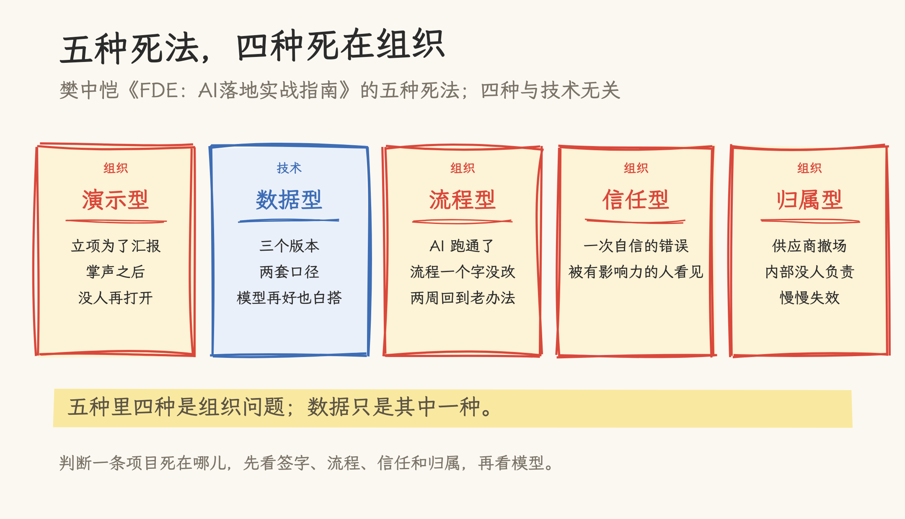
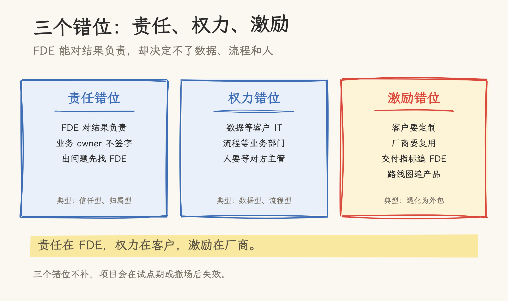
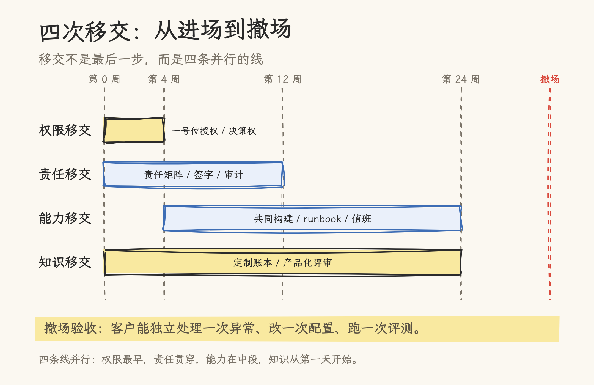

# FDE 落地最大的难点：有结果责任，没有组织权力

> 2026-10-23 | FDE 实践分析。基于本仓库 [FDE 主文](forward-deployed-engineer.md)、[《FDE：AI落地实战指南》导读](fde-ai-landing-guide.md)、[Datawhale 24 个案例解读](fde-100-cases-analysis.md)，以及 First Round、a16z、Ramp、Kindo、focal 等公开实践材料。案例与效果数字为受访者/厂商自述口径，未独立验证。

系统上线后的第三个月，FDE 撤场。群还在，文档还在，代码还在；业务同事开始绕过系统，用回原来的 Excel。没有人删掉它，只是没人再打开它。

樊中恺把这种死法叫“归属型”：系统上线，供应商撤场，内部没有明确负责人，慢慢失效，无人惋惜。它通常没有一次明显的故障，只是系统一点点没人用了。

FDE 的定义、80/95/99 的完整推演、Echo/Delta 和 L0–L4，见[主文](forward-deployed-engineer.md)。这篇只回答一个问题：为什么项目过了 Demo、甚至上了线，还是会在组织里死掉？

## 一、五种死法，四种死在组织

《FDE：AI落地实战指南》把企业 AI 项目的常见死法归成五类：

- 演示型：立项就是为了三个月后那场汇报，掌声之后系统再也没被打开。
- 数据型：模型选得不错，但喂给系统的文档有三个版本、两套口径。
- 流程型：AI 跑通了，业务流程一个字没改，员工要额外打开一个网页，两周后回到老办法。
- 信任型：系统整体不错，但有一次自信的错误答案被有影响力的人看见，信任瞬间崩塌。
- 归属型：系统上线，供应商撤场，内部没有明确负责人，慢慢失效。

作者自己的批注是：五种里只有一种带点技术色彩，其余四种全部属于组织问题。

**图 1**｜五种死法（据《FDE：AI落地实战指南》整理）。演示、流程、信任、归属四类都是组织问题；数据是唯一带技术色彩的一类。

这个判断和 24 个案例的实证对得上。Datawhale 的案例集里，两位 FDE 给出了几乎相同的量化判断：案例 9 说“技术上能落地，其实已经成功了 80%，真正让项目死掉的是业务、人和组织”；案例 24 说“技术大概只占 20%”。24 个案例里，知识库/RAG 9 例、Agent 7 例、OCR 与多模态 7 例，LLM 微调一例都没有。技术选型普遍克制，难的是数据口径、旧系统接口、员工愿不愿交出知识、上线后拿不到效果数据。

所以人们常把“FDE 落地难”归错原因。数据脏、接口不通、模型不稳，都是真问题，但它们大多可以列出来、排进计划。让项目停在半路的是另一类问题：谁来决定、谁来签字、谁来承担后果、FDE 走了以后谁来管。

英文实践里的复盘也指向同一件事。Kindo 的复盘说，最后一公里主要花在 schema mapping、数据接入、API 权限和 RBAC 上，模型推理反而不是瓶颈；Ramp 的 FDE 团队把“always be scoping”和“generalize our work”当作日常纪律，前者防止过度定制，后者防止定制污染代码库。

## 二、80/95/99：难点从代码移到责任

80/95/99 这把尺子，主文已经拆过。这里只看它和“组织权力”的关系。

0→80% 靠通用模型加 Prompt，一天能做出“挺好用”的 Demo。这一段越容易，人越容易以为项目快做完了。

80→95% 是最重的工程投入：补真实样本、建测试集、清洗数据、把老师傅的隐性知识结构化。案例 2 用了约半年补样本，把识别率从七成磨到 98%；案例 17 的人工校准来回十几次，才把报价逻辑挖成数据资产。这一段辛苦，但边界清楚，FDE 自己能推动。

95→99% 不一样。案例 21 拒绝“一键生成完整施工图”，因为设计人员要对合规安全负责；案例 24 的每个 AI 风险标记必须附依据、可溯源到原始数据行；案例 9 的报销单最终由财务签字。谁签字，谁保留否决权；模型变强也不会改变这一点。

到了这一段，问题变成“谁愿意为它签字”。签字的人不在 FDE 的汇报线里，也不一定在项目群里。FDE 可以设计人机边界、可以做可追溯、可以写异常处理，但不能替客户承担签字责任。

难点也在这里：FDE 对结果负责，但责任体系不属于 FDE。

## 三、三个错位：责任、权力、激励

把五种死法、24 个案例和主文里的五个风险放在一起，可以看到三个结构性错位。

| 错位 | 现场表现 | 典型死法 |
| --- | --- | --- |
| 责任错位 | FDE 对上线结果负责，业务 owner 不签字；出问题先找 FDE | 信任型、归属型 |
| 权力错位 | 要数据等客户 IT，要改流程等业务部门，要人配合等对方主管 | 数据型、流程型 |
| 激励错位 | 客户要定制，厂商要复用；FDE 被交付指标追，产品被路线图追 | 退化为外包、Expand 困难 |

**图 2**｜三个错位。FDE 对结果负责，但数据、流程、人的决定权在客户，复用压力在厂商。

责任错位最直接。FDE 驻场在客户那里，但没有客户组织的正式权力。数据开放要走 IT 排期，流程变更要等业务开会，员工配合要靠对方主管发话。很多项目卡在“推不动”，不是“做不出来”。

权力错位带来一个更隐蔽的后果：FDE 会用代码去补组织缺口。业务部门不愿改流程，就在系统外加一个网页；数据口径不统一，就写一堆适配脚本；审批链没打通，就让人工在中间传话。短期看项目上线了，长期看这些补丁全变成 FDE 的维护责任，系统越来越离不开人。

激励错位在厂商侧。客户想要定制，供应商想要复用；FDE 的考核如果是交付和续约，产品团队的考核如果是路线图，两边就会拉扯。没有产品化机制，FDE 越成功，定制代码越多，公司越像外包。主文里“退化为外包”的早期信号是“客户持续购买人天，项目无法复用”，说的就是这条。

主文还提到，多数项目在 L1 到 L2 之间夭折：试点用户没有被嵌入考核，“用不用都行”导致使用率下降；数据质量在 Demo 阶段被回避，进入真实环境后集中爆发；组织审批流程没有提前打通，权限和合规成了最后一公里。这三条都指向责任、权力、激励没有提前设计，跟模型能力关系不大。

## 四、四次移交：把“移交”设计成交付物

FDE 的成功标准，主文里有一句话：客户哪天不再需要你，才说明你干成了。“不再需要”不能等到撤场那天才发生，应该从第一天就写进交付物。

我把它拆成四次移交。

| 移交 | 关键交付物 | 验收信号 |
| --- | --- | --- |
| 责任移交 | 人机责任矩阵、签字与异常升级路径、审计日志 | 业务 owner 能说清“哪些 AI 做、哪些我签、出错找谁” |
| 权限移交 | 一号位授权、业务/IT owner 名单、决策权与升级机制 | 数据、流程、预算的变更不再靠 FDE 私下协调 |
| 能力移交 | 客户工程师参与构建、runbook、ownership matrix、90 天退出计划 | 客户能独立改一次配置、处理一次异常、跑一次评测 |
| 知识移交 | 定制账本、可复用 Skill/连接器/测试集、产品化评审记录 | 下一个同类客户交付成本下降，而不是从零再来 |

**图 3**｜四次移交的时间线。权限移交在启动前完成，责任移交贯穿构建与试点，能力移交从共同构建开始并在撤场前完成，知识移交从第一天做到产品化评审。

责任移交要做的是画清楚人机边界。逐环节写清楚：AI 输出什么、人检查什么、谁签字、异常怎么升级、日志留什么。95→99 的合规与信任靠这套边界和可追溯性；模型更准解决不了签字问题。

权限移交要在项目启动前完成。一号位、业务 owner、IT owner 三个角色要有名有姓，数据开放、流程变更、验收标准的决策权要写进项目章程。案例 23 把“一号位是否愿意采用”直接当作项目判断标准；案例 18 请董事长拿出 20 个编制建自有 AI 团队。没有这个授权，FDE 只能靠个人关系推项目，项目越大越推不动。

能力移交不能等到最后才给一份文档。客户工程师从第一周就参与构建、评审、值班；交付物包括 runbook、ownership matrix、培训记录，以及客户自己改过一次的配置。FDE 撤场前，客户团队要能独立处理一次真实异常，不能只在演示环境里点一遍按钮。

知识移交是厂商侧的产品化回路。每个客户需求打标签：一次性、可复用、产品级；每周做一次产品化评审；每个季度至少把一个现场能力收回核心产品。没有这条回路，FDE 团队最后会退化成咨询业务。a16z 那篇《The Palantirization of Everything》把这个边界讲得很直接：FDE 是“脚手架，不是房子”；只学驻场，不建产品底座，最后会变成“给某个行业做外包的 Accenture”。

## 五、合同与治理：让移交可验收

四次移交不能只靠 FDE 的个人自觉，要写进合同和治理。

1. 效果基线要在交付第一天就设计好。24 个案例里，只有 11 个给出明确量化数字，13 个是定性描述或明确“未提及”。案例 22 交付后拿不到效果数据，FDE 复盘时最大的遗憾就是没设计“效果基线”。基线至少包括：业务指标、采用率、异常率、人工否决率、单笔处理成本。没有基线，项目就无法证明价值，也无法判断什么时候该撤。

2. 验收标准要写成“客户能独立运行”。系统上线不算验收，客户团队能独立完成一次完整业务流程、处理一次异常、改一次配置才算。这个标准要写进合同，和付款节点挂钩。

3. 合同要写清 IP、知识转移和退出。定制代码归谁、客户工程师能不能拿到 runbook、FDE 撤场后支持多久、什么条件下可以退出。The Register 在 2026 年 10 月的报道里提到，客户对 FDE 的依赖会带来锁定、IP 泄漏和竞争风险；这些要靠合同里的退出条款，关系好坏解决不了。

4. 治理要有决策日志和升级路径。每周记录谁做了什么决策、哪些需求被拒、哪些风险被接受；遇到跨部门卡点时，能升级到一号位或 steering committee。FDE 没有正式权力，但可以借项目的治理结构获得“被授权的权力”。

5. 厂商侧要区分交付指标和产品化指标。只看交付和续约，FDE 会变成救火队；只看产品化，客户项目可能活不下来。两个指标都要有，且产品化要有固定的评审节奏。focal.vc 的 FDE playbook 还建议把技术 FDE 和商业 Deployment Strategist 拆开：一个负责构建与交付，一个负责客户策略与组织变革，形成“好警察/坏警察”的张力。这个拆法不一定适合所有团队，但它承认一件事：一个人同时写代码、管关系、推组织变革，很难。

## 六、边界：什么时候不该接

这篇不打算劝所有公司设 FDE。First Round 2026 年 2 月的文章标题就是“Do you really need a forward deployed engineer?”，里面的判断很克制：FDE 不是 one-size-fits-all，很多公司需要的是实施负责人、普通工程师，或者一个更偏售后的角色；把 FDE 当成整个业务的万能工具，是“a pretty blunt instrument”。

24 个案例也有清晰的局限：没有一个是彻底失败的，存在幸存者偏差；效果全部是受访者自述，没有独立验证、没有对照组；多个项目上线仅一两个月，长期效果还不知道。读这些案例，应该把它当作“活下来项目的经验集”，不是成功率统计。

所以 FDE 适合什么、不适合什么，要有前置判断：

- 客户问题足够复杂、模糊，标准产品接不住；
- 一号位愿意采用，业务 owner 愿意签字，数据拿得到；
- 场景能形成正反馈，且同类客户足够多，现场经验能产品化；
- 客户愿意让工程师进入真实流程，而不是只让做 Demo。

反过来，如果客户没有一号位、数据拿不到、流程不愿意改、需求完全一次性、预算养不起驻场团队，接了也会死。FDE 适合标准产品接不住的非显然问题，不是默认交付方式。

## 七、结论：客户能独立运行，才算做成

FDE 要交付的，是一套客户能自己运转的工作方式。

落到地上是四次移交：责任有人签，权限有人给，能力有人接，知识能回到产品。四次移交完成，FDE 才能撤场；否则系统还在，组织已经回到老办法。

回到开头那个第三个月。判断项目有没有做成，看撤场后的某一天：客户团队能不能自己处理一个异常、改一个配置、跑一次评测，业务 owner 能不能说清“这个结果我负责”。这些事发生了，FDE 才算落地。

## 延伸阅读：《FDE：AI落地实战指南》

樊中恺著，人民邮电出版社 2026 年 10 月出版。作者是百度主任架构师、文心应用技术负责人，主导过文心 App 从技术预研到工程落地的全过程。全书七篇三十章，按认知、能力、方法、技术、交付、案例、成长组织；技术篇只有五章，目的是让 FDE 判断“这个问题 AI 能不能解、该走哪条路”，这本书不负责把读者培养成算法工程师。

最值得先看的三处：五种死法、访谈问法与工作化石、第 22 章远洋保险理赔助手的按周复盘。附录有七件工具：FDE 能力自测表、客户访谈模板、AI 项目需求分析模板、Demo 设计模板、60 题面试题库、企业 AI 落地检查清单和术语表。

主文回答“为什么需要 FDE”，这本书回答“明天进场先做什么”。它写的是中文项目现场，方法仍要拿到自己的项目上校验。

## 参考资料

- 本站：[模型不稀缺了，稀缺的是把模型塞进业务的人](forward-deployed-engineer.md)
- 本站：[《FDE：AI落地实战指南》导读](fde-ai-landing-guide.md)
- 本站：[24 个企业 AI 落地案例解读：FDE 最难的不是模型](fde-100-cases-analysis.md)
- First Round Review：[Do you really need a forward deployed engineer?](https://review.firstround.com/do-you-really-need-a-forward-deployed-engineer/)，2026-02-24
- a16z：[The Palantirization of Everything](https://a16z.com/the-palantirization-of-everything/)，2026-01-16
- Ramp Builders：[Forward Deployed Engineering](https://engineering.ramp.com/post/forward-deployed-engineering)
- Kindo：[From Vision to Value: What We Learned by Going Forward-Deployed](https://www.kindo.ai/blog/from-vision-to-value-what-we-learned-by-going-forward-deployed)，2025-11-04
- focal.vc：[Build Your Own FDE Playbook](https://focal.vc/founder-resources/build-your-own-fde-playbook/)，2025-11-06
- The Register：[Vendors asking forward deployed engineers to make good on trillion-dollar AI bet](https://www.theregister.com/ai-and-ml/2026/10/22/vendors-asking-forward-deployed-engineers-to-make-good-on-trillion-dollar-ai-bet/5304366)，2026-10-22
- Datawhale：《FDE 案例 100》，2026-09，[fde100.datawhale.cn](https://fde100.datawhale.cn/)
- 樊中恺：《FDE：AI落地实战指南》，人民邮电出版社，2026-10，ISBN 9787115707499
