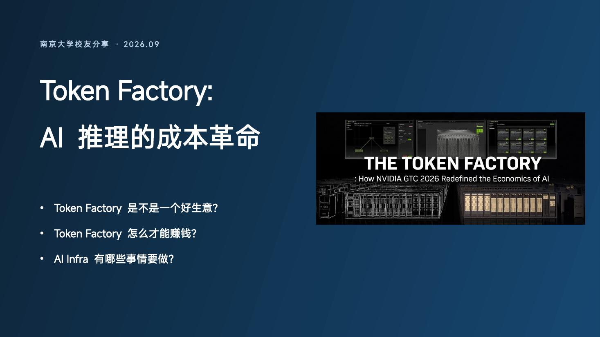

# Token Factory 演讲项目

对外演讲《Token Factory: AI 推理的成本革命》（南京大学校友会）的完整素材库。

**对外图文讲解**：[《Token Factory：AI 推理的成本革命》24 页 PPT 逐页配图讲解](talk-illustrated.md)——按 PPT 页序完整还原现场内容，适合直接阅读与转发。

## 内容结构

| 文件                                                                                           | 说明                                                                                                                   |
| ---------------------------------------------------------------------------------------------- | ---------------------------------------------------------------------------------------------------------------------- |
| [outline-2.0.md](outline-2.0.md)                                                               | **可排练版演讲提纲 2.0**《Token Factory 2.0:词元工厂的四条路线》：29 页/约 47 分钟，新增第三部分「四条路线」（A 超节点/B 云巨头/C 独立厂商两子路线/D 模型厂商+总表+三方分工收束页），沿用页只写更新点，数据核查清单与 Q&A 预判已按 2.0 素材重制 |
| [deck-spec-2.0.md](deck-spec-2.0.md)                                                           | **PPT 逐页制作稿 2.0**：29 页上稿文案（标题/正文/表格/脚注逐条可复制）+ 版式与路线四色规范 + 与 1.0 deck 的复用总表（14 页原样复用/6 页改数字/1 页小改/8 页全新）——对着它直接做 2.0 版 PPT |
| [outline.md](outline.md)                                                                       | **可排练版演讲提纲（1.0 存档）**：四部分结构 + 时间分配 + 逐小节要点/数据/转场句/观众收获 + Q&A 预判 + 数据核查清单                |
| [talk-illustrated.md](talk-illustrated.md)                                                     | **对外图文讲解**：PPT 24 页逐页配图（img/cover+01–23）讲解——"白菜化/Token 单位化 → 产品制造商 → 两件事 → 国产算力差距"全文口径 |
| [cluster-capacity-measurement.md](cluster-capacity-measurement.md)                             | **对外发布文档**：《Token 工厂的产能怎么算？》——Goodput 框架 + AIPerf 落地（概念公开、内部数据脱敏）                  |
| [references/01-wechat-token-factory-model.md](references/01-wechat-token-factory-model.md)     | 两年砍柴《Token工厂财务运营测算工具》微信原文（8 张 Sheet 模型全拆解，含下载方法）                                     |
| [references/02-ai-factory-ecosystem.md](references/02-ai-factory-ecosystem.md)                 | AI Factory 定义/黄仁勋叙事/分类框架/全球格局                                                                           |
| [references/03-business-model-and-finance.md](references/03-business-model-and-finance.md)     | 商业模式变革、财务测算结果、**电力占比口径矛盾辨析**、仓库成本锚点                                                     |
| [references/04-cost-technology.md](references/04-cost-technology.md)                           | **物理三维框架（算/存/传 + 能量统一）**、模型架构稀疏化（MoE/MoD/MLA/DSA）、KV Cache、硬件代际、价格历史               |
| [references/05-jevons-demand-future.md](references/05-jevons-demand-future.md)                 | 杰文斯悖论、需求爆发数据、政策落地、未来方向                                                                           |
| [references/06-listed-companies.md](references/06-listed-companies.md)                         | **上市公司财报证据**：硅基流动招股书（毛利率 −24%）、CoreWeave 季报（66% 毛利仍净亏）、一级市场同行数据                |
| [references/07-tokenfactory-whitepaper-2026.md](references/07-tokenfactory-whitepaper-2026.md) | **TokenFactory 白皮书 2026**（九章云极 × InfoQ）结构化全文：八章核心内容、成本结构、产业链三层、九章云极实践、趋势风险 |
| [references/08-hf-open-models-summer-2026.md](references/08-hf-open-models-summer-2026.md) | HF《State of Open Models: Summer 2026 Observations》报告摘要：模型能力与供给丰富度信号（万亿参数开源竞赛、开源追平闭源、296 万个模型）与 Agent 流量 |
| [references/09-model-price-performance.md](references/09-model-price-performance.md) | **模型性价比跃迁**：GLM-5.3-Flash 与 Qwen3.8-Flash 同日双发（2026-08-26）——性能/价格/架构数据、演讲用法、口径注 |
| [references/10-cluster-capacity-assessment.md](references/10-cluster-capacity-assessment.md) | **集群产能评估框架**（内部仓库引入）：SLO Goodput、单卡产能/集群日上限/日产值四数、品质承诺 P99 体系——"利用率是第一杠杆"的运营量化版 |
| [references/11-parameter-vs-throughput.md](references/11-parameter-vs-throughput.md) | **模型选型对产能的影响**：V4 Pro/Flash 实测——单卡产能 ~2×、同卡数端到端 3.8×、通信税（拓扑 NVLink/IB 决定税率） |
| [references/12-silicon-data-token-index.md](references/12-silicon-data-token-index.md) | **Silicon Data LLM Token 支出指数**：全市场平均支付价 8 月跌破 $1/百万、11-20 已至 $0.68（较峰值 −68%）且总支出翻倍——市场级价格锚点（11-23 增补核实） |
| [references/13-siliconflow-ipo-progress.md](references/13-siliconflow-ipo-progress.md) | **硅基流动港股 IPO 进展与招股书分析（2026-11）**：6-30 递表（18C/H 股）→ 10-19 备案已接收 → 11-20 证监会要求补充新增股东说明、尚未聆讯；日吞吐 478 亿→5,785 亿（11 倍）、国内第四 1.5% 份额；招股书 347 页本地分析——毛利率三段 83.3%→39.4%→−24.0%、经调整净亏 1.87 亿、供应商单一依赖 100%→20.4% 的分散化、行业增速 1,602.6% vs 公司 7.5 倍 |
| [references/14-token-economy-report-2026.md](references/14-token-economy-report-2026.md) | **信通院《词元（Token）经济发展研究报告（2026 年）》读图提炼版**（2026-09 出品，2026-11-23 逐页提取）：国家数据局定名「词元」、日均调用 140 万亿、词元价值光谱 10 万倍价值差、智算 2,185 EFLOPS、幻灭期研判与企业终止采购、六大趋势——含图 2 口径冲突等七条折扣清单 |
| [references/15-token-factory-landscape.md](references/15-token-factory-landscape.md) | **词元工厂的四条路线——行业真方案盘点素材（2.0）**：A 超节点软硬一体（CloudMatrix384/浪潮 HC1000/新华三 UniPoD）/ B 云巨头 MaaS（火山 49.5%/阿里 Token Hub）/ C 独立厂商两子路线（硅基流动补贴派 −24% vs 趋境技术派跨过成本线）/ D 模型厂商自营（智谱亏 47 亿、提价 83%）——含行业锚点与待补清单（11-23 起） |
| 《流言终结者》演示：GPU与CPU对比.mp4 | **现场演示视频**：GPU 与 CPU 执行对比（讲座互动环节用） |

## 注意

references/01–12 的市场数据均为 2026 年 8 月搜索所得；**2026-11-23 增补**：12（token 指数 11-20 新低 $0.68 + 总支出翻倍）、13（硅基流动 IPO 进展、2025 年报口径数据与招股书 347 页本地分析）、14（信通院《词元经济报告》50 页读图提炼）。引用前请按各文件头部时点复核。公众号原文全文原则上仅本地留存、提炼版入库（13/14 的 fulltext 读图或提炼完成后已删除）。
